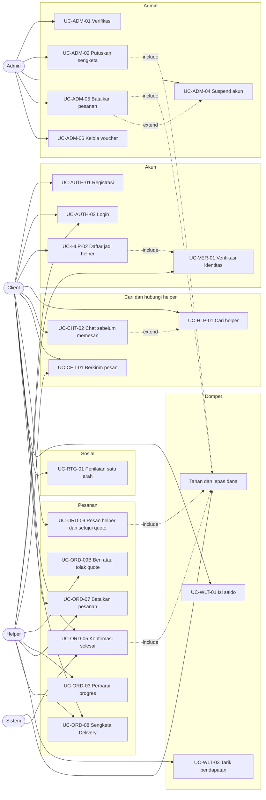

# Use Case Inventory dan Inventaris Layar

Status dokumen: `CONFIRMED` v1.0, 24 Oktober 2026. Perubahan v1.0: inventaris layar di bagian 4 disusun ulang dari prototipe Figma final dan bagian 5 mendapat status gap per 24 Oktober 2026. SRS v1.0 bagian 3.1.1 menyalin kedua tabel itu. Naik ke `CONFIRMED` pada 24 Oktober 2026 bersama baseline SRS v1.0 dan SDD v1.0 yang disetujui PIC, setelah seluruh turunan SA dikonfirmasi Backend. Perubahan v0.3 mengikuti DEC-25 sampai DEC-27 (`14_perubahan-model-marketplace.md`): lima use case dinyatakan DEPRECATED (UC-ORD-01, UC-ORD-02, UC-ORD-02B, UC-ORD-02C, UC-ORD-06), satu use case baru (UC-CHT-02), UC-ORD-09 menjadi satu satunya use case pemesanan, dan use case scenario diganti menjadi UC-CHT-02, UC-ORD-09, dan UC-ORD-09B. Perubahan v0.2 (28 September 2026) mengikuti DEC-21 sampai DEC-23.

## 1. Aktor

| ID | Aktor | Batasan |
| --- | --- | --- |
| ACT-01 | Client | Setiap akun terdaftar otomatis menjadi client |
| ACT-02 | Helper | Hanya akun yang lolos verifikasi dan mengaktifkan ketersediaan yang tampil di daftar helper dan bisa menerima permintaan pesanan |
| ACT-03 | Sistem | Aktor untuk proses terjadwal seperti batas waktu quote, pelepasan dana otomatis, dan konfirmasi otomatis |
| ACT-04 | Admin operasional | Diperankan oleh Mentor. Dikonfirmasi 28 Agustus 2026 (DEC-07), mengakses lewat panel admin sungguhan di dalam sistem, bukan proses manual di luar sistem |

## 2. Daftar use case

| ID | Use Case | Aktor utama | FR terkait | Status |
| --- | --- | --- | --- | --- |
| UC-AUTH-01 | Registrasi akun | Client | FR-AUTH-001, 002, 003 | Aktif |
| UC-AUTH-02 | Login | Client, Helper | FR-AUTH-004, 005, 007 | Aktif |
| UC-AUTH-03 | Lupa kata sandi | Client, Helper | FR-AUTH-006 | Aktif |
| UC-VER-01 | Mengajukan verifikasi identitas | Client | FR-VER-002, 003, 007 | Aktif |
| UC-HLP-01 | Mencari, menyaring, dan melihat detail helper | Client | FR-HLP-001, 002, 003, 004, 005, 006, 010, 011, FR-VER-004, 005, FR-ORD-016 | Aktif, direvisi 19 Okt 2026 |
| UC-HLP-02 | Mendaftar menjadi helper | Client | FR-HLP-007, 008, FR-VER-002 | Aktif |
| UC-HLP-03 | Mengatur ketersediaan | Helper | FR-HLP-009 | Aktif |
| UC-ORD-01 | ~~Membuat pesanan dengan harga estimasi dan batas talangan~~ | Client | | DEPRECATED 19 Okt 2026 (DEC-26). Isinya pindah ke UC-ORD-09 |
| UC-ORD-02 | ~~Mengajukan tawaran harga~~ | Helper | | DEPRECATED 19 Okt 2026 (DEC-26). Digantikan UC-ORD-09B |
| UC-ORD-02B | ~~Memilih tawaran dari daftar helper~~ | Client | | DEPRECATED 19 Okt 2026 (DEC-26). Digantikan UC-HLP-01 dan UC-ORD-09 |
| UC-ORD-02C | ~~Mengonfirmasi ketersediaan setelah terpilih, khusus broadcast~~ | Helper | | DEPRECATED 19 Okt 2026 (DEC-26) |
| UC-ORD-03 | Memperbarui progres pekerjaan dan mengunggah foto bukti | Helper | FR-ORD-009, 013, 021 | Aktif |
| UC-ORD-04 | Memantau pesanan berjalan | Client | FR-ORD-007, 008 | Aktif |
| UC-ORD-05 | Mengonfirmasi pesanan selesai | Client, Sistem | FR-ORD-010, 012, FR-WLT-003 | Aktif |
| UC-ORD-06 | ~~Mengunggah struk dan mengajukan penyesuaian talangan, Food run dan Laundry~~ | Helper, Client | | DEPRECATED 19 Okt 2026 (DEC-25) |
| UC-ORD-07 | Membatalkan pesanan | Client, Helper | FR-ORD-011, 023, FR-WLT-014 | Aktif |
| UC-ORD-08 | Mengajukan sengketa, khusus pesanan kategori Delivery (DEC-10) | Client, Helper | FR-ORD-018 | Aktif |
| UC-ORD-09 | Memesan helper terpilih dan menyetujui quote | Client | FR-ORD-001, 002, 003D, 016, 022, 024, FR-WLT-002, 011, 012, 013 | Aktif, satu satunya jalur pemesanan sejak 19 Okt 2026 |
| UC-ORD-09B | Memberi atau menolak quote | Helper | FR-ORD-003D, 006, FR-VER-004 | Aktif |
| UC-WLT-01 | Mengisi saldo | Client | FR-WLT-006 | Aktif |
| UC-WLT-02 | Melihat riwayat mutasi saldo | Client, Helper | FR-WLT-005 | Aktif |
| UC-WLT-03 | Menarik pendapatan | Helper | FR-WLT-007 | Aktif |
| UC-CHT-01 | Berkirim pesan dalam ruang percakapan | Client, Helper | FR-CHT-002, 003, 007, 008, 009 | Aktif, direvisi 19 Okt 2026 |
| UC-CHT-02 | Memulai percakapan dengan helper sebelum memesan | Client | FR-CHT-006, 007, 010 | Baru 19 Okt 2026 (DEC-27) |
| UC-RTG-01 | Memberi penilaian (satu arah, Client ke Helper) | Client | FR-RTG-001 | Aktif |
| UC-PRF-01 | Mengelola alamat tersimpan | Client | FR-PRF-002, 003 | Aktif |
| UC-ADM-01 | Meninjau dan memutuskan pengajuan verifikasi identitas | Admin operasional | FR-ADM-003, 004 | Aktif |
| UC-ADM-02 | Meninjau dan memutuskan sengketa | Admin operasional | FR-ADM-005, 006 | Aktif |
| UC-ADM-03 | Melihat ringkasan agregat komisi | Admin operasional | FR-ADM-007 | Aktif |
| UC-ADM-04 | Menonaktifkan dan mengaktifkan kembali akun | Admin operasional | FR-ADM-009, 010 | Aktif |
| UC-ADM-05 | Membatalkan pesanan aktif | Admin operasional | FR-ADM-011 | Aktif |
| UC-ADM-06 | Mengelola voucher | Admin operasional | FR-ADM-012 | Aktif |

## 3. Peta relasi aktor dan use case

Catatan untuk SRS: diagram di atas hanya peta ringkas. Versi resmi dengan notasi UML (batas sistem, generalisasi aktor, `«include»`, dan `«extend»`) ada di `13_use-case-dan-activity-diagram.md`, dipecah menjadi tiga diagram UC-D1 sampai UC-D3. Relasi `UC-CHT-02 «extend» UC-HLP-01` baru 19 Oktober 2026: chat adalah langkah opsional yang client ambil dari halaman detail helper.

## 4. Inventaris layar dari prototipe

Diperbarui 24 Oktober 2026 dari prototipe Figma final ([Prototyping in Figma](https://www.figma.com/design/Hk2CkaeEpM8SAmSRvviBvm/Prototyping-in-Figma?node-id=0-1)). Inventaris versi video prototipe (11 layar) digantikan tabel ini. Bila prototipe dan requirement berbeda, requirement di `02_requirement-master-list.md` yang menjadi acuan.

| No | Layar | Elemen kunci yang terlihat | Use case terkait |
| --- | --- | --- | --- |
| 1 | Splash dan Onboarding 1 sampai 3 | Logo, tiga layar pengenalan (Bantuan Mudah untuk Tugas Harian, Aman dengan Helper Terverifikasi, Solusi Tuntas dengan Harga Adil), indikator halaman, tombol Selanjutnya dan Ayo Mulai, tautan Lewati | UC-AUTH-01 |
| 2 | Daftar Akun | Nama lengkap, email, nomor telepon, kata sandi dengan tombol tampil atau sembunyi, tombol Daftar, tautan Masuk. Pesan galat terpisah untuk email sudah digunakan, nomor telepon sudah digunakan, dan kata sandi minimal 8 karakter | UC-AUTH-01 |
| 3 | Kode OTP | Nomor tujuan tersamar, enam kotak kode, tombol Verifikasi | UC-AUTH-01 |
| 4 | Masuk ke Akun | Email dan kata sandi, tautan Lupa Password, tombol Login, pesan galat email atau kata sandi salah, tautan Daftar | UC-AUTH-02, UC-AUTH-03 |
| 5 | Beranda | Sapaan nama, lokasi aktif, lonceng notifikasi, kolom pencarian, kategori Personal, Delivery, dan Household, pintasan Helper, jasa tersedia, penawaran spesial, navigasi bawah Beranda, Aktifitas, Obrolan, Akun | UC-HLP-01, UC-ORD-04 |
| 6 | Daftar helper | Judul kategori, kolom pencarian, chip penyaring (subkategori atau rating), kartu helper dengan foto, rating, jumlah ulasan, jarak, tarif, dan tag keahlian | UC-HLP-01 |
| 7 | Detail helper | Foto, nama, rating, jumlah tugas selesai, ikon percakapan, Tentang, Jasa, Review, harga mulai dari, tombol Tawar Harga | UC-HLP-01, UC-CHT-02 |
| 8 | Form permintaan pesanan | Alamat asal dan tujuan atau lokasi pengerjaan, rincian kebutuhan per kategori (misalnya estimasi muatan, ukuran rumah, berat pakaian), ketersediaan alat atau armada, waktu pengerjaan Sekarang atau Terjadwal, helper terpilih, catatan tambahan | UC-ORD-09 |
| 9 | Tawar Harga dan menunggu quote | Input harga estimasi client, keterangan batas 300 detik, layar Menunggu persetujuan Helper dengan sisa waktu | UC-ORD-09 |
| 10 | Quote dari helper | Harga akhir dari helper, tombol Terima dan Batalkan pesanan | UC-ORD-09 |
| 11 | Detail pesanan dan pembayaran | Alamat, detail pengerjaan, voucher, rincian harga, total, tombol Pesan Sekarang, layar Pesanan Berhasil Dibuat | UC-ORD-09 |
| 12 | Aktifitas | Tab Dalam Proses dan Riwayat, kartu pesanan dengan kategori, waktu, nominal, dan status | UC-ORD-04 |
| 13 | Pesanan berjalan | Alamat, detail pengerjaan, rincian harga, tombol Batal, dialog konfirmasi pekerjaan selesai | UC-ORD-04, UC-ORD-05, UC-ORD-07 |
| 14 | Beri rating helper | Foto dan nama helper, lima bintang | UC-RTG-01 |
| 15 | Obrolan | Daftar percakapan dengan pencarian, ruang percakapan dua arah, lampiran berkas, kolom ketik | UC-CHT-01, UC-CHT-02 |
| 16 | Alamat | Pencarian alamat, tab Terakhir dan Tersimpan, tombol Tambah alamat baru | UC-PRF-01 |
| 17 | Profil Saya | Foto, nama, email, lencana ID Verified, Edit Profil, Alamat Tersimpan, Keamanan dan Kata Sandi, Daftar Jadi Helper, Voucher Saya, Notifikasi, Pusat Bantuan, Keluar Akun | UC-PRF-01, UC-HLP-02 |

## 5. Gap analysis prototipe

Ini daftar layar dan kondisi yang belum ada di prototipe tetapi wajib ada supaya sistem bisa jalan. Daftar ini yang saya bawa ke UI/UX Designer.

**Status per 28 Agustus 2026**: isi logika bisnis di bawah ini sudah dibahas dan sebagian dikonfirmasi lewat diskusi dengan UI/UX (lihat `draf-alur-untuk-sesi-uiux.md` untuk hasil finalnya per alur). Yang belum masuk ke sini adalah baris resmi baru di tabel bagian 4, karena itu menunggu nama layar dan elemen visual sungguhan dari hasil desain, bukan cuma konfirmasi lisan atau tertulis soal logikanya.

Alur akun belum tergambar sama sekali. Tidak ada layar registrasi, login, input OTP, maupun lupa kata sandi, padahal onboarding berakhir di tombol mulai. Ini pekerjaan pertama untuk desainer.

Alur pembuatan pesanan juga belum ada. Prototipe melompat dari daftar helper langsung ke pelacakan, jadi belum terlihat bagaimana client mengisi deskripsi tugas, memilih alamat, melihat rincian estimasi biaya, dan menekan konfirmasi bayar. Ini alur paling kritis karena di sinilah uang mulai ditahan.

Sisi helper belum tergambar sama sekali. Belum ada layar permintaan pesanan masuk dengan hitung mundur, layar pekerjaan berjalan dengan tombol perubahan status, layar unggah bukti penyelesaian, maupun dasbor pendapatan.

Kondisi tidak normal belum tergambar. Belum ada tampilan saat tidak ada helper tersedia, saat saldo tidak cukup, saat pembayaran gagal, saat pesanan dibatalkan helper, dan saat koneksi terputus di tengah pelacakan.

Alur penilaian dan sengketa sudah direvisi, lihat catatan status di atas. Penilaian sekarang satu arah saja dari Client ke Helper (DEC-09), dan sengketa dikhususkan hanya kategori Delivery (DEC-10).

Terakhir, verifikasi identitas hanya muncul sebagai lencana. Layar unggah kartu identitas, swafoto, status peninjauan, dan alasan penolakan belum ada.

Satu tambahan baru di luar tujuh poin di atas: layar pelacakan yang sudah ada di prototipe (poin peta dengan ETA langsung) perlu **digambar ulang**, dikonfirmasi 28 Agustus 2026 tidak ada perubahan dari keputusan `DEC-06` sebelumnya, tetap memakai visualisasi tahapan status, bukan peta real time.

Tambahan 28 September 2026 dari keputusan sinkronisasi. Layar berikut belum ada di prototipe dan dibutuhkan oleh FR baru: layar quote di sisi helper dan client (FR-ORD-003D), daftar larangan Personal di form pembuatan pesanan (FR-ORD-022), unggah foto penjemputan Delivery (FR-ORD-021), pratinjau rincian pembatalan (FR-ORD-011), serta tiga halaman panel admin untuk suspend akun, pembatalan pesanan, dan manajemen voucher (FR-ADM-009, FR-ADM-011, FR-ADM-012). Label "Lokasi pengerjaan" dipakai pada Personal dan Household. Field batas talangan dan layar unggah struk yang dulu masuk daftar ini tidak perlu dibuat lagi sejak 19 Oktober 2026.

Tambahan 19 Oktober 2026 dari perubahan model pemesanan (DEC-25 sampai DEC-27). Beranda cukup menampilkan tiga kategori, dan tap kategori membuka daftar helper, bukan form pesanan. Layar yang perlu dibuat atau diubah: halaman detail helper dengan tombol Chat dan Pesan serta label sedang sibuk (FR-HLP-010, FR-HLP-011), ruang percakapan sebelum pesanan dengan tombol Pesan helper ini dan pemberitahuan pembayaran di luar aplikasi (FR-CHT-006 sampai FR-CHT-009), form permintaan pesanan dengan helper sudah terisi (FR-ORD-001), layar menunggu quote dengan hitung mundur, layar quote dengan tombol Setuju dan Bayar, layar permintaan masuk dan form quote di sisi helper, serta layar kedaluwarsa dengan tombol Pilih helper lain (FR-ORD-003D, FR-ORD-024). Layar daftar tawaran broadcast dan layar konfirmasi 60 detik tidak perlu dibuat.

**Status per 24 Oktober 2026 (prototipe Figma final)**: alur akun, beranda tiga kategori, daftar dan detail helper, form permintaan, tawar harga dan quote di sisi client, aktifitas, konfirmasi selesai, rating, obrolan, alamat, dan profil sudah tergambar. Selisih yang masih ada dicatat di tabel berikut untuk ditindaklanjuti UI/UX dan Mobile. Tambahan bertanggal di atas tetap disimpan sebagai jejak.

| No | Area | Selisih terhadap requirement | Acuan |
| --- | --- | --- | --- |
| 1 | Detail helper | Tombol Pesan tampil sebagai Tawar Harga dan tombol Chat sebagai ikon percakapan di kepala halaman. Label sedang sibuk belum digambar | FR-HLP-010, FR-HLP-011 |
| 2 | Sisi Helper | Layar permintaan masuk, form quote dengan rincian komisi dan upah bersih, serta tombol tolak dengan alasan belum ada | FR-ORD-003D, FR-ORD-006 |
| 3 | Ruang percakapan | Tombol Pesan helper ini dan pemberitahuan tetap soal pembayaran di luar TD-Wallet belum ada | FR-CHT-008, FR-CHT-009 |
| 4 | Metode pembayaran | Prototipe menampilkan e-wallet, transfer bank, dan Bayar di Tempat. Dana pesanan selalu ditahan dari saldo TD-Wallet saat quote disetujui, sehingga pilihan itu tidak menjadi metode pembayaran pesanan | FR-WLT-002, FR-WLT-006 |
| 5 | Subkategori Household | Prototipe memuat subkategori Pindahan, Rumah, Kamar, dan Pakaian. Pindahan beririsan dengan kategori Moving yang sudah dihapus dan perlu diselaraskan | DEC-25, definisi Household |
| 6 | Dompet dan pelacakan | Kartu saldo TD-Wallet dengan tombol isi saldo dan riwayat belum ada di Profil Saya. Halaman pelacakan dengan tahapan progres dan layar penarikan pendapatan helper belum digambar | FR-WLT-001, 005, 007, FR-ORD-008, 009 |
| 7 | Layar lain | Kedaluwarsa dengan tombol Pilih helper lain, pratinjau biaya pembatalan, form sengketa Delivery, daftar larangan Personal, pilih kategori dan unggah KTP serta swafoto, kolom ulasan pada rating, dan panel admin belum digambar | FR-ORD-003D, 011, 018, 022, FR-VER-002, FR-RTG-001, FR-ADM |

## 6. Templat use case scenario

Semua use case ditulis memakai templat berikut supaya seragam antara SRS dan SDD. Sejak 19 Oktober 2026 contoh di bagian ini adalah tiga use case yang membentuk alur pemesanan baru: client chat helper (UC-CHT-02), client memesan dan menyetujui quote (UC-ORD-09), dan helper memberi quote (UC-ORD-09B). Skenario UC-ORD-02 dan UC-ORD-02B versi lama dihapus bersama use case-nya dan hanya tersisa di riwayat git.

### UC-CHT-02, memulai percakapan dengan helper sebelum memesan

Baru 19 Oktober 2026 mengikuti DEC-27.

| Bagian | Isi |
| --- | --- |
| Deskripsi | Client menghubungi helper yang dia temukan di daftar helper untuk bertanya sebelum memutuskan memesan |
| Aktor | Client, dengan Helper sebagai aktor pendukung |
| Kode FR | FR-CHT-006, FR-CHT-007, FR-CHT-009, FR-CHT-010 |
| Pra Kondisi | Client login dan tidak disuspend. Helper terverifikasi, tidak disuspend, dan bukan milik client sendiri |
| Pasca Kondisi | Ada satu ruang percakapan untuk pasangan client dan helper itu, belum ada pesanan dan belum ada dana yang berpindah |

Skenario utama

| Langkah | Aktor | Sistem |
| --- | --- | --- |
| 1 | Client membuka halaman detail helper dari daftar helper | Menampilkan profil, kategori, ulasan, jumlah pekerjaan selesai, tombol Chat, dan tombol Pesan |
| 2 | Client menekan Chat | Memeriksa pra kondisi, mengambil ruang percakapan pasangan itu kalau sudah ada atau membuat ruang baru |
| 3 | | Menampilkan ruang percakapan dengan nomor telepon helper tersamar dan pemberitahuan bahwa pembayaran di luar TD-Wallet tidak dilindungi |
| 4 | Client mengirim pesan | Menyimpan pesan dan mengirim notifikasi ke helper |
| 5 | Helper membalas | Menyimpan balasan dan mengirim notifikasi ke client |
| 6 | Client menekan Pesan helper ini | Membuka form permintaan pesanan dengan helper sudah terisi, lanjut UC-ORD-09 |

Skenario alternatif dan eksepsi

| Kode | Kondisi | Perilaku sistem |
| --- | --- | --- |
| A1 | Helper sedang memegang pesanan aktif atau mematikan ketersediaan | Chat tetap bisa dipakai, tombol Pesan helper ini dinonaktifkan dengan label sedang sibuk atau tidak menerima pesanan |
| A2 | Client tidak memesan setelah chat | Ruang percakapan tetap tersimpan dan bisa dipakai lagi kapan saja |
| E1 | Client sudah membuka 20 ruang percakapan baru hari ini | Menolak dengan kode CHAT_ROOM_LIMIT_REACHED, ruang yang sudah ada tetap bisa dipakai |
| E2 | Client membuka profil helper miliknya sendiri lewat tautan langsung | Menolak dengan kode SELF_CHAT_NOT_ALLOWED |
| E3 | Helper disuspend setelah ruang dibuat | Ruang tetap tersimpan, client tidak bisa mengirim pesan baru dan melihat label akun nonaktif |

### UC-ORD-09, memesan helper terpilih dan menyetujui quote

Baru 28 September 2026 mengikuti DEC-21, ditulis ulang 19 Oktober 2026 mengikuti DEC-26 sebagai satu satunya jalur pemesanan. Use case ini dipasangkan dengan UC-ORD-09B di sisi helper.

| Bagian | Isi |
| --- | --- |
| Deskripsi | Client mengirim permintaan pesanan ke helper yang dia pilih, helper memberi quote upah jasa, client menyetujui quote, dan dana langsung ditahan |
| Aktor | Client, dengan Helper sebagai aktor pendukung |
| Kode FR | FR-ORD-001, FR-ORD-002, FR-ORD-003D, FR-ORD-016, FR-ORD-022, FR-ORD-024, FR-WLT-002, FR-WLT-011, FR-WLT-013 |
| Pra Kondisi | Helper tujuan terverifikasi, ketersediaan aktif, tidak disuspend, menguasai kategori yang dipesan, tidak memegang pesanan aktif, dan bukan milik client sendiri |
| Pasca Kondisi | Status pesanan accepted dan dana client tertahan sebesar quote dikurangi voucher, atau pesanan expired tanpa dana berpindah |

Skenario utama

| Langkah | Aktor | Sistem |
| --- | --- | --- |
| 1 | Client menekan Pesan dari halaman detail helper atau dari ruang percakapan | Memeriksa helper masih memenuhi pra kondisi, menampilkan form dengan helper sudah terisi dan field alamat sesuai kategori |
| 2 | Client mengisi deskripsi, alamat, waktu, estimasi upah, dan voucher | Menampilkan rentang biaya acuan |
| 3 | Client menekan kirim | Membuat pesanan berstatus awaiting_quote dengan batas 300 detik, membuat ruang percakapan kalau belum ada, mengirim notifikasi ke helper |
| 4 | | Menerima quote dari helper (UC-ORD-09B), memberi tahu client |
| 5 | Client membuka quote | Memeriksa syarat voucher terhadap quote, menampilkan total yang akan ditahan dan sisa waktu 300 detik |
| 6 | Client menekan Setuju dan Bayar | Mengunci baris helper, memeriksa saldo, menahan dana, mengubah status menjadi accepted |
| 7 | | Mengubah permintaan lain ke helper itu yang masih awaiting_quote menjadi expired dan memberi tahu client masing masing |

Skenario alternatif dan eksepsi

| Kode | Kondisi | Perilaku sistem |
| --- | --- | --- |
| E1 | Helper tidak memberi quote dalam 300 detik | Status pesanan menjadi expired, client ditawari tombol Pilih helper lain |
| E2 | Helper menolak permintaan | Status pesanan menjadi expired dengan alasan tercatat, client ditawari tombol Pilih helper lain |
| E3 | Client menyetujui setelah quote lewat 300 detik | Menolak dengan kode QUOTE_EXPIRED, pesanan expired |
| E4 | Saldo client tidak cukup saat menyetujui | Menolak dengan kode WALLET_INSUFFICIENT_BALANCE, quote tetap berlaku sampai masa berlakunya habis sehingga client bisa mengisi saldo |
| E5 | Helper baru saja menerima pesanan lain | Menolak dengan kode HELPER_HAS_ACTIVE_ORDER, pesanan expired, tidak ada dana yang ditahan |
| E6 | Client menekan Pilih helper lain | Membuka daftar helper kategori yang sama, lalu membuat pesanan baru ke helper yang dipilih dengan data yang sama. Pesanan lama tetap expired |
| E7 | Permintaan persetujuan dikirim ulang karena jaringan buruk | Idempotency key yang sama mengembalikan hasil pertama, tidak ada penahanan dana ganda |
| A1 | Voucher tidak memenuhi syarat terhadap quote | Persetujuan tetap berjalan tanpa voucher, client diberi tahu, voucher tetap tersimpan |
| A2 | Client ingin menawar balik quote | Tidak tersedia pada versi ini. Client bisa bertanya lewat chat, menyetujui, membiarkan quote kedaluwarsa, atau membatalkan gratis |

### UC-ORD-09B, memberi atau menolak quote

Ditulis 19 Oktober 2026. Sebelumnya use case ini hanya terdaftar di tabel tanpa skenario.

| Bagian | Isi |
| --- | --- |
| Deskripsi | Helper yang dipilih client meninjau permintaan pesanan, lalu mengirim quote upah jasa atau menolak |
| Aktor | Helper |
| Kode FR | FR-ORD-003D, FR-ORD-006, FR-VER-004 |
| Pra Kondisi | Ada pesanan berstatus awaiting_quote yang ditujukan ke helper ini, belum lewat 300 detik sejak dibuat, dan belum punya quote |
| Pasca Kondisi | Quote tersimpan dengan masa berlaku 300 detik, atau pesanan expired karena ditolak |

Skenario utama

| Langkah | Aktor | Sistem |
| --- | --- | --- |
| 1 | Helper membuka notifikasi permintaan pesanan | Menampilkan kategori, deskripsi, alamat, waktu, estimasi upah client, dan sisa waktu untuk merespons |
| 2 | Helper bertanya lewat ruang percakapan kalau ada detail yang kurang jelas | Menyimpan pesan dengan tanda nomor pesanan |
| 3 | Helper mengisi nominal quote | Menampilkan komisi platform 10 persen dan upah bersih yang akan diterima |
| 4 | Helper menekan kirim | Menyimpan quote berstatus submitted dengan masa berlaku 300 detik, memberi tahu client |

Skenario alternatif dan eksepsi

| Kode | Kondisi | Perilaku sistem |
| --- | --- | --- |
| A1 | Helper menolak permintaan | Mengubah pesanan menjadi expired, menyimpan alasan di riwayat status, tidak menambah jumlah pembatalan helper |
| A2 | Helper mematikan ketersediaan setelah permintaan masuk | Permintaan yang sudah masuk tetap bisa dijawab sampai batas waktunya |
| E1 | Helper mengirim quote setelah 300 detik | Menolak dengan kode QUOTE_DEADLINE_PASSED, pesanan sudah expired |
| E2 | Helper mengirim quote kedua untuk pesanan yang sama | Menolak dengan kode QUOTE_ALREADY_SUBMITTED |
| E3 | Client membatalkan sebelum helper mengirim quote | Menolak quote dengan kode ORDER_NOT_AWAITING_QUOTE, helper menerima notifikasi pembatalan |
