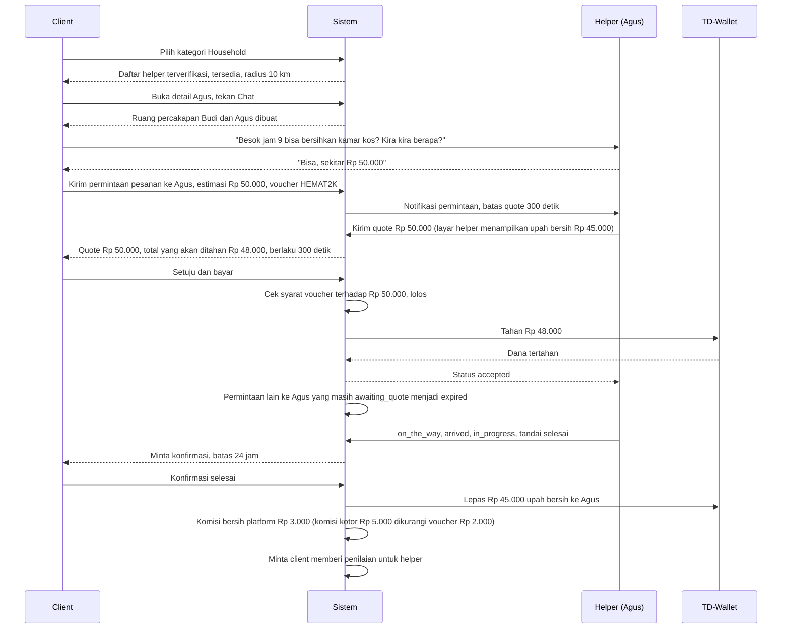
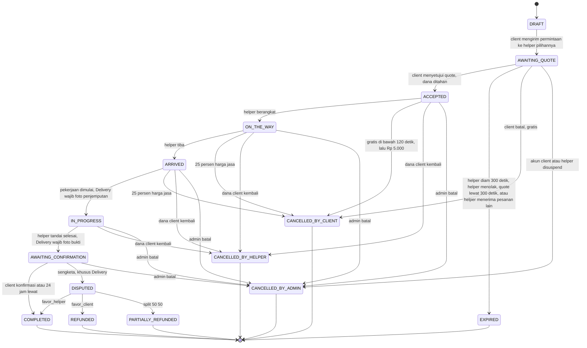

# Analisis Dua Peran dan Validasi Transaksi Dua Arah

Status dokumen: `REVIEW` v0.3, 19 Oktober 2026. Dokumen ini menjawab pertanyaan yang diangkat tim tentang dua peran dan validasi transaksi. Bagian 1 dan 2 tidak berubah sejak v0.1, kecuali satu kalimat soal konflik kepentingan di bagian 2. Bagian 3 sampai 9 direvisi mengikuti DEC-25 sampai DEC-27 di `14_perubahan-model-marketplace.md`: pemesanan model marketplace, chat sebelum pesanan, dan penghapusan talangan. Bagian 6 versi lama tentang talangan diganti bagian baru tentang percakapan sebelum pesanan.

## 1. Rumusan masalah

Aplikasi ini bukan aplikasi satu arah seperti toko daring biasa. Ada dua orang yang sama sama punya kepentingan uang di satu transaksi, dan keduanya bisa dirugikan oleh pihak lain.

Dari sisi client, risikonya membayar tetapi pekerjaan tidak dikerjakan, dikerjakan asal asalan, atau helper menghilang setelah menerima pesanan. Dari sisi helper, risikonya sudah menempuh perjalanan tetapi client membatalkan, tidak mengonfirmasi selesai, atau menghilang. Kalau desainnya keliru, salah satu pihak selalu menanggung risiko lebih besar dan aplikasi kehilangan kepercayaan.

Ada dua pertanyaan desain yang harus dijawab sebelum apa pun dibangun. Pertama, bagaimana satu orang bisa menjadi client dan helper tanpa membuat data identitas dan saldo menjadi kacau. Kedua, kapan tepatnya uang berpindah dan siapa yang memegangnya di antara waktu pesanan dibuat dan pekerjaan selesai.

## 2. Arsitektur akun untuk dua peran

Tiga opsi yang saya pertimbangkan.

| Opsi | Cara kerja | Kelebihan | Kekurangan |
| --- | --- | --- | --- |
| A. Dua akun terpisah | Satu orang mendaftar dua kali dengan email berbeda untuk jadi client dan helper | Pemisahan tegas, otorisasi sederhana | Identitas dan saldo terpecah, verifikasi identitas ganda, rekonsiliasi uang menyulitkan, pengalaman pengguna buruk |
| B. Satu akun satu peran aktif | Satu akun punya kolom peran yang nilainya client atau helper, diganti lewat pengaturan | Skema paling sederhana | Riwayat pesanan sebagai client hilang saat berganti peran, saldo ambigu milik peran mana, tidak sesuai prototipe yang menampilkan menu jadi helper di dalam profil client |
| C. Satu akun dua kapabilitas | Satu entitas `user` selalu punya kapabilitas client, ditambah `helper_profile` opsional yang aktif setelah verifikasi. Antarmuka menyediakan pertukaran konteks tampilan | Identitas dan dompet tunggal, riwayat utuh, sesuai prototipe, verifikasi cukup sekali | Butuh aturan otorisasi per aksi dan aturan pencegahan konflik kepentingan |

Rekomendasi saya opsi C, tercatat sebagai `DEC-01`. Alasannya bukan sekadar kerapian data. Dompet tunggal membuat pendapatan sebagai helper bisa langsung dipakai memesan sebagai client, dan itu justru inti cerita SDG 8 yang mau kita angkat, yaitu perputaran ekonomi di dalam komunitas.

Konsekuensi teknis yang harus dipatuhi.

Peran ditentukan per pesanan, bukan per akun. Setiap baris pesanan menyimpan `client_id` dan `helper_id`, dan otorisasi sebuah aksi diperiksa terhadap posisi pengguna pada pesanan itu, bukan terhadap kolom peran global. Pertanyaan yang dijawab sistem selalu berbentuk apakah pengguna ini adalah client dari pesanan ini, bukan apakah pengguna ini seorang client.

Pertukaran konteks tampilan hanya mengubah tampilan, bukan hak akses. Kalau helper sedang melihat mode client, dia tetap wajib menerima notifikasi pesanan aktif miliknya sebagai helper. Kehilangan notifikasi karena salah mode adalah bug yang mahal.

Larangan konflik kepentingan wajib ditegakkan di sisi server. Sistem menolak permintaan pesanan yang `helper_id`-nya milik client itu sendiri dan tidak menampilkan profil helper milik pengguna di daftar helper yang dia lihat, ini `FR-ORD-016`. Selain itu, satu helper tidak boleh memegang lebih dari satu pesanan aktif, ini `FR-ORD-017`, dan seorang pengguna tidak boleh menjadi helper untuk pesanan yang dibuatnya lewat akun lain yang terdeteksi memakai nomor telepon atau perangkat yang sama.

## 3. Kapan uang berpindah

Direvisi 19 Oktober 2026 mengikuti DEC-25 dan DEC-26. Prinsip dari revisi 19 Agustus tetap berlaku: dana tidak ditahan saat pesanan dibuat, tetapi saat ada kepastian ganda, yaitu satu harga pasti dan satu helper pasti.

Dengan model marketplace, helper sudah pasti sejak client memilihnya, dan harga baru pasti saat helper mengirim quote. Karena itu titik penahanan dana hanya satu: saat client menyetujui quote. Helper tidak perlu mengonfirmasi ulang, karena dia sendiri yang baru saja mengirim quote itu.

Nominal yang ditahan adalah `held_amount = service_client_charge`, yaitu harga jasa dari quote dikurangi voucher. Sebelum 19 Oktober 2026 nominal ini ditambah batas talangan untuk Food run dan Laundry. Kedua kategori itu sudah dihapus (DEC-25), jadi `held_amount` kini selalu sama dengan `service_client_charge`. Rumus lengkap ada di `05_erd-draft.md` bagian 2.2.

Kalau client diam sampai 24 jam setelah helper menandai selesai, sistem yang mengonfirmasi (FR-ORD-012). Tanpa aturan ini, helper bisa disandera oleh client yang tidak menekan tombol.

## 4. State machine pesanan

Direvisi 19 Oktober 2026. Perubahan dari versi 28 September: status `SEARCHING` dan `PENDING_CONFIRMATION` hilang bersama broadcast (DEC-26), status `PRICE_ADJUSTMENT` hilang bersama talangan (DEC-25), dan `AWAITING_QUOTE` menjadi satu satunya jalan dari `DRAFT` ke `ACCEPTED`.

Aturan yang mengikat untuk BE dan Mobile: transisi hanya sah kalau tergambar pada diagram ini, setiap transisi dicatat di `order_status_history` beserta pelaku dan waktu, dan tidak ada status yang boleh dilewati. Mobile selalu mengikuti status dari server dan memakai daftar status berikutnya yang dikirim API-ORD-03 dan API-ORD-05 untuk menentukan tombol.

Tiga catatan untuk jalur yang berubah.

Pertama, `AWAITING_QUOTE` punya dua tahap yang dibedakan lewat tabel `order_offers`, bukan lewat status. Selama belum ada baris quote, pesanan menunggu helper (batas `quote_deadline_at`). Setelah ada baris quote berstatus `submitted`, pesanan menunggu client (batas `order_offers.valid_until`). Mobile menampilkan layar berbeda untuk dua tahap itu.

Kedua, `EXPIRED` bersifat akhir. Client yang ingin mencoba helper lain menekan "Pilih helper lain", lalu sistem membuat pesanan baru dengan data yang sama untuk helper yang client pilih (API-ORD-13). Alasan kedaluwarsa (helper diam, helper menolak, quote lewat waktu, atau helper menerima pesanan lain) dicatat di kolom `reason` pada `order_status_history`.

Ketiga, `DISPUTED` tidak punya jalur ke `CANCELLED_BY_ADMIN`. Pesanan yang sedang disengketakan diselesaikan lewat keputusan sengketa, bukan pembatalan (DEC-22).

## 5. Aturan pembatalan dan kompensasi

Final per DEC-19 dan DEC-22, disesuaikan 19 Oktober 2026 karena status `searching` dan `pending_confirmation` hilang dan talangan tidak ada lagi. "Harga jasa" berarti `total_amount`, yaitu harga dari quote yang disetujui, bukan harga estimasi client.

### 5.1 Pembatalan oleh client

| Status saat client membatalkan | Dana jasa client | Kompensasi helper | Voucher |
| --- | --- | --- | --- |
| `awaiting_quote` | Belum ada dana tertahan | Tidak ada | Kembali |
| `accepted`, kurang dari 120 detik sejak `accepted_at` | Kembali penuh | Tidak ada | Kembali |
| `accepted`, 120 detik atau lebih | Kembali dikurangi Rp 5.000 | Rp 5.000 | Hangus |
| `on_the_way`, `arrived` | Kembali dikurangi 25 persen dari `total_amount`, dibulatkan ke bawah | 25 persen dari `total_amount` | Hangus |
| `in_progress`, `awaiting_confirmation` | Client tidak bisa membatalkan sepihak | Tidak berlaku | Tidak berlaku |

Kompensasi masuk utuh ke helper, platform tidak mengambil komisi dari kompensasi. Kompensasi tidak pernah melebihi `service_client_charge` **(turunan SA)**.

### 5.2 Pembatalan oleh helper

Helper boleh membatalkan pada `accepted`, `on_the_way`, `arrived`, dan `in_progress`. Dana jasa client kembali penuh, helper tidak menerima upah, dan `helper_profile.cancelled_order_count` bertambah satu. Voucher client kembali **(turunan SA)**.

Pada `awaiting_quote`, helper tidak membatalkan, tetapi menolak permintaan (API-ORD-04E). Penolakan tidak menambah `cancelled_order_count` karena belum ada pekerjaan yang dijanjikan.

### 5.3 Pembatalan oleh admin

Admin boleh membatalkan pesanan berstatus `accepted` sampai `awaiting_confirmation` dengan alasan wajib diisi (DEC-22). Dana jasa kembali penuh ke client dan helper tidak menerima kompensasi pembatalan. Pilihan split tidak tersedia di sini. Pesanan berstatus `disputed` tidak bisa dibatalkan admin dan harus diselesaikan lewat keputusan sengketa. Voucher client kembali **(turunan SA)**.

Pesanan `awaiting_quote` tidak dibatalkan admin satu per satu. Pesanan itu ikut batal sebagai `cancelled_by_admin` saat akun client atau akun helper tujuannya disuspend (FR-ADM-009).

### 5.4 Contoh angka

| Kasus | held_amount | Ke helper | Kembali ke client |
| --- | --- | --- | --- |
| Household jasa Rp 50.000, voucher Rp 2.000, client batal pada `accepted` setelah 3 menit | 48.000 | 5.000 | 43.000 |
| Delivery jasa Rp 40.000, voucher Rp 4.000, client batal pada `on_the_way` | 36.000 | 10.000 | 26.000 |
| Household jasa Rp 50.000, voucher Rp 2.000, helper batal pada `in_progress` | 48.000 | 0 | 48.000 |
| Household jasa Rp 50.000, voucher Rp 2.000, admin batal pada `in_progress` | 48.000 | 0 | 48.000 |

## 6. Percakapan sebelum pesanan

Bagian baru 19 Oktober 2026 mengikuti DEC-27. Bagian 6 versi lama (talangan Food run dan Laundry) sudah tidak berlaku sejak DEC-25 dan hanya tersisa di riwayat git.

Ruang percakapan sekarang milik satu pasangan client dan helper, bukan milik satu pesanan **(turunan SA)**. Client membuka ruang itu dari halaman detail helper untuk bertanya sebelum memesan, misalnya soal jadwal atau kisaran harga. Kalau client langsung mengirim permintaan pesanan tanpa chat, sistem membuat ruangnya otomatis, sehingga helper tetap bisa bertanya sebelum mengirim quote. Ruang yang sama dipakai selama dan sesudah pesanan, termasuk untuk pesanan berikutnya dengan helper yang sama.

Aturan yang mengikat:

1. Hanya client yang bisa membuka ruang baru. Helper hanya membalas di ruang yang sudah dibuka client **(turunan SA)**.
2. Client boleh chat helper yang sedang sibuk atau sedang mematikan ketersediaan. Yang dinonaktifkan hanya tombol Pesan (FR-HLP-011).
3. Pesan yang dikirim saat pasangan itu punya pesanan berstatus `awaiting_quote` sampai `disputed` ditandai dengan `order_id`. Admin membaca pesan bertanda itu saat memutuskan sengketa (FR-ADM-005) **(turunan SA)**.
4. Nomor telepon tetap tersamar di ruang percakapan (NFR-SEC-04), dan ruang percakapan menampilkan pemberitahuan tetap bahwa pembayaran di luar TD-Wallet tidak dilindungi (FR-CHT-009).
5. Satu client maksimal membuka 20 ruang baru per hari (FR-CHT-010, ASUMSI).
6. Pengguna tidak bisa membuka ruang percakapan dengan profil helper miliknya sendiri (INV-05).
7. Akun yang disuspend tidak bisa membaca atau mengirim pesan. Ruangnya tidak dihapus supaya jejak audit tetap ada.

Dua risiko baru muncul dari fitur ini dan dicatat di README sebagai RSK-05 dan RSK-06. RSK-05: client dan helper bisa sepakat bertransaksi di luar aplikasi, sehingga platform kehilangan komisi dan client kehilangan perlindungan escrow. RSK-06: helper bisa menerima banyak chat tanpa niat memesan. Mitigasi pada versi ini terbatas pada aturan nomor 4 dan 5. Deteksi nomor telepon di dalam pesan dan fitur blokir pengguna dicatat sebagai pengembangan lanjutan.

## 7. Daftar invarian sistem

Direvisi 19 Oktober 2026. INV-05, INV-12, INV-13, dan INV-14 disesuaikan, INV-16 sampai INV-18 baru.

| ID | Invarian |
| --- | --- |
| INV-01 | Saldo tersedia dan saldo tertahan pengguna tidak pernah bernilai negatif |
| INV-02 | Jumlah saldo tersedia ditambah saldo tertahan selalu sama dengan hasil penjumlahan seluruh mutasi ledger pengguna tersebut |
| INV-03 | Jumlah seluruh mutasi `hold` untuk satu pesanan selalu sama dengan `orders.held_amount` |
| INV-04 | Dana yang sudah dilepas ke helper tidak bisa dilepas ulang meskipun permintaan dikirim berkali kali |
| INV-05 | `client_id` dan user pemilik `helper_id` pada satu pesanan tidak boleh sama. Aturan yang sama berlaku untuk `client_id` dan user pemilik `helper_profile_id` pada satu ruang percakapan |
| INV-06 | Satu helper hanya boleh punya satu pesanan berstatus antara `accepted` sampai `awaiting_confirmation` |
| INV-07 | Setiap perubahan status pesanan menghasilkan tepat satu baris riwayat status |
| INV-08 | Penilaian hanya boleh dibuat untuk pesanan berstatus `completed` dan maksimal satu penilaian per pesanan, dari client ke helper |
| INV-09 | Pada setiap pesanan yang mencapai status akhir, dana ke helper ditambah komisi bersih platform ditambah dana kembali ke client sama dengan `held_amount` |
| INV-10 | Tidak ada pesanan berstatus `accepted` atau setelahnya tanpa catatan penahanan dana yang bersesuaian |
| INV-11 | `voucher_discount` tidak pernah melebihi `floor(total_amount x 10%)`, sehingga `platform_commission` tidak pernah negatif |
| INV-12 | `helper_payout` tidak pernah dipengaruhi voucher |
| INV-13 | Satu pengguna hanya punya maksimal satu `verification_request` berstatus `pending` |
| INV-14 | Akun dengan `is_suspended` bernilai benar tidak memiliki pesanan berstatus `awaiting_quote` sampai `awaiting_confirmation` atau `disputed`, baik sebagai client maupun sebagai helper |
| INV-15 | Satu pesanan hanya memakai maksimal satu voucher |
| INV-16 | Satu pasangan client dan helper hanya punya satu ruang percakapan |
| INV-17 | `orders.helper_id` terisi sejak pesanan dibuat dan tidak pernah berubah, dan satu pesanan punya maksimal satu baris `order_offers` |
| INV-18 | `orders.held_amount` selalu sama dengan `orders.service_client_charge` pada pesanan yang dananya sudah ditahan |

## 8. Edge case yang harus punya jawaban

| Kasus | Perilaku yang diharapkan |
| --- | --- |
| Dua client menyetujui quote dari helper yang sama pada detik yang hampir bersamaan | Penguncian tingkat basis data pada baris helper. Persetujuan pertama menahan dana dan memicu FR-ORD-024. Persetujuan kedua ditolak dengan `HELPER_HAS_ACTIVE_ORDER`, pesanan kedua menjadi `expired`, dan tidak ada dana yang ditahan |
| Client menekan setuju dua kali karena jaringan lambat | Idempotency key sama menghasilkan satu transaksi, permintaan kedua mengembalikan hasil yang pertama |
| Saldo client habis dipakai pesanan lain di antara quote masuk dan persetujuan | Penahanan dilakukan dalam satu transaksi basis data dengan pengecekan saldo. Kalau kurang, ditolak dengan `WALLET_INSUFFICIENT_BALANCE` dan quote tetap berlaku sampai `valid_until` sehingga client bisa mengisi saldo |
| Helper mematikan ketersediaan saat masih ada permintaan `awaiting_quote` | Permintaan yang sudah masuk tetap bisa dijawab sampai batas 300 detik. Helper tidak muncul di daftar helper dan tidak menerima permintaan baru (FR-HLP-009) |
| Helper mengirim quote jauh di atas kisaran yang disepakati di chat | Client bisa membiarkan quote kedaluwarsa atau membatalkan gratis, lalu memilih helper lain. Tidak ada tawar balik (DEC-21) |
| Client dan helper sepakat bayar tunai di luar aplikasi lewat chat | Tidak dilindungi escrow maupun kanal sengketa. Ruang percakapan menampilkan pemberitahuan FR-CHT-009 dan nomor telepon tetap tersamar. Risiko dicatat sebagai RSK-05 |
| Client membuka banyak ruang chat tanpa niat memesan | Ruang ke-21 pada hari yang sama ditolak dengan `CHAT_ROOM_LIMIT_REACHED` (FR-CHT-010) |
| Helper yang disuspend masih punya ruang percakapan dengan beberapa client | Ruang tetap tersimpan untuk audit. Helper menerima `403 ACCOUNT_SUSPENDED`, client melihat label akun nonaktif dan tombol Pesan nonaktif |
| Aplikasi helper mati saat status `on_the_way` | Status tetap di server, dipulihkan saat aplikasi dibuka lagi |
| Helper menandai selesai padahal belum mengerjakan, kategori Delivery | Client mengajukan sengketa dalam 24 jam, dana tetap tertahan sampai keputusan admin |
| Helper menandai selesai padahal belum mengerjakan, kategori selain Delivery | Tidak ada kanal sengketa formal (DEC-10). Client bisa melapor lewat kanal dukungan, admin bisa membatalkan pesanan sebelum 24 jam lewat |
| Client tidak pernah membuka aplikasi lagi setelah pekerjaan selesai | Konfirmasi otomatis setelah 24 jam, helper tetap dibayar |
| Voucher tidak memenuhi syarat terhadap quote yang disetujui | Persetujuan tetap berjalan tanpa voucher, client diberi tahu, voucher tetap tersimpan untuk pesanan lain |
| Admin mencoba suspend akun yang masih punya pesanan aktif | Ditolak dengan `USER_HAS_ACTIVE_ORDER` beserta daftar nomor pesanannya |
| Pengguna menghapus akun sementara masih ada pesanan berjalan | Penghapusan ditolak sampai seluruh pesanan mencapai status akhir dan saldo tertahan nol |
| Jam perangkat dimundurkan untuk mengakali batas waktu | Seluruh perhitungan waktu memakai waktu server |

## 9. Status pertanyaan terbuka

Per 19 Oktober 2026 tidak ada pertanyaan desain besar yang terbuka di dokumen ini. Lima pertanyaan sesi 19 Agustus terjawab lewat DEC-04 sampai DEC-08, dua belas pertanyaan ERD terjawab lewat DEC-14 sampai DEC-24, dan perubahan model pemesanan tercatat sebagai DEC-25 sampai DEC-27.

Hal yang masih terbuka tercatat di `14_perubahan-model-marketplace.md` bagian 6: konfirmasi Backend atas turunan SA, angka batas ruang chat per hari, dan tiga hal kecil lama soal voucher dan pembulatan split.
