# ERD dan Catatan Skema

Status dokumen: `CONFIRMED` v1.0, 24 Oktober 2026. Perubahan v1.0: seluruh turunan SA di bagian 7 dikonfirmasi Kai pada 24 Oktober 2026 (DEC-28), penanda **(turunan SA)** di badan dokumen dipertahankan sebagai jejak asal kolom, dan bagian 9 mencatat selisih implementasi yang ditemukan QA. Isi skema tidak berubah dari v0.4. Versi 0.4 (19 Oktober 2026) menerapkan DEC-25 sampai DEC-27 (`14_perubahan-model-marketplace.md`) di atas v0.3. Tabel dan kolom yang berasal langsung dari keputusan berstatus final. Turunan SA yang saat itu belum dikonfirmasi Kai ditandai **(turunan SA)** dan dirangkum di bagian 7. Daftar perubahan skema untuk migrasi ada di bagian 8.

Riwayat singkat: v0.1 draf SA, v0.2 perbaikan mekanis hasil review Kai 6 September 2026, v0.3 penggabungan ERD final dan keputusan sinkronisasi 28 September 2026, v0.4 model pemesanan marketplace dan penghapusan talangan 19 Oktober 2026. Rincian v0.3 yang sudah tidak berlaku (tabel `PRICE_ADJUSTMENT`, kolom talangan, `booking_type`) hanya tersisa di riwayat git.

## 1. Diagram

Nama entitas memakai huruf besar tunggal. Nama tabel fisik di PostgreSQL memakai huruf kecil jamak mengikuti konvensi Laravel, misalnya entitas `ORDER` menjadi tabel `orders` karena `order` adalah reserved word (DEC-16).

```mermaid
erDiagram
    USER ||--o| HELPER_PROFILE : "boleh memiliki"
    USER ||--|| WALLET : memiliki
    USER ||--o{ ADDRESS : menyimpan
    USER ||--o{ ORDER : "membuat sebagai client"
    HELPER_PROFILE ||--o{ ORDER : "dipilih sebagai helper"
    HELPER_PROFILE ||--o{ HELPER_SERVICE_CATEGORY : menguasai
    SERVICE_CATEGORY ||--o{ HELPER_SERVICE_CATEGORY : dikuasai
    SERVICE_CATEGORY ||--o{ ORDER : mengkategorikan
    ORDER ||--o{ ORDER_STATUS_HISTORY : mencatat
    ORDER ||--o| ORDER_OFFER : "menerima quote"
    ORDER ||--o{ ORDER_ATTACHMENT : "foto bukti"
    ORDER ||--o{ WALLET_TRANSACTION : memicu
    ORDER ||--o| RATING : "dinilai client"
    ORDER ||--o| DISPUTE : "boleh sengketa"
    ORDER ||--o| USER_VOUCHER : "memakai voucher"
    ORDER ||--o{ CHAT_MESSAGE : "konteks pesanan"
    USER ||--o{ CHAT_ROOM : "membuka sebagai client"
    HELPER_PROFILE ||--o{ CHAT_ROOM : dihubungi
    CHAT_ROOM ||--o{ CHAT_MESSAGE : berisi
    WALLET ||--o{ WALLET_TRANSACTION : mencatat
    USER ||--o{ NOTIFICATION : menerima
    USER ||--o{ USER_VOUCHER : memiliki
    VOUCHER ||--o{ USER_VOUCHER : diterbitkan
    SERVICE_CATEGORY ||--o{ VOUCHER : membatasi
    USER ||--o{ VERIFICATION_REQUEST : mengajukan
    USER ||--o{ VERIFICATION_REQUEST : "ditinjau admin"
    USER ||--o{ DISPUTE : "mengajukan sengketa"
    USER ||--o{ DISPUTE : "diputuskan admin"
    USER ||--o{ ADMIN_ACTION_LOG : mencatat
    USER ||--o{ ORDER_ATTACHMENT : mengunggah

    USER {
        bigint id PK
        varchar full_name
        varchar phone_number UK
        varchar email UK
        varchar password
        varchar photo_url
        enum verification_status
        boolean is_admin
        boolean is_suspended
        text suspended_reason
        timestamp created_at
        timestamp updated_at
    }

    HELPER_PROFILE {
        bigint id PK
        bigint user_id FK
        bigint hourly_rate
        enum is_available
        decimal rating_average
        int rating_count
        int completed_order_count
        int cancelled_order_count
        timestamp approved_at
        timestamp updated_at
    }

    HELPER_SERVICE_CATEGORY {
        bigint id PK
        bigint helper_profile_id FK
        bigint service_category_id FK
        timestamp created_at
    }

    SERVICE_CATEGORY {
        bigint id PK
        varchar code UK
        varchar name
        bigint base_fee
        boolean requires_proof_photo
        boolean requires_pickup_photo
        boolean requires_pickup_address
        boolean requires_destination_address
        boolean is_dispute_eligible
        timestamp updated_at
    }

    ADDRESS {
        bigint id PK
        bigint user_id FK
        varchar label
        text full_address
        decimal latitude
        decimal longitude
        varchar landmark_note
        boolean is_primary
        timestamp created_at
        timestamp updated_at
    }

    ORDER {
        bigint id PK
        varchar order_number UK
        bigint client_id FK
        bigint helper_id FK
        bigint category_id FK
        enum status
        text task_description
        bigint pickup_address_id FK
        bigint destination_address_id FK
        bigint client_estimated_price
        bigint base_fee
        bigint distance_fee
        bigint service_fee
        bigint total_amount
        bigint voucher_discount
        bigint service_client_charge
        bigint held_amount
        bigint platform_commission
        bigint helper_payout
        bigint cancellation_fee
        timestamp scheduled_at
        timestamp quote_deadline_at
        timestamp accepted_at
        timestamp helper_finished_at
        timestamp completed_at
        timestamp created_at
        timestamp updated_at
    }

    ORDER_OFFER {
        bigint id PK
        bigint order_id FK
        bigint proposed_price
        enum offer_status
        timestamp offered_at
        timestamp valid_until
        timestamp responded_at
        timestamp updated_at
    }

    ORDER_STATUS_HISTORY {
        bigint id PK
        bigint order_id FK
        enum from_status
        enum to_status
        bigint actor_user_id FK
        varchar actor_type
        text reason
        timestamp created_at
    }

    ORDER_ATTACHMENT {
        bigint id PK
        bigint order_id FK
        bigint uploaded_by_user_id FK
        enum attachment_type
        varchar file_url
        timestamp created_at
    }

    WALLET {
        bigint id PK
        bigint user_id FK
        bigint available_balance
        bigint held_balance
        varchar currency
        timestamp updated_at
    }

    WALLET_TRANSACTION {
        bigint id PK
        bigint wallet_id FK
        bigint order_id FK
        enum transaction_type
        bigint amount
        bigint balance_after
        varchar idempotency_key UK
        text description
        timestamp created_at
    }

    RATING {
        bigint id PK
        bigint order_id FK
        bigint client_id FK
        bigint helper_id FK
        int score
        text review
        timestamp created_at
    }

    CHAT_ROOM {
        bigint id PK
        bigint client_id FK
        bigint helper_profile_id FK
        timestamp last_message_at
        timestamp created_at
        timestamp updated_at
    }

    CHAT_MESSAGE {
        bigint id PK
        bigint chat_room_id FK
        bigint sender_user_id FK
        bigint order_id FK
        text content
        varchar attachment_url
        timestamp read_at
        timestamp created_at
    }

    DISPUTE {
        bigint id PK
        bigint order_id FK
        bigint raised_by_user_id FK
        text reason
        enum resolution
        bigint client_refund_amount
        bigint helper_release_amount
        text admin_note
        bigint resolved_by_admin_id FK
        timestamp resolved_at
        timestamp created_at
        timestamp updated_at
    }

    VERIFICATION_REQUEST {
        bigint id PK
        bigint user_id FK
        varchar id_card_url
        varchar selfie_url
        enum review_status
        text rejection_reason
        bigint reviewed_by_admin_id FK
        timestamp reviewed_at
        timestamp created_at
        timestamp updated_at
    }

    ADMIN_ACTION_LOG {
        bigint id PK
        bigint admin_user_id FK
        enum action_type
        varchar target_entity
        bigint target_id
        text note
        timestamp created_at
    }

    VOUCHER {
        bigint id PK
        varchar code UK
        enum discount_type
        bigint discount_value
        bigint max_discount_amount
        bigint min_order_amount
        bigint usage_limit
        bigint category_id FK
        boolean is_active
        timestamp valid_from
        timestamp valid_until
        timestamp created_at
        timestamp updated_at
    }

    USER_VOUCHER {
        bigint id PK
        bigint user_id FK
        bigint voucher_id FK
        bigint used_order_id FK
        bigint discount_applied
        timestamp used_at
    }

    NOTIFICATION {
        bigint id PK
        bigint user_id FK
        enum type
        varchar title
        text body
        bigint reference_order_id FK
        timestamp read_at
        timestamp created_at
    }
```



## 2. Kamus data untuk kolom yang sering disalahpahami

### 2.1 Konsep uang pada `ORDER` (DEC-15, disederhanakan DEC-25)

Seluruh kolom nominal bertipe `bigint` dalam satuan rupiah penuh. Sejak talangan dihapus, `advance_limit` dan `advance_actual` tidak ada lagi. `held_amount` tetap disimpan sebagai kolom sendiri walaupun nilainya kini selalu sama dengan `service_client_charge` (INV-18), supaya invarian escrow (INV-03, INV-09) tetap merujuk satu kolom yang jelas dan rumus tidak perlu ditulis ulang kalau suatu saat ada komponen dana tertahan lain.

| Kolom | Arti | Kapan diisi |
| --- | --- | --- |
| `client_estimated_price` | Harga estimasi upah jasa yang client isi di form permintaan. Hanya panduan bagi helper menyusun quote **(turunan SA)** | Saat pesanan dibuat |
| `base_fee`, `distance_fee`, `service_fee` | Komponen rentang biaya acuan FR-ORD-002. `service_fee` flat sama dengan `service_category.base_fee` (DEC-14 nomor 4). Bukan dasar penahanan dana | Saat estimasi dihitung |
| `total_amount` | Harga jasa final, sama dengan `order_offers.proposed_price` yang disetujui client | Saat dana ditahan |
| `voucher_discount` | Diskon voucher yang berlaku, maksimal sama dengan komisi kotor | Saat dana ditahan |
| `service_client_charge` | `total_amount - voucher_discount`, harga jasa yang client bayar | Saat dana ditahan |
| `held_amount` | Dana yang ditahan escrow untuk pesanan ini, sama dengan `service_client_charge` | Saat dana ditahan |
| `helper_payout` | Upah bersih helper, `total_amount - floor(total_amount x 10%)` | Saat settlement |
| `platform_commission` | Komisi bersih platform, `floor(total_amount x 10%) - voucher_discount`, minimal nol | Saat settlement |
| `cancellation_fee` | Kompensasi pembatalan yang masuk ke helper, 0 kalau pembatalan gratis | Saat dibatalkan |

### 2.2 Rumus settlement

```
Saat client menyetujui quote
  total_amount          = order_offers.proposed_price
  gross_commission      = floor(total_amount x 10 / 100)
  voucher_discount      = min(nilai_voucher, gross_commission)   (0 kalau voucher tidak memenuhi syarat)
  service_client_charge = total_amount - voucher_discount
  held_amount           = service_client_charge

Saat pesanan selesai (completed, atau sengketa favor_helper)
  helper_payout         = total_amount - gross_commission
  platform_commission   = gross_commission - voucher_discount
  helper_release        = helper_payout
  client_refund         = held_amount - helper_release - platform_commission   (selalu 0)

Saat pesanan dibatalkan client
  helper_release        = cancellation_fee   (maksimal service_client_charge)
  platform_commission   = 0
  client_refund         = held_amount - helper_release

Saat pesanan dibatalkan helper atau admin
  helper_release        = 0
  platform_commission   = 0
  client_refund         = held_amount

Saat sengketa favor_client
  helper_release        = 0
  platform_commission   = 0
  client_refund         = held_amount

Saat sengketa split (khusus Delivery)
  helper_release        = floor(held_amount / 2)   (usulan turunan SA, aturan selisih Rp1 diputuskan BE)
  client_refund         = held_amount - helper_release
  platform_commission   = 0

Invarian di semua kasus
  helper_release + platform_commission + client_refund = held_amount
```

Contoh angka yang sudah diuji dengan skrip, dipakai konsisten di `04`, `06`, `07`, dan `11`. Voucher HEMAT2K adalah potongan tetap Rp 2.000 dengan minimal pesanan Rp 20.000. Voucher Rp 4.000 dan Rp 5.000 masing masing bersyarat minimal pesanan Rp 40.000 dan Rp 50.000, sesuai validasi DEC-23.

| Kasus | total_amount | Voucher | held_amount | Ke helper | Komisi bersih | Kembali ke client |
| --- | --- | --- | --- | --- | --- | --- |
| Household normal, voucher HEMAT2K | 50.000 | 2.000 | 48.000 | 45.000 | 3.000 | 0 |
| Delivery, voucher setara komisi kotor | 50.000 | 5.000 | 45.000 | 45.000 | 0 | 0 |
| Delivery tanpa voucher | 38.000 | 0 | 38.000 | 34.200 | 3.800 | 0 |
| Batal client, accepted 120 detik lebih, Household | 50.000 | 2.000 | 48.000 | 5.000 | 0 | 43.000 |
| Batal client, on_the_way, Delivery | 40.000 | 4.000 | 36.000 | 10.000 | 0 | 26.000 |
| Batal helper atau admin, Household | 50.000 | 2.000 | 48.000 | 0 | 0 | 48.000 |
| Sengketa Delivery, favor_helper | 60.000 | 0 | 60.000 | 54.000 | 6.000 | 0 |
| Sengketa Delivery, favor_client | 60.000 | 0 | 60.000 | 0 | 0 | 60.000 |
| Sengketa Delivery, split | 60.000 | 0 | 60.000 | 30.000 | 0 | 30.000 |

### 2.3 Tabel `ORDER_OFFER` sebagai quote (DEC-21, DEC-26)

Nama tabel tetap `order_offers` supaya Backend tidak perlu mengganti model dan migrasi yang mungkin sudah dibuat, tetapi isinya kini hanya quote. Satu pesanan punya maksimal satu baris **(turunan SA nomor 17)**.

| Kolom | Arti |
| --- | --- |
| `order_id` | Pesanan yang di-quote, unik |
| `proposed_price` | Upah jasa yang helper ajukan, tidak pernah memuat uang belanja |
| `offer_status` | `submitted` saat quote dikirim, `confirmed` saat client menyetujui dan dana ditahan, `expired` kalau lewat `valid_until` tanpa persetujuan, `withdrawn` kalau pesanan batal sebelum quote disetujui |
| `offered_at` | Waktu quote dikirim |
| `valid_until` | `offered_at` ditambah 300 detik, batas client menyetujui |
| `responded_at` | Waktu client menyetujui, atau waktu baris berubah menjadi `expired` atau `withdrawn` |

Kalau helper menolak permintaan sebelum memberi quote, tidak ada baris `order_offers` yang dibuat. Pesanan langsung berubah menjadi `expired` dan alasan penolakan disimpan di `order_status_history.reason`.

### 2.4 Tabel `CHAT_ROOM` dan `CHAT_MESSAGE` (DEC-27)

| Kolom | Arti |
| --- | --- |
| `chat_rooms.client_id` | User yang membuka ruang sebagai client. Hanya client yang bisa membuka ruang baru **(turunan SA nomor 13)** |
| `chat_rooms.helper_profile_id` | Helper yang dihubungi. Pasangan `client_id` dan `helper_profile_id` unik **(turunan SA nomor 12)** |
| `chat_rooms.last_message_at` | Dipakai mengurutkan daftar percakapan FR-CHT-002 |
| `chat_messages.order_id` | Diisi otomatis dengan pesanan pasangan itu yang sedang berstatus `awaiting_quote` sampai `disputed`. Kosong untuk pesan sebelum pesanan **(turunan SA nomor 14)** |
| `chat_messages.sender_user_id` | Pengirim, harus salah satu dari user client atau user pemilik helper profile pada ruang itu |

Kolom `chat_rooms.order_id`, `is_read_only`, dan `closed_at` versi v0.3 dihapus karena ruang tidak lagi ditutup per pesanan (FR-CHT-004 DEPRECATED).

### 2.5 Kolom lain

`ORDER.helper_id` terisi sejak pesanan dibuat dengan helper yang client pilih, dan tidak pernah berubah (INV-17). Relasi `ORDER` ke `HELPER_PROFILE` kini wajib, bukan opsional.

`ORDER.quote_deadline_at` adalah waktu pesanan dibuat ditambah 300 detik, batas helper memberi quote atau menolak **(turunan SA nomor 18)**. Kolom ini menggantikan `offer_window_expires_at`.

`SERVICE_CATEGORY.requires_destination_address` pada Personal dan Household berarti lokasi pengerjaan, bukan tujuan antar. UI/UX memakai label "Lokasi pengerjaan" untuk dua kategori itu (DEC-16).

`SERVICE_CATEGORY.requires_pickup_photo` dan `is_dispute_eligible` adalah dua kolom **(turunan SA)**. Keduanya memindahkan aturan "foto penjemputan wajib" dan "sengketa hanya Delivery" dari kode ke data, mengikuti pola kolom `requires_*`. Kolom `requires_advance` dihapus bersama talangan.

`USER.verification_status` adalah ringkasan. Backend memperbaruinya dalam transaksi basis data yang sama dengan `VERIFICATION_REQUEST.review_status` saat admin memutuskan (DEC-16).

`USER.is_suspended` adalah satu-satunya sumber status suspend. `HELPER_PROFILE.is_available` hanya bernilai `available` atau `unavailable` (DEC-16). Daftar helper hanya menampilkan helper dengan `is_available = available`, pemilik akun tidak disuspend, dan `verification_status = verified`.

`HELPER_PROFILE.max_advance_limit` dihapus bersama talangan.

`ORDER.helper_finished_at` mencatat waktu helper menandai pekerjaan selesai, menjadi titik awal hitungan 24 jam konfirmasi otomatis dan jendela sengketa.

`USER_VOUCHER.discount_applied` menyimpan diskon sungguhan saat dipakai, terpisah dari `VOUCHER.discount_value` yang bisa berubah belakangan.

## 3. Konfigurasi kategori (DEC-14 nomor 3, DEC-18, DEC-25)

| `code` | `requires_proof_photo` | `requires_pickup_photo` | `requires_pickup_address` | `requires_destination_address` | `is_dispute_eligible` |
| --- | --- | --- | --- | --- | --- |
| `delivery` | true | true | true | true | true |
| `personal` | false | false | false | true (lokasi pengerjaan) | false |
| `household` | false | false | false | true (lokasi pengerjaan) | false |

Baris `food_run`, `moving`, dan `laundry` dihapus dari data seed (DEC-25). Kolom `requires_proof_photo` mengikuti FR-ORD-013, `requires_pickup_photo` mengikuti FR-ORD-021.

## 4. Nilai enumerasi (DEC-16, disesuaikan DEC-25 sampai DEC-27)

| Kolom | Nilai yang diperbolehkan |
| --- | --- |
| `user.verification_status` | `unverified`, `pending`, `verified`, `rejected` |
| `helper_profile.is_available` | `available`, `unavailable` |
| `order.status` | `draft`, `awaiting_quote`, `accepted`, `on_the_way`, `arrived`, `in_progress`, `awaiting_confirmation`, `completed`, `cancelled_by_client`, `cancelled_by_helper`, `cancelled_by_admin`, `expired`, `disputed`, `refunded`, `partially_refunded` **(turunan SA)** |
| `order_offer.offer_status` | `submitted`, `confirmed`, `expired`, `withdrawn` |
| `order_attachment.attachment_type` | `pickup_proof`, `completion_proof`, `dispute_evidence` |
| `wallet_transaction.transaction_type` | `topup`, `hold`, `release`, `refund`, `payout`, `cancellation_fee` |
| `dispute.resolution` | `pending`, `favor_client`, `favor_helper`, `split` |
| `admin_action_log.action_type` | `approve_verification`, `reject_verification`, `resolve_dispute`, `suspend_account`, `reactivate_account`, `cancel_order`, `create_voucher`, `update_voucher`, `deactivate_voucher` |
| `voucher.discount_type` | `fixed`, `percentage` |
| `notification.type` | `order_offer`, `order_status_change`, `chat_message`, `dispute_update`, `wallet_mutation`, `promo` |

Nilai yang dihapus 19 Oktober 2026: `order.booking_type` seluruhnya, status `searching`, `pending_confirmation`, dan `price_adjustment`, `offer_status` `selected`, `not_selected`, dan `declined`, `attachment_type` `receipt`, `transaction_type` `advance_reimbursement`, serta enum `price_adjustment.approval_status` bersama tabelnya.

Nilai `notification.type` `order_offer` dipertahankan dan kini berarti notifikasi permintaan pesanan ke helper dan quote masuk ke client. Komisi platform tetap tidak masuk dompet siapa pun, sehingga ringkasan komisi FR-ADM-007 membaca `orders.platform_commission`.

## 5. Aturan integritas dan indeks PostgreSQL

### 5.1 Indeks dan constraint

```sql
-- Kueri pesanan aktif client dan helper, termasuk permintaan awaiting_quote milik helper
CREATE INDEX idx_orders_client_status ON orders(client_id, status);
CREATE INDEX idx_orders_helper_status ON orders(helper_id, status);

-- Satu quote per pesanan (turunan SA nomor 17)
CREATE UNIQUE INDEX uq_order_offer_order ON order_offers(order_id);

-- Satu ruang percakapan per pasangan client dan helper (turunan SA nomor 12)
CREATE UNIQUE INDEX uq_chat_room_pair ON chat_rooms(client_id, helper_profile_id);

-- Daftar percakapan dan isi percakapan
CREATE INDEX idx_chat_rooms_client_last ON chat_rooms(client_id, last_message_at DESC);
CREATE INDEX idx_chat_rooms_helper_last ON chat_rooms(helper_profile_id, last_message_at DESC);
CREATE INDEX idx_chat_messages_room_created ON chat_messages(chat_room_id, created_at);

-- Riwayat mutasi dompet
CREATE INDEX idx_wallet_tx_wallet_created ON wallet_transactions(wallet_id, created_at DESC);

-- Satu voucher per order (DEC-14 nomor 6)
CREATE UNIQUE INDEX uq_user_voucher_order ON user_vouchers(used_order_id) WHERE used_order_id IS NOT NULL;

-- Satu pengajuan verifikasi pending per pengguna (DEC-14 nomor 7)
CREATE UNIQUE INDEX uq_verification_pending ON verification_requests(user_id) WHERE review_status = 'pending';

-- Rating satu arah, satu per order (DEC-09)
CREATE UNIQUE INDEX uq_rating_order ON ratings(order_id);

-- Pivot kategori helper (DEC-16)
CREATE UNIQUE INDEX uq_helper_category ON helper_service_categories(helper_profile_id, service_category_id);

-- Uang tidak boleh negatif dan voucher tidak boleh melebihi komisi kotor (DEC-14 nomor 5, DEC-15)
ALTER TABLE wallets ADD CONSTRAINT chk_wallet_nonneg CHECK (available_balance >= 0 AND held_balance >= 0);
ALTER TABLE orders ADD CONSTRAINT chk_voucher_cap CHECK (voucher_discount <= total_amount / 10);
ALTER TABLE orders ADD CONSTRAINT chk_commission_nonneg CHECK (platform_commission >= 0);
ALTER TABLE orders ADD CONSTRAINT chk_held_equals_charge CHECK (held_amount = service_client_charge);
```

Pembagian bilangan bulat `total_amount / 10` di PostgreSQL sudah membulatkan ke bawah, sama dengan `floor(total_amount x 10%)`. Constraint `chk_held_equals_charge` menegakkan INV-18 dan harus dilepas kalau suatu saat ada komponen dana tertahan lain.

### 5.2 Invarian dompet

1. Setiap transaksi keuangan wajib membawa `idempotency_key` unik.
2. Mutasi saldo hanya lewat fungsi transaksi atomik di backend dengan `SELECT ... FOR UPDATE` pada baris `wallets` yang terlibat.
3. `wallet_transactions` bersifat tambah saja. Koreksi memakai baris lawan, bukan mengubah baris lama.
4. Jumlah seluruh baris `hold` untuk satu pesanan sama dengan `orders.held_amount`.

### 5.3 Validasi yang ditegakkan di backend

| Aturan | Sumber |
| --- | --- |
| Permintaan pesanan ditolak kalau helper tujuan belum `verified`, sedang `unavailable`, akunnya disuspend, tidak menguasai kategori pesanan, atau sedang memegang pesanan `accepted` sampai `awaiting_confirmation` | DEC-26, FR-VER-004, FR-ORD-017 |
| Permintaan pesanan dan pembukaan ruang chat ditolak kalau user pemilik `helper_id` sama dengan client | INV-05, FR-ORD-016 |
| Quote hanya diterima dari helper pesanan itu, saat status `awaiting_quote`, sebelum `quote_deadline_at`, dan kalau belum ada baris `order_offers` | DEC-21 |
| Persetujuan quote ditolak setelah `valid_until`, dan ditolak dengan `HELPER_HAS_ACTIVE_ORDER` kalau helper sudah memegang pesanan aktif | DEC-21, INV-06 |
| Setelah satu pesanan helper menjadi `accepted`, pesanan lain ke helper itu yang masih `awaiting_quote` diubah menjadi `expired` dalam transaksi yang sama | FR-ORD-024 |
| Ruang chat baru hanya bisa dibuka client, maksimal 20 per client per hari | FR-CHT-007, FR-CHT-010 |
| Suspend ditolak kalau pengguna masih punya order berstatus `accepted` sampai `awaiting_confirmation`, atau `disputed`. Kalau lolos, seluruh order `awaiting_quote` miliknya sebagai client maupun helper menjadi `cancelled_by_admin` | DEC-22, DEC-26 |
| Admin cancel hanya untuk order berstatus `accepted` sampai `awaiting_confirmation`, tidak untuk `disputed` | DEC-22 |
| Voucher `fixed` ditolak kalau `min_order_amount < discount_value x 10`. Voucher `percentage` ditolak kalau `discount_value > 10` | DEC-23 |
| Syarat voucher dicek terhadap `order_offers.proposed_price` saat client menyetujui quote, bukan `client_estimated_price` | DEC-23 |
| Sengketa hanya boleh diajukan kalau `service_category.is_dispute_eligible` bernilai true | DEC-10 |
| Transisi `arrived` ke `in_progress` pada kategori dengan `requires_pickup_photo` ditolak tanpa `order_attachment` bertipe `pickup_proof` | DEC-24 |
| Transisi `in_progress` ke `awaiting_confirmation` pada kategori dengan `requires_proof_photo` ditolak tanpa `order_attachment` bertipe `completion_proof` | FR-ORD-013 |

## 6. Keputusan skema lama yang tetap berlaku

Nominal uang disimpan sebagai `bigint` rupiah penuh, bukan `float` atau `decimal`, dikonfirmasi Kai 6 September 2026.

Dompet dipecah menjadi `available_balance` dan `held_balance`, sehingga penahanan dana bisa diaudit dan INV-02 bisa diperiksa otomatis.

`ORDER.helper_id` menunjuk ke `helper_profile`, bukan langsung ke `user`, supaya data helper saat pesanan dibuat bisa ditelusuri.

Kolom `is_admin` pada `user` menandai akun admin. Akun admin dibuat lewat seeder atau proses terpisah, tidak lewat form registrasi publik (DEC-07).

`ADMIN_ACTION_LOG` mencatat setiap tindakan admin dalam satu tempat. `target_entity` berisi nama tabel yang kena aksi, `target_id` berisi id barisnya.

## 7. Turunan SA (dikonfirmasi Kai 24 Oktober 2026)

Nomor 1 sampai 11 berasal dari `10_notulen-sinkronisasi-erd-final.md` bagian 6. Nomor 12 sampai 21 berasal dari `14_perubahan-model-marketplace.md` bagian 3, lengkap dengan alasannya.

| No | Turunan | Lokasi | Status per 24 Okt 2026 |
| --- | --- | --- | --- |
| 1 | `orders.client_estimated_price` terpisah dari komponen rentang acuan | Bagian 2.1 | Dikonfirmasi |
| 2 | `price_adjustments.recognized_amount` dan `additional_hold_amount` | | Gugur, tabel dihapus (DEC-25) |
| 3 | `transaction_type` `advance_reimbursement` | | Gugur (DEC-25) |
| 4 | Status `partially_refunded` | Bagian 4 | Dikonfirmasi |
| 5 | `disputes.client_refund_amount` dan `helper_release_amount` | Bagian 1 | Dikonfirmasi |
| 6 | Voucher kembali pada pembatalan oleh helper dan admin cancel | `04` bagian 5 | Dikonfirmasi |
| 7 | Kompensasi pembatalan maksimal `service_client_charge` | `04` bagian 5 | Dikonfirmasi |
| 8 | Split: `helper_release = floor(held_amount / 2)` | Bagian 2.2 | Dikonfirmasi |
| 9 | Tombol Pesan Langsung nonaktif karena batas talangan | | Gugur (DEC-25) |
| 10 | `service_category.requires_pickup_photo` dan `is_dispute_eligible` | Bagian 2.5 dan 3 | Dikonfirmasi |
| 11 | `orders.helper_finished_at`, `cancellation_fee`, `vouchers.is_active`, `created_at` pada `disputes` dan `verification_requests` | Bagian 1 | Dikonfirmasi. Bagian `offer_window_expires_at` diganti nomor 18, unique `(order_id, helper_id)` diganti nomor 17 |
| 12 | `chat_rooms` per pasangan client dan helper | Bagian 2.4 | Dikonfirmasi |
| 13 | Hanya client yang membuka ruang chat baru | Bagian 2.4, 5.3 | Dikonfirmasi |
| 14 | `chat_messages.order_id` terisi otomatis | Bagian 2.4 | Dikonfirmasi |
| 15 | Pemberitahuan pembayaran di luar aplikasi dan batas 20 ruang chat per hari | Bagian 5.3, FR-CHT-009, FR-CHT-010 | Dikonfirmasi |
| 16 | `orders.helper_id` terisi sejak pesanan dibuat, `booking_type` dihapus | Bagian 2.5 | Dikonfirmasi |
| 17 | `order_offers` maksimal satu baris per pesanan, kolom dan nilai enum broadcast dihapus | Bagian 2.3 | Dikonfirmasi |
| 18 | `offer_window_expires_at` menjadi `quote_deadline_at` | Bagian 2.5 | Dikonfirmasi |
| 19 | Permintaan lain ke helper otomatis `expired` saat helper `accepted` | Bagian 5.3, FR-ORD-024 | Dikonfirmasi |
| 20 | Pesanan `expired` dikirim ulang ke helper lain sebagai pesanan baru | `06` API-ORD-13 | Dikonfirmasi |
| 21 | Larangan Personal soal belanja atas nama client | FR-ORD-022 | Dikonfirmasi |

## 8. Perubahan skema v0.3 ke v0.4 untuk migrasi

Kalau Backend sudah membuat migrasi dari v0.3 atau dari `erd_final.md`, daftar ini adalah migrasi pembaliknya. Kalau belum, cukup buat migrasi langsung dari bagian 1.

| Objek | Perubahan |
| --- | --- |
| Tabel `price_adjustments` | Dihapus |
| `orders.booking_type` | Kolom dihapus |
| `orders.advance_limit`, `orders.advance_actual` | Kolom dihapus |
| `orders.offer_window_expires_at` | Diganti nama menjadi `quote_deadline_at` |
| `orders.helper_id` | Menjadi `NOT NULL` |
| `orders.created_at` | Ditambahkan, mengikuti timestamp bawaan Laravel |
| `orders` | Constraint `chk_held_equals_charge` ditambahkan |
| `order_offers.helper_id`, `order_offers.confirmation_expires_at` | Kolom dihapus |
| `order_offers` | Unique `(order_id, helper_id)` diganti unique `(order_id)`, indeks `idx_order_offers_helper_status` dihapus |
| `helper_profiles.max_advance_limit` | Kolom dihapus |
| `service_categories.requires_advance` | Kolom dihapus, baris `food_run`, `moving`, dan `laundry` dihapus dari seed |
| `chat_rooms.order_id`, `is_read_only`, `closed_at` | Kolom dihapus |
| `chat_rooms.client_id`, `helper_profile_id`, `last_message_at`, `created_at` | Kolom ditambahkan, unique `(client_id, helper_profile_id)` |
| `chat_messages.order_id` | Kolom ditambahkan, nullable |
| Enum `order.status` | `searching`, `pending_confirmation`, `price_adjustment` dihapus |
| Enum `offer_status` | `selected`, `not_selected`, `declined` dihapus |
| Enum `attachment_type` | `receipt` dihapus |
| Enum `transaction_type` | `advance_reimbursement` dihapus |

## 9. Selisih implementasi temuan QA (24 Oktober 2026)

Pengujian QA terhadap build dan API di lingkungan Render menunjukkan sebagian implementasi masih mengikuti skema sebelum v0.4. Rinciannya beserta ID test case dan defect ada di SDD v1.0 bagian 4.4. Ringkasnya, perubahan berikut dari bagian 8 belum tercermin di implementasi yang diuji: kolom dan validasi talangan (`advance_limit`, `max_advance_limit`), `orders.booking_type`, penggantian nama `offer_window_expires_at` menjadi `quote_deadline_at`, dan pembatasan kategori aktif pada pivot kategori helper (`food_run` dan `moving` masih bisa dipilih).

Satu selisih belum punya keputusan. Implementasi memakai UUID untuk id pengguna dan helper serta nomor pesanan berpola `ORD-`, sedangkan bagian 1 memakai `BIGINT` auto increment dan contoh nomor pesanan `TD-2942`. Kai dan SA perlu memutuskan apakah bagian 1 diperbarui mengikuti implementasi atau implementasi dimigrasi, lalu mencatatnya di decision log `README.md`.
