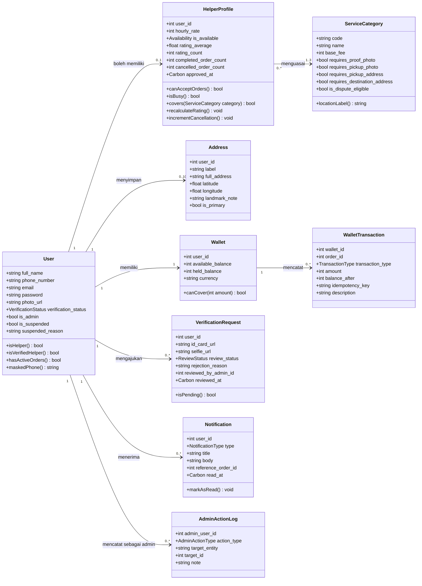
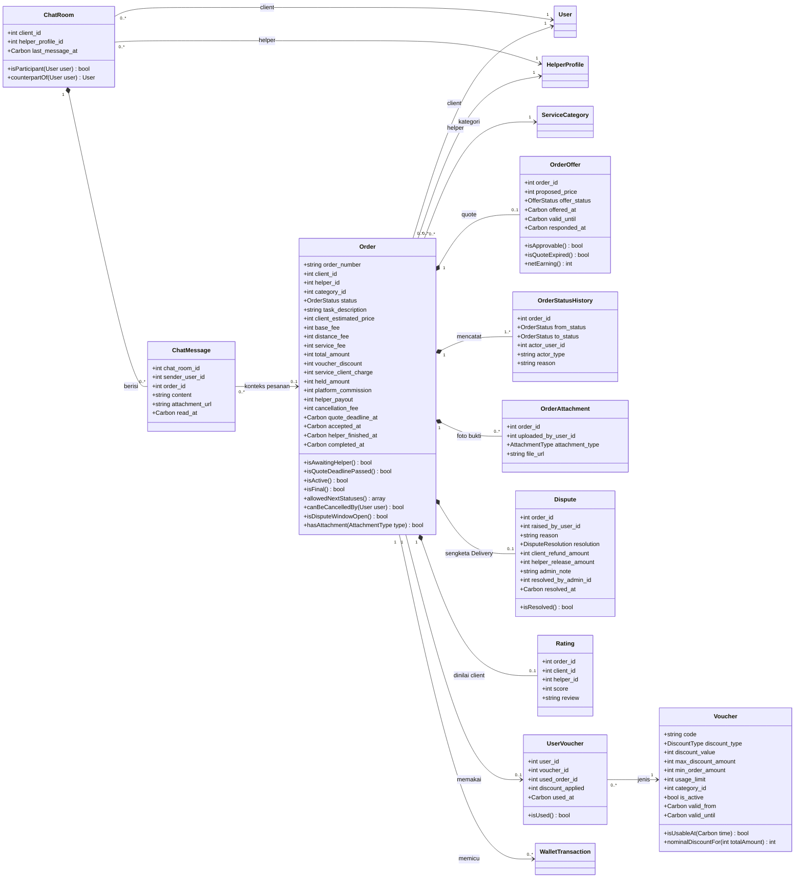

# Class Diagram

Status dokumen: `REVIEW` v0.2, 19 Oktober 2026. Diagram ini menurunkan `05_erd-draft.md` v0.4 dan aturan di `04_dual-role-transaction-analysis.md` v0.3 menjadi rancangan kelas untuk backend Laravel. Seluruh keputusan sampai DEC-27 sudah tercermin.

Perubahan dari v0.1 mengikuti DEC-25 sampai DEC-27 (`14_perubahan-model-marketplace.md`): kelas `PriceAdjustment` dan `PriceAdjustmentService` serta enumerasi `BookingType` dan `AdjustmentStatus` dihapus, atribut dan method talangan dihapus dari `HelperProfile`, `ServiceCategory`, dan `Order`, `OrderOffer` menjadi quote satu per pesanan, `ChatRoom` berpindah dari milik pesanan menjadi milik pasangan client dan helper, dan `ChatService` ditambahkan. Gambar StarUML yang sesuai versi ini ada di `TolonginDong StarUML v0.2.mdj`.

## 1. Cara membaca dokumen ini

ERD menjawab bagaimana data disimpan. Class diagram menjawab objek apa yang ada dan perilaku apa yang dimiliki tiap objek. Karena itu diagram ini memuat method, sedangkan ERD tidak.

Rancangan mengikuti pola yang lazim di Laravel. Model Eloquent menyimpan data dan perilaku sederhana yang hanya menyentuh dirinya sendiri, misalnya `Order::canBeCancelledBy()`. Aturan yang menyentuh lebih dari satu model atau memindahkan uang ditempatkan di kelas service, misalnya `EscrowService::hold()` yang mengubah `Order`, `Wallet`, dan `WalletTransaction` dalam satu transaksi basis data. Dengan pembagian ini, seluruh invarian uang (INV-01 sampai INV-04, INV-09 sampai INV-12, INV-18) punya satu tempat penegakan.

Diagram dipecah menjadi empat bagian supaya tetap terbaca:

1. Akun, helper, dan dompet.
2. Pesanan dan turunannya.
3. Enumerasi.
4. Service layer.

Konvensi penulisan:
- Atribut memakai `snake_case` sama dengan kolom basis data, karena Eloquent membaca atribut langsung dari kolom.
- Method memakai `camelCase` sesuai PSR-12.
- Tipe `int` untuk seluruh nominal uang (rupiah penuh, dari kolom `bigint`), `Carbon` untuk waktu.
- `+` publik, `-` privat. Atribut `id`, `created_at`, dan `updated_at` tidak ditulis ulang di setiap kelas.

Versi resmi untuk SRS dan SDD sebaiknya digambar ulang di draw.io atau StarUML dari diagram ini. Mermaid dipakai di repo karena bisa ditinjau langsung di GitHub dan dilacak perubahannya lewat git.

## 2. Akun, helper, dan dompet

Catatan bagian ini:

- `User` selalu punya kapabilitas client. `HelperProfile` bersifat opsional dan baru aktif setelah verifikasi (DEC-01). Karena itu `isHelper()` hanya memeriksa keberadaan profil, sedangkan `isVerifiedHelper()` juga memeriksa `verification_status`.
- `hasActiveOrders()` dipakai `AdminService` sebelum suspend. Method ini mencari pesanan berstatus `accepted` sampai `awaiting_confirmation` atau `disputed`, baik sebagai client maupun helper (DEC-22, disesuaikan DEC-26).
- `canAcceptOrders()` bernilai benar kalau helper `verified`, `available`, dan pemilik akunnya tidak disuspend. `isBusy()` bernilai benar kalau helper memegang pesanan `accepted` sampai `awaiting_confirmation`. API-HLP-01 memakai keduanya untuk mengisi `can_be_ordered` dan label sedang sibuk (FR-HLP-011). `covers()` memeriksa kategori lewat pivot `helper_service_categories`.
- `locationLabel()` mengembalikan "Lokasi pengerjaan" untuk Personal dan Household, dan "Alamat tujuan" untuk kategori lain (DEC-16).
- Multiplisitas `0..10` pada alamat berasal dari FR-PRF-002, dan `1..3` pada kategori dari FR-HLP-008 (turun dari `1..6` sejak DEC-25). Relasi kategori helper disimpan di tabel pivot `helper_service_categories`.
- `Wallet` sengaja tidak punya method yang mengubah saldo. Saldo hanya boleh berubah lewat `EscrowService` atau `WalletService` di bagian 5, supaya setiap perubahan selalu disertai baris `WalletTransaction` dan kunci baris `SELECT ... FOR UPDATE`.

## 3. Pesanan dan turunannya

Catatan bagian ini:

- Komposisi (belah ketupat penuh) dipakai untuk objek yang tidak punya arti tanpa pemiliknya: quote, riwayat status, lampiran, sengketa, dan rating milik pesanan, serta pesan milik ruang chat. Asosiasi biasa dipakai untuk objek yang hidup mandiri seperti `User`, `ServiceCategory`, dan `Voucher`.
- `Order` ke `HelperProfile` bermultiplisitas `1` sejak 19 Oktober 2026. Client memilih helper sebelum pesanan dibuat, jadi `helper_id` selalu terisi dan tidak pernah berubah (INV-17).
- `Order` ke `OrderOffer` bermultiplisitas `0..1`. Selama helper belum merespons, belum ada quote. `isAwaitingHelper()` bernilai benar kalau status `awaiting_quote` dan belum ada quote, sehingga Mobile tahu harus menampilkan layar menunggu helper atau layar persetujuan quote.
- `ChatRoom` tidak lagi menjadi bagian dari `Order`. Ruang chat milik pasangan `User` sebagai client dan `HelperProfile` (DEC-27), dan dibuat sebelum pesanan atau otomatis saat permintaan pesanan dikirim. Hubungan ke pesanan hanya lewat `ChatMessage.order_id` yang opsional, dipakai admin saat membaca bukti sengketa.
- `allowedNextStatuses()` membaca tabel transisi `OrderStateMachine` di bagian 5, lalu memfilter berdasarkan kategori. Contohnya, `disputed` hanya muncul kalau kategori `is_dispute_eligible`. API-ORD-03 dan API-ORD-05 mengirim hasil method ini ke Mobile.
- `netEarning()` pada `OrderOffer` mengembalikan `proposed_price - floor(proposed_price x 10%)` untuk layar helper (FR-ORD-006). Angka ini tidak pernah dipengaruhi voucher (INV-12).
- `nominalDiscountFor()` pada `Voucher` menghitung diskon mentah dari jenis voucher. Pembatasan terhadap komisi dilakukan `SettlementCalculator`, bukan di sini, supaya aturan INV-11 hanya ada di satu tempat.

## 4. Enumerasi

```mermaid
classDiagram
    direction LR

    class OrderStatus {
        <<enumeration>>
        DRAFT
        AWAITING_QUOTE
        ACCEPTED
        ON_THE_WAY
        ARRIVED
        IN_PROGRESS
        AWAITING_CONFIRMATION
        COMPLETED
        CANCELLED_BY_CLIENT
        CANCELLED_BY_HELPER
        CANCELLED_BY_ADMIN
        EXPIRED
        DISPUTED
        REFUNDED
        PARTIALLY_REFUNDED
    }

    class OfferStatus {
        <<enumeration>>
        SUBMITTED
        CONFIRMED
        EXPIRED
        WITHDRAWN
    }

    class AttachmentType {
        <<enumeration>>
        PICKUP_PROOF
        COMPLETION_PROOF
        DISPUTE_EVIDENCE
    }

    class TransactionType {
        <<enumeration>>
        TOPUP
        HOLD
        RELEASE
        REFUND
        PAYOUT
        CANCELLATION_FEE
    }

    class DisputeResolution {
        <<enumeration>>
        PENDING
        FAVOR_CLIENT
        FAVOR_HELPER
        SPLIT
    }

    class VerificationStatus {
        <<enumeration>>
        UNVERIFIED
        PENDING
        VERIFIED
        REJECTED
    }

    class ReviewStatus {
        <<enumeration>>
        PENDING
        VERIFIED
        REJECTED
    }

    class Availability {
        <<enumeration>>
        AVAILABLE
        UNAVAILABLE
    }

    class DiscountType {
        <<enumeration>>
        FIXED
        PERCENTAGE
    }

    class AdminActionType {
        <<enumeration>>
        APPROVE_VERIFICATION
        REJECT_VERIFICATION
        RESOLVE_DISPUTE
        SUSPEND_ACCOUNT
        REACTIVATE_ACCOUNT
        CANCEL_ORDER
        CREATE_VOUCHER
        UPDATE_VOUCHER
        DEACTIVATE_VOUCHER
    }

    class NotificationType {
        <<enumeration>>
        ORDER_OFFER
        ORDER_STATUS_CHANGE
        CHAT_MESSAGE
        DISPUTE_UPDATE
        WALLET_MUTATION
        PROMO
    }
```

Di Laravel, setiap enumerasi menjadi PHP backed enum (`enum OrderStatus: string`) dengan nilai huruf kecil sama persis dengan isi kolom basis data, misalnya `case AwaitingQuote = 'awaiting_quote'`. Huruf besar di diagram hanya konvensi UML.

Enumerasi yang dihapus 19 Oktober 2026: `BookingType` (jenis pesanan tinggal satu) dan `AdjustmentStatus` (talangan dihapus). Nilai yang dihapus dari enumerasi lain tercatat di `05_erd-draft.md` bagian 4.

`ReviewStatus` ditulis terpisah dari `VerificationStatus` karena `verification_request.review_status` tidak punya nilai `unverified`. Nilai `unverified` hanya berlaku pada ringkasan di `user.verification_status`.

## 5. Service layer

```mermaid
classDiagram
    direction TB

    class OrderStateMachine {
        -array transitions
        +canTransition(Order order, OrderStatus to) bool
        +transition(Order order, OrderStatus to, User actor, string reason) void
        -assertPhotoRequirements(Order order, OrderStatus to) void
        -recordHistory(Order order, OrderStatus from, OrderStatus to, User actor) void
    }

    class HelperSearchService {
        +search(User client, string categoryCode, float lat, float lng, string sort) array
        +detail(User client, HelperProfile helper) HelperDetail
    }

    class ChatService {
        +openRoom(User client, HelperProfile helper) ChatRoom
        +send(ChatRoom room, User sender, string content, string attachmentUrl) ChatMessage
        -assertDailyRoomLimit(User client) void
        -activeOrderOf(ChatRoom room) Order
    }

    class OrderService {
        +estimate(EstimateRequest data) ReferencePricing
        +create(User client, CreateOrderRequest data) Order
        +resendToHelper(Order expiredOrder, HelperProfile newHelper) Order
        +expireQuoteRequest(Order order, string reason) void
        +autoConfirm(Order order) void
        -assertHelperOrderable(User client, HelperProfile helper, ServiceCategory category) void
    }

    class OfferService {
        +submitQuote(Order order, HelperProfile helper, int price) OrderOffer
        +approve(Order order, OrderOffer offer, string idempotencyKey) Order
        +decline(Order order, HelperProfile helper, string reason) Order
        +expireQuote(OrderOffer offer) void
        -expireOtherRequests(HelperProfile helper, Order accepted) void
    }

    class EscrowService {
        +hold(Order order, string idempotencyKey) void
        +settle(Order order, SettlementResult result, string idempotencyKey) void
        -lockWallets(Order order) void
        -writeLedger(Wallet wallet, TransactionType type, int amount, string key) void
    }

    class SettlementCalculator {
        +pricing(int totalAmount, Voucher voucher) PricingResult
        +completion(Order order) SettlementResult
        +cancellation(Order order, int cancellationFee) SettlementResult
        +fullRefund(Order order) SettlementResult
        +disputeResolution(Order order, DisputeResolution resolution) SettlementResult
        -grossCommission(int totalAmount) int
    }

    class CancellationPolicy {
        +quote(Order order, User actor) CancellationQuote
        -clientFee(Order order) int
        -isVoucherReturned(Order order, int fee) bool
    }

    class VoucherService {
        +validateOnApproval(Order order, int proposedPrice) VoucherCheck
        +consume(UserVoucher userVoucher, Order order, int discount) void
        +release(UserVoucher userVoucher) void
        +validateDefinition(VoucherRequest data) void
    }

    class DisputeService {
        +raise(Order order, User actor, string reason, array evidenceIds) Dispute
        +resolve(Dispute dispute, User admin, DisputeResolution resolution, string note) Dispute
    }

    class AdminService {
        +suspendUser(User admin, User target, string reason) void
        +reactivateUser(User admin, User target) void
        +cancelOrder(User admin, Order order, string reason) Order
        +log(User admin, AdminActionType type, string entity, int id, string note) void
    }

    class VerificationService {
        +submit(User user, string idCardUrl, string selfieUrl) VerificationRequest
        +approve(User admin, VerificationRequest request) void
        +reject(User admin, VerificationRequest request, string reason) void
    }

    class NotificationService {
        +notify(User user, NotificationType type, string title, string body, Order order) void
    }

    class SettlementResult {
        <<value object>>
        +int helper_release
        +int helper_payout
        +int cancellation_fee
        +int platform_commission
        +int client_refund
        +assertBalanced(int heldAmount) void
    }

    class PricingResult {
        <<value object>>
        +int total_amount
        +int voucher_discount
        +int service_client_charge
        +int held_amount
    }

    class CancellationQuote {
        <<value object>>
        +bool cancellable
        +int cancellation_fee
        +int client_refund
        +bool voucher_returned
        +string rule
    }

    OrderService --> OrderStateMachine
    OrderService --> ChatService
    OrderService --> SettlementCalculator
    OfferService --> OrderStateMachine
    OfferService --> EscrowService
    OfferService --> VoucherService
    OfferService --> SettlementCalculator
    CancellationPolicy --> SettlementCalculator
    DisputeService --> SettlementCalculator
    DisputeService --> EscrowService
    DisputeService --> OrderStateMachine
    AdminService --> CancellationPolicy
    AdminService --> EscrowService
    AdminService --> OrderStateMachine
    AdminService --> VoucherService
    SettlementCalculator ..> SettlementResult : membuat
    SettlementCalculator ..> PricingResult : membuat
    CancellationPolicy ..> CancellationQuote : membuat
    OrderStateMachine --> NotificationService
    EscrowService --> NotificationService
    ChatService --> NotificationService
```

### 5.1 Peran tiap service

`OrderStateMachine` adalah satu-satunya jalan untuk mengubah `orders.status`. Tabel transisinya adalah salinan state machine di `04` bagian 4. Setiap transisi menulis satu baris `OrderStatusHistory` (INV-07), memicu notifikasi (FR-NOT-002), dan memeriksa syarat foto sebelum transisi `arrived` ke `in_progress` pada kategori `requires_pickup_photo` (FR-ORD-021) serta `in_progress` ke `awaiting_confirmation` pada kategori `requires_proof_photo` (FR-ORD-013).

`HelperSearchService` menyusun daftar helper untuk API-HLP-01 dan API-HLP-02. Service ini hanya membaca data. Penyaringannya memakai `HelperProfile::canAcceptOrders()` dan `covers()`, menyembunyikan profil milik client sendiri (FR-ORD-016), lalu menandai helper yang `isBusy()` (FR-HLP-011).

`ChatService` adalah service baru 19 Oktober 2026. `openRoom()` mengembalikan ruang yang sudah ada untuk pasangan client dan helper atau membuat ruang baru, menolak kalau pemanggilnya bukan client, kalau helper milik client sendiri (INV-05), atau kalau client sudah membuka 20 ruang baru hari itu (FR-CHT-010). `send()` mengisi `ChatMessage.order_id` dari pesanan pasangan itu yang sedang berstatus `awaiting_quote` sampai `disputed`, memperbarui `last_message_at`, dan memicu notifikasi.

`SettlementCalculator` adalah satu-satunya tempat rumus uang. Kelas ini murni menghitung dan tidak menyentuh basis data, sehingga QA dan Backend bisa mengujinya dengan unit test tanpa menyiapkan data. Seluruh contoh angka di `05` bagian 2.2 menjadi test case kelas ini. Setiap hasilnya diperiksa `SettlementResult::assertBalanced()`, yang melempar galat kalau `helper_release + platform_commission + client_refund` tidak sama dengan `held_amount` (INV-09). `fullRefund()` dipakai untuk pembatalan oleh helper, pembatalan oleh admin, dan sengketa `favor_client`, karena ketiganya mengembalikan seluruh dana ke client tanpa komisi.

`EscrowService` adalah satu-satunya kelas yang mengubah saldo. Setiap method membuka transaksi basis data, mengunci baris dompet yang terlibat, menulis `WalletTransaction` dengan idempotency key, lalu memperbarui saldo. Method `holdAdditional()` versi v0.1 dihapus karena tidak ada lagi penahanan tambahan dari struk talangan.

`OrderService::create()` memanggil `assertHelperOrderable()` (helper `verified`, `available`, tidak disuspend, menguasai kategori, tidak sibuk, bukan milik client), membuat pesanan `awaiting_quote` dengan `quote_deadline_at`, lalu memanggil `ChatService::openRoom()` supaya ruang percakapan pasangan itu pasti ada (FR-CHT-007). `resendToHelper()` menggantikan `rebroadcast()` versi v0.1.

`OfferService` kini hanya menangani quote. `approve()` menjalankan pemeriksaan voucher terhadap `proposed_price` (DEC-23), memanggil `EscrowService::hold()`, mengubah status ke `accepted`, lalu memanggil `expireOtherRequests()` untuk FR-ORD-024, semuanya dalam satu transaksi basis data dengan kunci baris helper (INV-06). Method `select()` dan `confirm()` versi broadcast dihapus.

`CancellationPolicy` menerjemahkan tabel pembatalan `04` bagian 5 menjadi `CancellationQuote`. API-ORD-09A mengembalikan quote ini sebagai pratinjau, dan API-ORD-09 menghitungnya ulang saat pembatalan sungguhan.

`AdminService::suspendUser()` memanggil `User::hasActiveOrders()` dan menolak kalau hasilnya benar. Kalau lolos, service membatalkan seluruh pesanan `awaiting_quote` milik pengguna sebagai client maupun sebagai helper lewat `OrderStateMachine`, mengubah quote terkait menjadi `withdrawn`, dan mencabut token Sanctum. `cancelOrder()` menolak pesanan `disputed` dan `awaiting_quote`, lalu memakai `SettlementCalculator::fullRefund()` (DEC-22).

### 5.2 Proses terjadwal

Tiga proses berjalan lewat Laravel scheduler dan queue, dengan aktor `Sistem` di riwayat status:

| Proses | Method | Pemicu |
| --- | --- | --- |
| Helper tidak memberi quote atau menolak dalam 300 detik | `OrderService::expireQuoteRequest()` | Saat `quote_deadline_at` lewat dan belum ada quote |
| Client tidak menyetujui quote dalam 300 detik | `OfferService::expireQuote()` | Saat `order_offers.valid_until` lewat, quote menjadi `expired` dan pesanan `expired` |
| Client tidak mengonfirmasi | `OrderService::autoConfirm()` | 24 jam sejak `helper_finished_at` |

Proses jendela tawaran broadcast, batas konfirmasi 60 detik, dan penutupan ruang chat tujuh hari dihapus 19 Oktober 2026.

## 6. Pemetaan method ke requirement

| Method | FR atau aturan | Keputusan |
| --- | --- | --- |
| `HelperSearchService::search()` | FR-HLP-001 sampai FR-HLP-005, FR-HLP-011, FR-VER-004, FR-ORD-016 | DEC-25, DEC-26 |
| `HelperSearchService::detail()` | FR-HLP-010, FR-HLP-011, FR-CHT-008 | DEC-26, DEC-27 |
| `ChatService::openRoom()` | FR-CHT-006, FR-CHT-007, FR-CHT-010, INV-05, INV-16 | DEC-27 |
| `ChatService::send()` | FR-CHT-002, FR-CHT-009, FR-NOT-003, FR-ADM-005 | DEC-27 |
| `OrderService::create()` | FR-ORD-001, FR-ORD-003D, FR-ORD-016, FR-ORD-017 | DEC-21, DEC-26 |
| `OrderService::resendToHelper()` | FR-ORD-003D | DEC-26 |
| `OfferService::submitQuote()` | FR-ORD-003D, FR-ORD-006 | DEC-21 |
| `OfferService::approve()` | FR-ORD-003D, FR-ORD-024, FR-WLT-002, FR-WLT-011, INV-06 | DEC-21, DEC-23, DEC-26 |
| `OfferService::decline()` | FR-ORD-003D | DEC-21 |
| `EscrowService::hold()` | FR-WLT-002, FR-WLT-008, FR-WLT-009, INV-01, INV-03, INV-10, INV-18 | DEC-15 |
| `EscrowService::settle()` | FR-WLT-003, FR-WLT-004, INV-04, INV-09 | DEC-15 |
| `SettlementCalculator::pricing()` | FR-WLT-013, INV-11, INV-12 | DEC-14 nomor 5, DEC-15 |
| `SettlementCalculator::completion()` | FR-WLT-003 | DEC-15 |
| `SettlementCalculator::disputeResolution()` | FR-ADM-006 | DEC-24 |
| `CancellationPolicy::quote()` | FR-ORD-011, FR-ORD-023, FR-WLT-014 | DEC-19 |
| `VoucherService::validateOnApproval()` | FR-WLT-011, FR-WLT-012 | DEC-23 |
| `VoucherService::validateDefinition()` | FR-ADM-012 | DEC-23 |
| `DisputeService::raise()` | FR-ORD-018 | DEC-10 |
| `DisputeService::resolve()` | FR-ADM-005, FR-ADM-006 | DEC-24 |
| `AdminService::suspendUser()` | FR-ADM-009, INV-14 | DEC-22, DEC-26 |
| `AdminService::cancelOrder()` | FR-ADM-011 | DEC-22 |
| `AdminService::log()` | FR-ADM-008 | DEC-07 |
| `VerificationService::submit()` | FR-VER-002, FR-VER-007, INV-13 | DEC-14 nomor 7 |
| `OrderStateMachine::transition()` | FR-ORD-009, FR-ORD-013, FR-ORD-021, FR-NOT-002, INV-07 | DEC-16, DEC-24 |
| `OrderService::autoConfirm()` | FR-ORD-012 | |
| `HelperProfile::recalculateRating()` | FR-RTG-003 | DEC-09 |

## 7. Yang sengaja tidak masuk diagram

Controller, Form Request, API Resource, dan Policy Laravel tidak digambar. Kelas-kelas itu hanya meneruskan permintaan ke service di bagian 5 dan tidak memuat aturan bisnis, sehingga menggambarnya hanya menambah kotak tanpa menambah informasi. Tipe permintaan seperti `CreateOrderRequest` dan `VoucherRequest` muncul sebagai parameter method sebagai penanda saja.

Modul autentikasi (registrasi, OTP, login, refresh token) memakai Laravel Sanctum dan belum dirancang sebagai service tersendiri. Modul ini masuk revisi berikutnya bersama kontrak API autentikasi yang juga belum ditulis di `06`.

## 8. Hal yang perlu dicek Backend

| No | Hal | Alasan |
| --- | --- | --- |
| 1 | Pemakaian PHP backed enum untuk seluruh kolom enum | Supaya nilai di kode dan basis data tidak bisa berbeda |
| 2 | `SettlementCalculator` sebagai kelas murni tanpa akses basis data | Memungkinkan unit test rumus uang tanpa data uji |
| 3 | Pembagian `OfferService` dan `OrderService` | Kai boleh menggabungkan kalau dirasa terlalu terpecah, asal `EscrowService`, `SettlementCalculator`, dan `OrderStateMachine` tetap terpisah |
| 4 | `ChatService` dan `HelperSearchService` sebagai service terpisah | Baru 19 Oktober 2026. `HelperSearchService` boleh digabung ke query scope Eloquent kalau Kai lebih suka, asal aturan penyaringan tetap di satu tempat |
