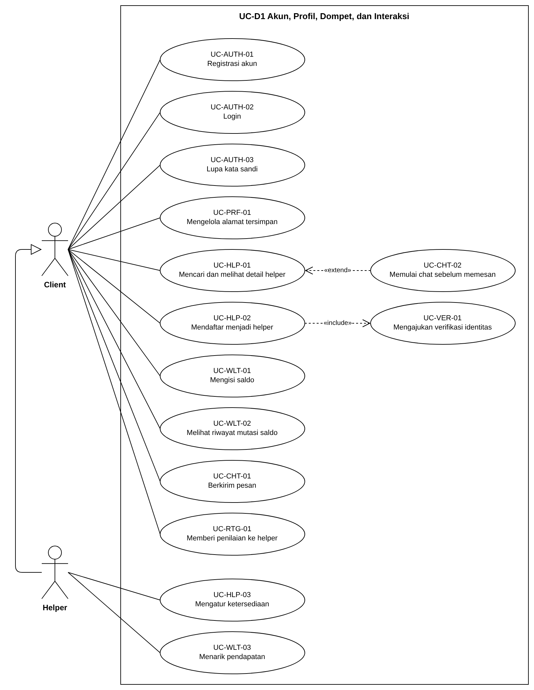
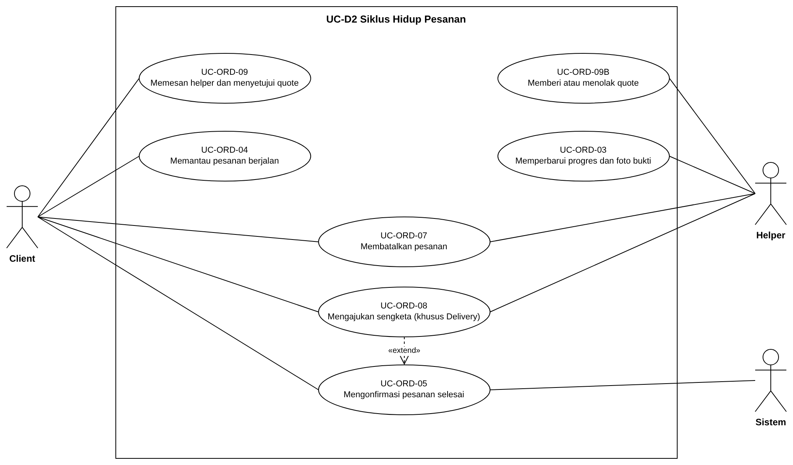
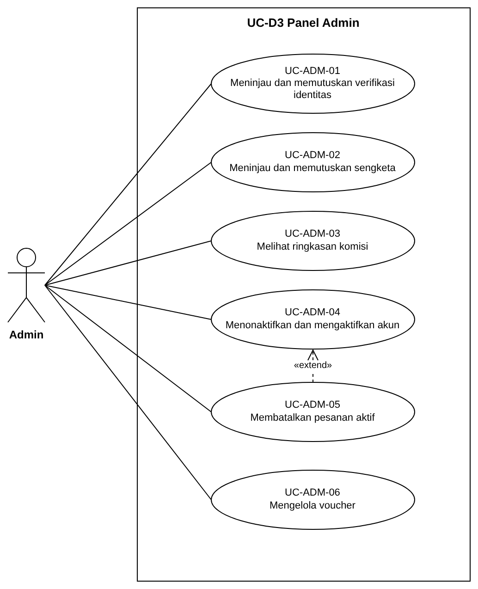
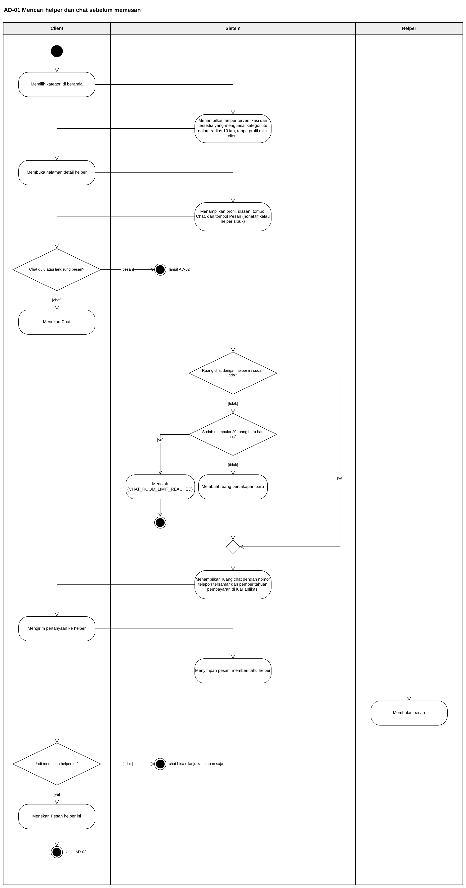
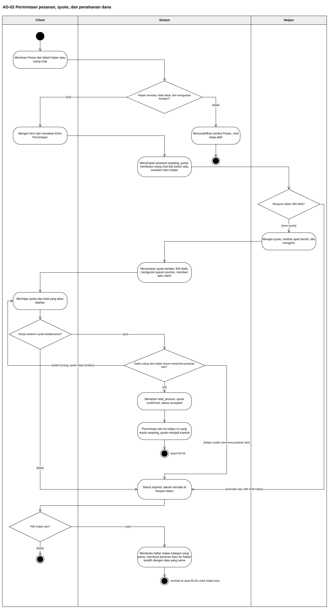
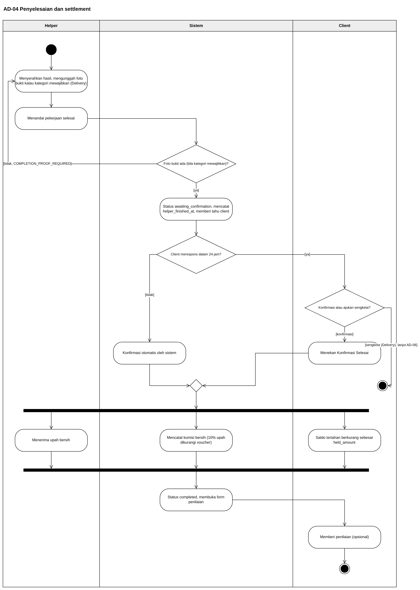
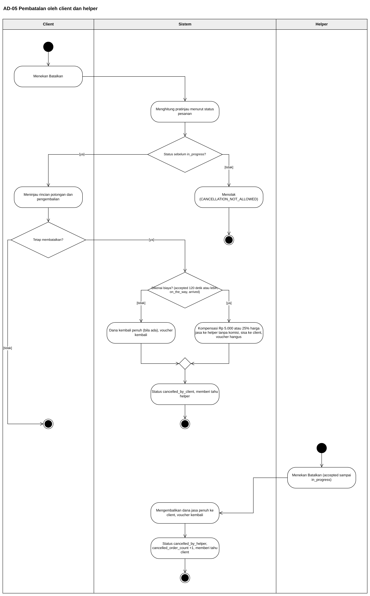
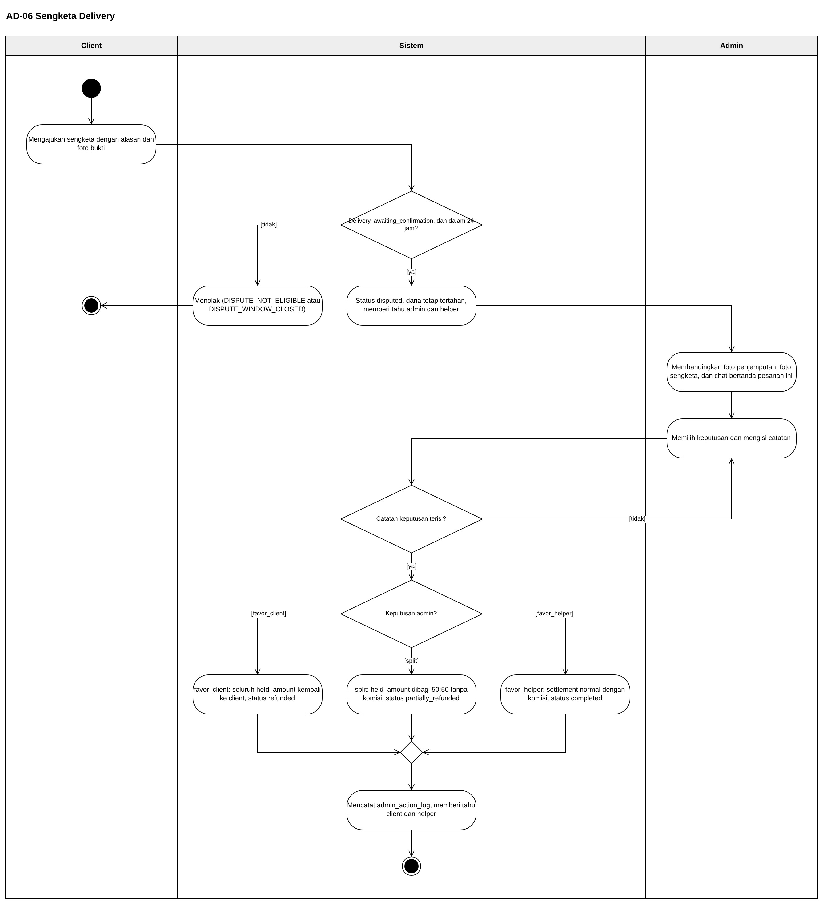
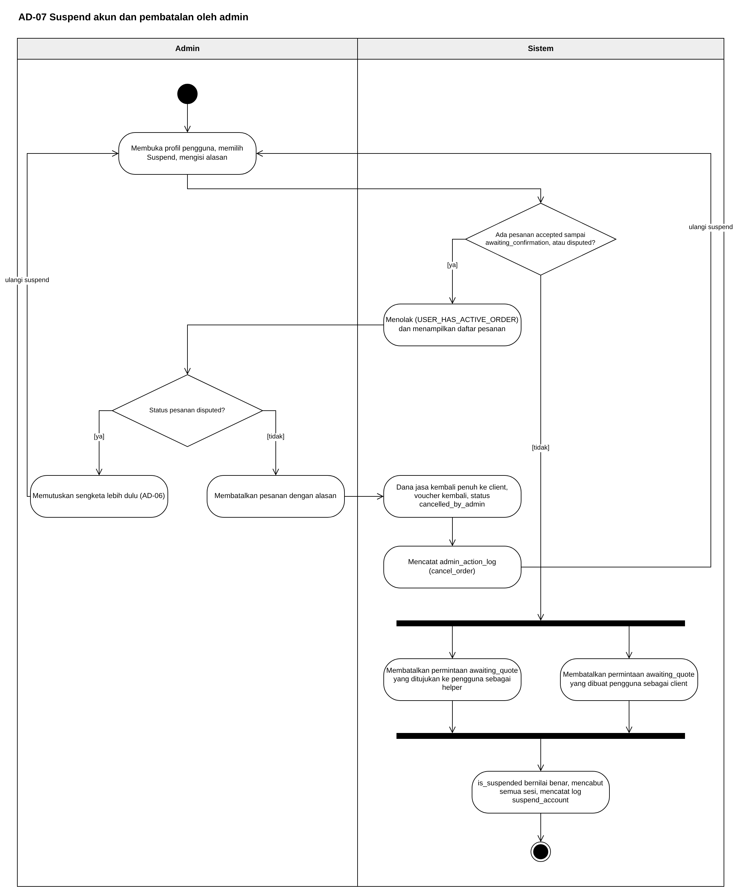
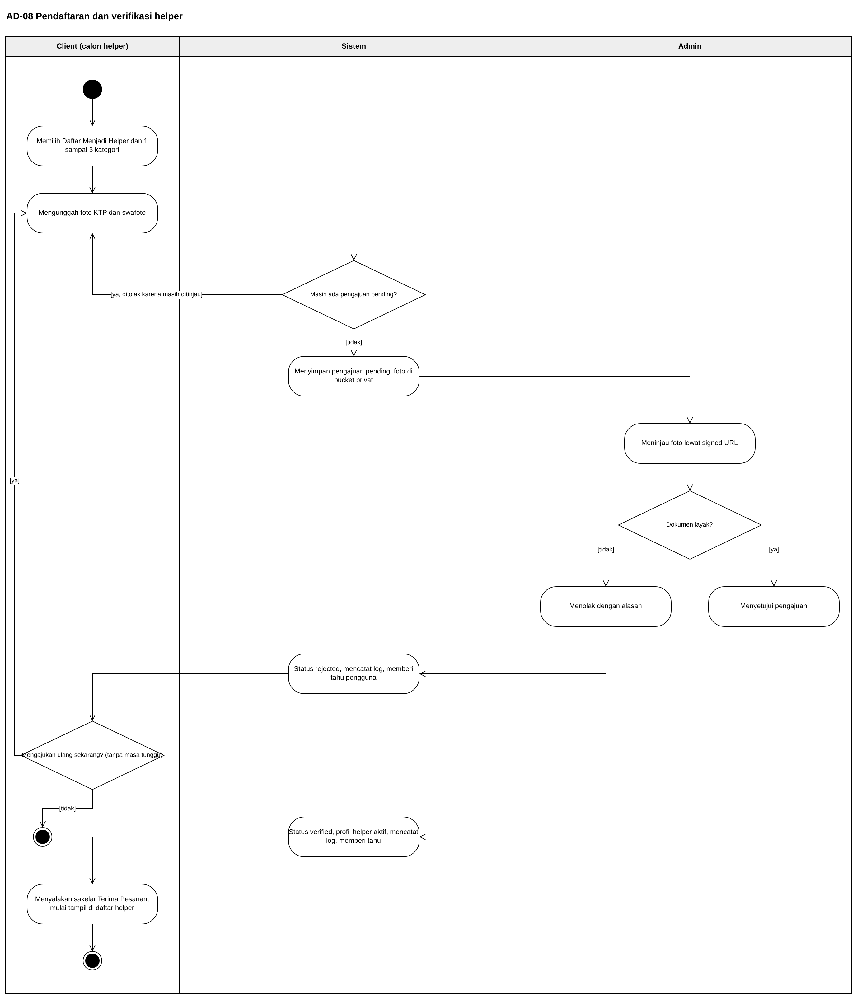

# Use Case Diagram dan Activity Diagram

Status dokumen: `REVIEW` v0.2, 19 Oktober 2026. Tiga use case diagram dan tujuh activity diagram aktif untuk SRS bagian 3.3.1 dan 3.3.2. Isinya diturunkan dari `03_use-case-inventory.md` v0.3, `04_dual-role-transaction-analysis.md` v0.3, `02_requirement-master-list.md` v0.3, dan `11_skenario-pengguna.md` v2.0, serta sudah mengikuti DEC-25 sampai DEC-27.

Perubahan dari v0.1 (29 September 2026): UC-D1, UC-D2, AD-01, dan AD-02 digambar ulang untuk model marketplace dan chat sebelum pesanan. AD-04, AD-05, AD-07, AD-08, dan AD-06 disesuaikan labelnya karena talangan dan broadcast dihapus. AD-03 (struk talangan) dipensiunkan bersama Food run dan Laundry. Kodenya tidak dipakai ulang, dan gambar `assets/13/AD-03.png` boleh dihapus dari repo. UC-D3 tidak berubah.

Setiap diagram tersedia dalam dua bentuk: gambar pratinjau di folder `assets/13/` supaya bisa ditinjau langsung di GitHub, dan XML draw.io yang bisa ditempel lalu diedit. Kalau diagram perlu diubah, ubah di draw.io lalu ekspor ulang gambarnya. Jangan mengedit gambar pratinjau saja, karena XML dan gambar akan berbeda.

## 1. Cara memasukkan ke draw.io

Ada dua cara. Pilih salah satu.

**Cara A, satu diagram per halaman (salin tempel).**

1. Buka draw.io (app.diagrams.net atau aplikasi desktop), buat diagram kosong.
2. Tambah halaman baru untuk setiap diagram lewat tombol `+` di bawah kanvas, lalu beri nama halaman sesuai kode diagram, misalnya `AD-01`.
3. Buka menu `Extras`, pilih `Edit Diagram`. Pada antarmuka berbahasa Indonesia menunya `Ekstra`, `Sunting Diagram`.
4. Hapus seluruh isi kotak teks, tempel XML dari blok di bawah (klik `XML draw.io ...` untuk membukanya), lalu tekan `OK`.
5. Semua bentuk langsung muncul dan bisa diedit seperti biasa.

**Cara B, semua sekaligus.** Buka file `assets/13/13_use-case-dan-activity-diagram.drawio` lewat `File`, `Open`. File ini berisi 10 halaman yang sama persis dengan XML di dokumen ini.

Untuk SRS, ekspor setiap halaman lewat `File`, `Export as`, `PNG`, dengan zoom 200 persen dan latar putih supaya tetap tajam di halaman A4.

## 2. Konvensi yang dipakai

Use case diagram memakai notasi UML standar: aktor stick figure, use case elips berisi kode dan nama, batas sistem persegi, garis asosiasi polos, generalisasi aktor dengan panah segitiga kosong, dan relasi `«include»` serta `«extend»` dengan garis putus-putus. Arah panah `«extend»` selalu dari use case tambahan ke use case dasar.

Activity diagram memakai swimlane per aktor, dengan urutan kolom yang mengikuti siapa memulai alur. Aksi berbentuk persegi membulat, keputusan berbentuk belah ketupat berisi pertanyaan dengan guard `[ya]` atau `[tidak]` di garis keluarnya, merge berbentuk belah ketupat kecil tanpa teks, dan fork atau join berupa batang hitam tebal untuk aksi yang berjalan bersamaan. Titik akhir yang diberi label `lanjut AD-xx` berarti alurnya berlanjut di activity diagram lain.

Istilah status (`awaiting_quote`, `accepted`, dan seterusnya) sengaja ditulis sama persis dengan nilai enum di `05_erd-draft.md`, supaya Backend dan QA bisa menelusuri langsung.

Use case dipecah menjadi tiga diagram, bukan satu, karena 28 use case aktif dalam satu gambar membuat garis asosiasi saling menimpa dan tidak terbaca di halaman A4. Pembagiannya mengikuti kelompok fungsi, sama seperti pengelompokan modul di `02`.

| Diagram | Isi | Aktor |
| --- | --- | --- |
| UC-D1 | Akun, profil, pencarian helper, chat sebelum memesan, dompet, percakapan, penilaian | Client, Helper |
| UC-D2 | Siklus hidup pesanan dari permintaan dan quote sampai selesai atau batal | Client, Helper, Sistem |
| UC-D3 | Panel admin | Admin |


## 3. Use case diagram

### UC-D1 Akun, Profil, Dompet, dan Interaksi



Helper digambar sebagai turunan (generalisasi) dari Client, mengikuti DEC-01: setiap helper adalah akun client yang mengaktifkan kapabilitas helper. Karena itu Helper otomatis mewarisi semua use case Client di diagram ini, termasuk berkirim pesan, dan hanya dua use case khusus helper yang digambar terpisah. UC-HLP-02 selalu menyertakan UC-VER-01 (`«include»`), karena mendaftar menjadi helper tidak bisa selesai tanpa verifikasi identitas. UC-CHT-02 memperluas UC-HLP-01 (`«extend»`) sejak 19 Oktober 2026: dari halaman detail helper, client boleh memulai chat sebelum memesan, tetapi langkah ini opsional (DEC-27).

<details>
<summary>XML draw.io UC-D1</summary>

```xml
<mxGraphModel dx="1200" dy="800" grid="1" gridSize="10" guides="1" tooltips="1" connect="1" arrows="1" fold="1" page="1" pageScale="1" pageWidth="1169" pageHeight="1654" math="0" shadow="0"><root><mxCell id="0" /><mxCell id="1" parent="0" /><mxCell id="uc01-bnd" value="UC-D1 Akun, Profil, Dompet, dan Interaksi" style="rounded=0;whiteSpace=wrap;html=1;verticalAlign=top;align=center;fontStyle=1;fontSize=13;fillColor=none;strokeColor=#000000;spacingTop=2;" vertex="1" parent="1"><mxGeometry x="200" y="0" width="620" height="1030" as="geometry" /></mxCell><mxCell id="uc01-client" value="Client" style="shape=umlActor;verticalLabelPosition=bottom;verticalAlign=top;html=1;outlineConnect=0;fontSize=12;fontStyle=1;" vertex="1" parent="1"><mxGeometry x="80" y="330" width="40" height="80" as="geometry" /></mxCell><mxCell id="uc01-helper" value="Helper" style="shape=umlActor;verticalLabelPosition=bottom;verticalAlign=top;html=1;outlineConnect=0;fontSize=12;fontStyle=1;" vertex="1" parent="1"><mxGeometry x="80" y="820" width="40" height="80" as="geometry" /></mxCell><mxCell id="uc01-a1" value="UC-AUTH-01&lt;br&gt;Registrasi akun" style="ellipse;whiteSpace=wrap;html=1;fontSize=11;fillColor=#ffffff;strokeColor=#000000;" vertex="1" parent="1"><mxGeometry x="260" y="50" width="220" height="64" as="geometry" /></mxCell><mxCell id="uc01-a2" value="UC-AUTH-02&lt;br&gt;Login" style="ellipse;whiteSpace=wrap;html=1;fontSize=11;fillColor=#ffffff;strokeColor=#000000;" vertex="1" parent="1"><mxGeometry x="260" y="130" width="220" height="64" as="geometry" /></mxCell><mxCell id="uc01-a3" value="UC-AUTH-03&lt;br&gt;Lupa kata sandi" style="ellipse;whiteSpace=wrap;html=1;fontSize=11;fillColor=#ffffff;strokeColor=#000000;" vertex="1" parent="1"><mxGeometry x="260" y="210" width="220" height="64" as="geometry" /></mxCell><mxCell id="uc01-p1" value="UC-PRF-01&lt;br&gt;Mengelola alamat tersimpan" style="ellipse;whiteSpace=wrap;html=1;fontSize=11;fillColor=#ffffff;strokeColor=#000000;" vertex="1" parent="1"><mxGeometry x="260" y="290" width="220" height="64" as="geometry" /></mxCell><mxCell id="uc01-h1" value="UC-HLP-01&lt;br&gt;Mencari dan melihat detail helper" style="ellipse;whiteSpace=wrap;html=1;fontSize=11;fillColor=#ffffff;strokeColor=#000000;" vertex="1" parent="1"><mxGeometry x="260" y="370" width="220" height="64" as="geometry" /></mxCell><mxCell id="uc01-h2" value="UC-HLP-02&lt;br&gt;Mendaftar menjadi helper" style="ellipse;whiteSpace=wrap;html=1;fontSize=11;fillColor=#ffffff;strokeColor=#000000;" vertex="1" parent="1"><mxGeometry x="260" y="450" width="220" height="64" as="geometry" /></mxCell><mxCell id="uc01-w1" value="UC-WLT-01&lt;br&gt;Mengisi saldo" style="ellipse;whiteSpace=wrap;html=1;fontSize=11;fillColor=#ffffff;strokeColor=#000000;" vertex="1" parent="1"><mxGeometry x="260" y="530" width="220" height="64" as="geometry" /></mxCell><mxCell id="uc01-w2" value="UC-WLT-02&lt;br&gt;Melihat riwayat mutasi saldo" style="ellipse;whiteSpace=wrap;html=1;fontSize=11;fillColor=#ffffff;strokeColor=#000000;" vertex="1" parent="1"><mxGeometry x="260" y="610" width="220" height="64" as="geometry" /></mxCell><mxCell id="uc01-c1" value="UC-CHT-01&lt;br&gt;Berkirim pesan" style="ellipse;whiteSpace=wrap;html=1;fontSize=11;fillColor=#ffffff;strokeColor=#000000;" vertex="1" parent="1"><mxGeometry x="260" y="690" width="220" height="64" as="geometry" /></mxCell><mxCell id="uc01-r1" value="UC-RTG-01&lt;br&gt;Memberi penilaian ke helper" style="ellipse;whiteSpace=wrap;html=1;fontSize=11;fillColor=#ffffff;strokeColor=#000000;" vertex="1" parent="1"><mxGeometry x="260" y="770" width="220" height="64" as="geometry" /></mxCell><mxCell id="uc01-h3" value="UC-HLP-03&lt;br&gt;Mengatur ketersediaan" style="ellipse;whiteSpace=wrap;html=1;fontSize=11;fillColor=#ffffff;strokeColor=#000000;" vertex="1" parent="1"><mxGeometry x="260" y="870" width="220" height="64" as="geometry" /></mxCell><mxCell id="uc01-w3" value="UC-WLT-03&lt;br&gt;Menarik pendapatan" style="ellipse;whiteSpace=wrap;html=1;fontSize=11;fillColor=#ffffff;strokeColor=#000000;" vertex="1" parent="1"><mxGeometry x="260" y="950" width="220" height="64" as="geometry" /></mxCell><mxCell id="uc01-v1" value="UC-VER-01&lt;br&gt;Mengajukan verifikasi identitas" style="ellipse;whiteSpace=wrap;html=1;fontSize=11;fillColor=#ffffff;strokeColor=#000000;" vertex="1" parent="1"><mxGeometry x="580" y="450" width="220" height="64" as="geometry" /></mxCell><mxCell id="uc01-x1" value="" style="endArrow=none;html=1;strokeColor=#000000;exitX=1;exitY=0.5;exitDx=0;exitDy=0;entryX=0;entryY=0.5;entryDx=0;entryDy=0;" edge="1" parent="1" source="uc01-client" target="uc01-a1"><mxGeometry relative="1" as="geometry" /></mxCell><mxCell id="uc01-x2" value="" style="endArrow=none;html=1;strokeColor=#000000;exitX=1;exitY=0.5;exitDx=0;exitDy=0;entryX=0;entryY=0.5;entryDx=0;entryDy=0;" edge="1" parent="1" source="uc01-client" target="uc01-a2"><mxGeometry relative="1" as="geometry" /></mxCell><mxCell id="uc01-x3" value="" style="endArrow=none;html=1;strokeColor=#000000;exitX=1;exitY=0.5;exitDx=0;exitDy=0;entryX=0;entryY=0.5;entryDx=0;entryDy=0;" edge="1" parent="1" source="uc01-client" target="uc01-a3"><mxGeometry relative="1" as="geometry" /></mxCell><mxCell id="uc01-x4" value="" style="endArrow=none;html=1;strokeColor=#000000;exitX=1;exitY=0.5;exitDx=0;exitDy=0;entryX=0;entryY=0.5;entryDx=0;entryDy=0;" edge="1" parent="1" source="uc01-client" target="uc01-p1"><mxGeometry relative="1" as="geometry" /></mxCell><mxCell id="uc01-x5" value="" style="endArrow=none;html=1;strokeColor=#000000;exitX=1;exitY=0.5;exitDx=0;exitDy=0;entryX=0;entryY=0.5;entryDx=0;entryDy=0;" edge="1" parent="1" source="uc01-client" target="uc01-h1"><mxGeometry relative="1" as="geometry" /></mxCell><mxCell id="uc01-x6" value="" style="endArrow=none;html=1;strokeColor=#000000;exitX=1;exitY=0.5;exitDx=0;exitDy=0;entryX=0;entryY=0.5;entryDx=0;entryDy=0;" edge="1" parent="1" source="uc01-client" target="uc01-h2"><mxGeometry relative="1" as="geometry" /></mxCell><mxCell id="uc01-x7" value="" style="endArrow=none;html=1;strokeColor=#000000;exitX=1;exitY=0.5;exitDx=0;exitDy=0;entryX=0;entryY=0.5;entryDx=0;entryDy=0;" edge="1" parent="1" source="uc01-client" target="uc01-w1"><mxGeometry relative="1" as="geometry" /></mxCell><mxCell id="uc01-x8" value="" style="endArrow=none;html=1;strokeColor=#000000;exitX=1;exitY=0.5;exitDx=0;exitDy=0;entryX=0;entryY=0.5;entryDx=0;entryDy=0;" edge="1" parent="1" source="uc01-client" target="uc01-w2"><mxGeometry relative="1" as="geometry" /></mxCell><mxCell id="uc01-x9" value="" style="endArrow=none;html=1;strokeColor=#000000;exitX=1;exitY=0.5;exitDx=0;exitDy=0;entryX=0;entryY=0.5;entryDx=0;entryDy=0;" edge="1" parent="1" source="uc01-client" target="uc01-c1"><mxGeometry relative="1" as="geometry" /></mxCell><mxCell id="uc01-x10" value="" style="endArrow=none;html=1;strokeColor=#000000;exitX=1;exitY=0.5;exitDx=0;exitDy=0;entryX=0;entryY=0.5;entryDx=0;entryDy=0;" edge="1" parent="1" source="uc01-client" target="uc01-r1"><mxGeometry relative="1" as="geometry" /></mxCell><mxCell id="uc01-x11" value="" style="endArrow=none;html=1;strokeColor=#000000;exitX=1;exitY=0.5;exitDx=0;exitDy=0;entryX=0;entryY=0.5;entryDx=0;entryDy=0;" edge="1" parent="1" source="uc01-helper" target="uc01-h3"><mxGeometry relative="1" as="geometry" /></mxCell><mxCell id="uc01-x12" value="" style="endArrow=none;html=1;strokeColor=#000000;exitX=1;exitY=0.5;exitDx=0;exitDy=0;entryX=0;entryY=0.5;entryDx=0;entryDy=0;" edge="1" parent="1" source="uc01-helper" target="uc01-w3"><mxGeometry relative="1" as="geometry" /></mxCell><mxCell id="uc01-x13" value="«include»" style="endArrow=open;endSize=10;dashed=1;html=1;strokeColor=#000000;fontSize=10;exitX=1;exitY=0.5;exitDx=0;exitDy=0;entryX=0;entryY=0.5;entryDx=0;entryDy=0;" edge="1" parent="1" source="uc01-h2" target="uc01-v1"><mxGeometry relative="1" as="geometry" /></mxCell><mxCell id="uc01-x14" value="" style="endArrow=block;endFill=0;endSize=14;html=1;strokeColor=#000000;exitX=0;exitY=0.5;exitDx=0;exitDy=0;entryX=0;entryY=0.5;entryDx=0;entryDy=0;" edge="1" parent="1" source="uc01-helper" target="uc01-client"><mxGeometry relative="1" as="geometry"><Array as="points"><mxPoint x="40" y="860" /><mxPoint x="40" y="370" /></Array></mxGeometry></mxCell><mxCell id="uc01-c2" value="UC-CHT-02&lt;br&gt;Memulai chat sebelum memesan" style="ellipse;whiteSpace=wrap;html=1;fontSize=11;fillColor=#ffffff;strokeColor=#000000;" vertex="1" parent="1"><mxGeometry x="580" y="370" width="220" height="64" as="geometry" /></mxCell><mxCell id="uc01-x15" value="«extend»" style="endArrow=open;endSize=10;dashed=1;html=1;strokeColor=#000000;fontSize=10;exitX=0;exitY=0.5;exitDx=0;exitDy=0;entryX=1;entryY=0.5;entryDx=0;entryDy=0;" edge="1" parent="1" source="uc01-c2" target="uc01-h1"><mxGeometry relative="1" as="geometry" /></mxCell></root></mxGraphModel>
```

</details>

### UC-D2 Siklus Hidup Pesanan



Di diagram ini Client dan Helper digambar di sisi berlawanan dan dihubungkan langsung, tanpa generalisasi, supaya terlihat jelas siapa memicu apa di setiap tahap pesanan. Sejak 19 Oktober 2026 pemesanan hanya punya satu pasangan use case: client memesan helper pilihannya dan menyetujui quote (UC-ORD-09), helper memberi atau menolak quote (UC-ORD-09B). Use case broadcast dan struk talangan dihapus (DEC-25, DEC-26). Sistem muncul sebagai aktor sekunder untuk konfirmasi otomatis setelah 24 jam (FR-ORD-012). UC-ORD-08 memperluas UC-ORD-05 hanya untuk pesanan Delivery (DEC-10).

<details>
<summary>XML draw.io UC-D2</summary>

```xml
<mxGraphModel dx="1200" dy="800" grid="1" gridSize="10" guides="1" tooltips="1" connect="1" arrows="1" fold="1" page="1" pageScale="1" pageWidth="1169" pageHeight="1654" math="0" shadow="0"><root><mxCell id="0" /><mxCell id="1" parent="0" /><mxCell id="uc02-bnd" value="UC-D2 Siklus Hidup Pesanan" style="rounded=0;whiteSpace=wrap;html=1;verticalAlign=top;align=center;fontStyle=1;fontSize=13;fillColor=none;strokeColor=#000000;spacingTop=2;" vertex="1" parent="1"><mxGeometry x="200" y="0" width="720" height="580" as="geometry" /></mxCell><mxCell id="uc02-client" value="Client" style="shape=umlActor;verticalLabelPosition=bottom;verticalAlign=top;html=1;outlineConnect=0;fontSize=12;fontStyle=1;" vertex="1" parent="1"><mxGeometry x="60" y="230" width="40" height="80" as="geometry" /></mxCell><mxCell id="uc02-helper" value="Helper" style="shape=umlActor;verticalLabelPosition=bottom;verticalAlign=top;html=1;outlineConnect=0;fontSize=12;fontStyle=1;" vertex="1" parent="1"><mxGeometry x="1020" y="200" width="40" height="80" as="geometry" /></mxCell><mxCell id="uc02-sistem" value="Sistem" style="shape=umlActor;verticalLabelPosition=bottom;verticalAlign=top;html=1;outlineConnect=0;fontSize=12;fontStyle=1;" vertex="1" parent="1"><mxGeometry x="1020" y="440" width="40" height="80" as="geometry" /></mxCell><mxCell id="uc02-o9" value="UC-ORD-09&lt;br&gt;Memesan helper dan menyetujui quote" style="ellipse;whiteSpace=wrap;html=1;fontSize=11;fillColor=#ffffff;strokeColor=#000000;" vertex="1" parent="1"><mxGeometry x="230" y="60" width="220" height="64" as="geometry" /></mxCell><mxCell id="uc02-o4" value="UC-ORD-04&lt;br&gt;Memantau pesanan berjalan" style="ellipse;whiteSpace=wrap;html=1;fontSize=11;fillColor=#ffffff;strokeColor=#000000;" vertex="1" parent="1"><mxGeometry x="230" y="160" width="220" height="64" as="geometry" /></mxCell><mxCell id="uc02-o9b" value="UC-ORD-09B&lt;br&gt;Memberi atau menolak quote" style="ellipse;whiteSpace=wrap;html=1;fontSize=11;fillColor=#ffffff;strokeColor=#000000;" vertex="1" parent="1"><mxGeometry x="690" y="60" width="220" height="64" as="geometry" /></mxCell><mxCell id="uc02-o3" value="UC-ORD-03&lt;br&gt;Memperbarui progres dan foto bukti" style="ellipse;whiteSpace=wrap;html=1;fontSize=11;fillColor=#ffffff;strokeColor=#000000;" vertex="1" parent="1"><mxGeometry x="690" y="160" width="220" height="64" as="geometry" /></mxCell><mxCell id="uc02-o7" value="UC-ORD-07&lt;br&gt;Membatalkan pesanan" style="ellipse;whiteSpace=wrap;html=1;fontSize=11;fillColor=#ffffff;strokeColor=#000000;" vertex="1" parent="1"><mxGeometry x="460" y="270" width="220" height="64" as="geometry" /></mxCell><mxCell id="uc02-o8" value="UC-ORD-08&lt;br&gt;Mengajukan sengketa (khusus Delivery)" style="ellipse;whiteSpace=wrap;html=1;fontSize=11;fillColor=#ffffff;strokeColor=#000000;" vertex="1" parent="1"><mxGeometry x="460" y="360" width="220" height="64" as="geometry" /></mxCell><mxCell id="uc02-o5" value="UC-ORD-05&lt;br&gt;Mengonfirmasi pesanan selesai" style="ellipse;whiteSpace=wrap;html=1;fontSize=11;fillColor=#ffffff;strokeColor=#000000;" vertex="1" parent="1"><mxGeometry x="460" y="460" width="220" height="64" as="geometry" /></mxCell><mxCell id="uc02-x2" value="" style="endArrow=none;html=1;strokeColor=#000000;exitX=1;exitY=0.5;exitDx=0;exitDy=0;entryX=0;entryY=0.5;entryDx=0;entryDy=0;" edge="1" parent="1" source="uc02-client" target="uc02-o9"><mxGeometry relative="1" as="geometry" /></mxCell><mxCell id="uc02-x4" value="" style="endArrow=none;html=1;strokeColor=#000000;exitX=1;exitY=0.5;exitDx=0;exitDy=0;entryX=0;entryY=0.5;entryDx=0;entryDy=0;" edge="1" parent="1" source="uc02-client" target="uc02-o4"><mxGeometry relative="1" as="geometry" /></mxCell><mxCell id="uc02-x6" value="" style="endArrow=none;html=1;strokeColor=#000000;exitX=1;exitY=0.5;exitDx=0;exitDy=0;entryX=0;entryY=0.5;entryDx=0;entryDy=0;" edge="1" parent="1" source="uc02-client" target="uc02-o7"><mxGeometry relative="1" as="geometry" /></mxCell><mxCell id="uc02-x7" value="" style="endArrow=none;html=1;strokeColor=#000000;exitX=1;exitY=0.5;exitDx=0;exitDy=0;entryX=0;entryY=0.5;entryDx=0;entryDy=0;" edge="1" parent="1" source="uc02-client" target="uc02-o8"><mxGeometry relative="1" as="geometry" /></mxCell><mxCell id="uc02-x8" value="" style="endArrow=none;html=1;strokeColor=#000000;exitX=1;exitY=0.5;exitDx=0;exitDy=0;entryX=0;entryY=0.5;entryDx=0;entryDy=0;" edge="1" parent="1" source="uc02-client" target="uc02-o5"><mxGeometry relative="1" as="geometry" /></mxCell><mxCell id="uc02-x10" value="" style="endArrow=none;html=1;strokeColor=#000000;exitX=0;exitY=0.5;exitDx=0;exitDy=0;entryX=1;entryY=0.5;entryDx=0;entryDy=0;" edge="1" parent="1" source="uc02-helper" target="uc02-o9b"><mxGeometry relative="1" as="geometry" /></mxCell><mxCell id="uc02-x12" value="" style="endArrow=none;html=1;strokeColor=#000000;exitX=0;exitY=0.5;exitDx=0;exitDy=0;entryX=1;entryY=0.5;entryDx=0;entryDy=0;" edge="1" parent="1" source="uc02-helper" target="uc02-o3"><mxGeometry relative="1" as="geometry" /></mxCell><mxCell id="uc02-x14" value="" style="endArrow=none;html=1;strokeColor=#000000;exitX=0;exitY=0.5;exitDx=0;exitDy=0;entryX=1;entryY=0.5;entryDx=0;entryDy=0;" edge="1" parent="1" source="uc02-helper" target="uc02-o7"><mxGeometry relative="1" as="geometry" /></mxCell><mxCell id="uc02-x15" value="" style="endArrow=none;html=1;strokeColor=#000000;exitX=0;exitY=0.5;exitDx=0;exitDy=0;entryX=1;entryY=0.5;entryDx=0;entryDy=0;" edge="1" parent="1" source="uc02-helper" target="uc02-o8"><mxGeometry relative="1" as="geometry" /></mxCell><mxCell id="uc02-x16" value="" style="endArrow=none;html=1;strokeColor=#000000;exitX=0;exitY=0.5;exitDx=0;exitDy=0;entryX=1;entryY=0.5;entryDx=0;entryDy=0;" edge="1" parent="1" source="uc02-sistem" target="uc02-o5"><mxGeometry relative="1" as="geometry" /></mxCell><mxCell id="uc02-x18" value="«extend»" style="endArrow=open;endSize=10;dashed=1;html=1;strokeColor=#000000;fontSize=10;exitX=0.5;exitY=1;exitDx=0;exitDy=0;entryX=0.5;entryY=0;entryDx=0;entryDy=0;" edge="1" parent="1" source="uc02-o8" target="uc02-o5"><mxGeometry relative="1" as="geometry" /></mxCell></root></mxGraphModel>
```

</details>

### UC-D3 Panel Admin



UC-ADM-05 memperluas UC-ADM-04 (`«extend»`): admin membatalkan pesanan aktif hanya ketika suspend ditolak karena pengguna masih punya pesanan berjalan (DEC-22). Admin tetap bisa membatalkan pesanan tanpa niat suspend, sehingga UC-ADM-05 juga terhubung langsung ke aktor. Diagram ini tidak berubah pada v0.2.

<details>
<summary>XML draw.io UC-D3</summary>

```xml
<mxGraphModel dx="1200" dy="800" grid="1" gridSize="10" guides="1" tooltips="1" connect="1" arrows="1" fold="1" page="1" pageScale="1" pageWidth="1169" pageHeight="1654" math="0" shadow="0"><root><mxCell id="0"/><mxCell id="1" parent="0"/><mxCell id="uc03-bnd" value="UC-D3 Panel Admin" style="rounded=0;whiteSpace=wrap;html=1;verticalAlign=top;align=center;fontStyle=1;fontSize=13;fillColor=none;strokeColor=#000000;spacingTop=2;" vertex="1" parent="1"><mxGeometry x="200" y="0" width="360" height="620" as="geometry"/></mxCell><mxCell id="uc03-admin" value="Admin" style="shape=umlActor;verticalLabelPosition=bottom;verticalAlign=top;html=1;outlineConnect=0;fontSize=12;fontStyle=1;" vertex="1" parent="1"><mxGeometry x="60" y="260" width="40" height="80" as="geometry"/></mxCell><mxCell id="uc03-d1" value="UC-ADM-01&lt;br&gt;Meninjau dan memutuskan verifikasi identitas" style="ellipse;whiteSpace=wrap;html=1;fontSize=11;fillColor=#ffffff;strokeColor=#000000;" vertex="1" parent="1"><mxGeometry x="280" y="50" width="220" height="64" as="geometry"/></mxCell><mxCell id="uc03-d2" value="UC-ADM-02&lt;br&gt;Meninjau dan memutuskan sengketa" style="ellipse;whiteSpace=wrap;html=1;fontSize=11;fillColor=#ffffff;strokeColor=#000000;" vertex="1" parent="1"><mxGeometry x="280" y="135" width="220" height="64" as="geometry"/></mxCell><mxCell id="uc03-d3" value="UC-ADM-03&lt;br&gt;Melihat ringkasan komisi" style="ellipse;whiteSpace=wrap;html=1;fontSize=11;fillColor=#ffffff;strokeColor=#000000;" vertex="1" parent="1"><mxGeometry x="280" y="220" width="220" height="64" as="geometry"/></mxCell><mxCell id="uc03-d4" value="UC-ADM-04&lt;br&gt;Menonaktifkan dan mengaktifkan akun" style="ellipse;whiteSpace=wrap;html=1;fontSize=11;fillColor=#ffffff;strokeColor=#000000;" vertex="1" parent="1"><mxGeometry x="280" y="305" width="220" height="64" as="geometry"/></mxCell><mxCell id="uc03-d5" value="UC-ADM-05&lt;br&gt;Membatalkan pesanan aktif" style="ellipse;whiteSpace=wrap;html=1;fontSize=11;fillColor=#ffffff;strokeColor=#000000;" vertex="1" parent="1"><mxGeometry x="280" y="405" width="220" height="64" as="geometry"/></mxCell><mxCell id="uc03-d6" value="UC-ADM-06&lt;br&gt;Mengelola voucher" style="ellipse;whiteSpace=wrap;html=1;fontSize=11;fillColor=#ffffff;strokeColor=#000000;" vertex="1" parent="1"><mxGeometry x="280" y="500" width="220" height="64" as="geometry"/></mxCell><mxCell id="uc03-x1" value="" style="endArrow=none;html=1;strokeColor=#000000;exitX=1;exitY=0.5;exitDx=0;exitDy=0;entryX=0;entryY=0.5;entryDx=0;entryDy=0;" edge="1" parent="1" source="uc03-admin" target="uc03-d1"><mxGeometry relative="1" as="geometry"></mxGeometry></mxCell><mxCell id="uc03-x2" value="" style="endArrow=none;html=1;strokeColor=#000000;exitX=1;exitY=0.5;exitDx=0;exitDy=0;entryX=0;entryY=0.5;entryDx=0;entryDy=0;" edge="1" parent="1" source="uc03-admin" target="uc03-d2"><mxGeometry relative="1" as="geometry"></mxGeometry></mxCell><mxCell id="uc03-x3" value="" style="endArrow=none;html=1;strokeColor=#000000;exitX=1;exitY=0.5;exitDx=0;exitDy=0;entryX=0;entryY=0.5;entryDx=0;entryDy=0;" edge="1" parent="1" source="uc03-admin" target="uc03-d3"><mxGeometry relative="1" as="geometry"></mxGeometry></mxCell><mxCell id="uc03-x4" value="" style="endArrow=none;html=1;strokeColor=#000000;exitX=1;exitY=0.5;exitDx=0;exitDy=0;entryX=0;entryY=0.5;entryDx=0;entryDy=0;" edge="1" parent="1" source="uc03-admin" target="uc03-d4"><mxGeometry relative="1" as="geometry"></mxGeometry></mxCell><mxCell id="uc03-x5" value="" style="endArrow=none;html=1;strokeColor=#000000;exitX=1;exitY=0.5;exitDx=0;exitDy=0;entryX=0;entryY=0.5;entryDx=0;entryDy=0;" edge="1" parent="1" source="uc03-admin" target="uc03-d5"><mxGeometry relative="1" as="geometry"></mxGeometry></mxCell><mxCell id="uc03-x6" value="" style="endArrow=none;html=1;strokeColor=#000000;exitX=1;exitY=0.5;exitDx=0;exitDy=0;entryX=0;entryY=0.5;entryDx=0;entryDy=0;" edge="1" parent="1" source="uc03-admin" target="uc03-d6"><mxGeometry relative="1" as="geometry"></mxGeometry></mxCell><mxCell id="uc03-x7" value="«extend»" style="endArrow=open;endSize=10;dashed=1;html=1;strokeColor=#000000;fontSize=10;exitX=0.5;exitY=0;exitDx=0;exitDy=0;entryX=0.5;entryY=1;entryDx=0;entryDy=0;" edge="1" parent="1" source="uc03-d5" target="uc03-d4"><mxGeometry relative="1" as="geometry"></mxGeometry></mxCell></root></mxGraphModel>
```

</details>

## 4. Activity diagram

Urutan diagram mengikuti alur pengguna. AD-02 dan AD-04 adalah alur tempat dana ditahan dan dilepas, jadi paling penting ditinjau lebih dulu oleh Backend dan QA.

| Kode | Alur | Aktor | Status |
| --- | --- | --- | --- |
| AD-01 | Mencari helper dan chat sebelum memesan | Client, Sistem, Helper | Digambar ulang 19 Okt 2026, sebelumnya pesanan broadcast |
| AD-02 | Permintaan pesanan, quote, dan penahanan dana | Client, Sistem, Helper | Digambar ulang 19 Okt 2026 |
| AD-03 | ~~Struk talangan Food run dan Laundry~~ | | Dipensiunkan 19 Okt 2026 (DEC-25) |
| AD-04 | Penyelesaian dan settlement | Helper, Sistem, Client | Disesuaikan |
| AD-05 | Pembatalan oleh client dan helper | Client, Sistem, Helper | Disesuaikan |
| AD-06 | Sengketa Delivery | Client, Sistem, Admin | Disesuaikan |
| AD-07 | Suspend akun dan pembatalan oleh admin | Admin, Sistem | Disesuaikan |
| AD-08 | Pendaftaran dan verifikasi helper | Client, Sistem, Admin | Disesuaikan |

### AD-01 Mencari helper dan chat sebelum memesan

Keterlacakan: UC-HLP-01, UC-CHT-02, UC-CHT-01. FR-HLP-001 s.d. FR-HLP-005, FR-HLP-010, FR-HLP-011, FR-CHT-006 s.d. FR-CHT-010, FR-ORD-016. DEC-25, DEC-26, DEC-27.



Daftar helper hanya memuat helper terverifikasi yang sedang tersedia, menguasai kategori yang dipilih, dan berada dalam radius 10 km. Chat bersifat opsional. Ruang chat milik pasangan client dan helper, jadi kalau ruangnya sudah ada, sistem membuka ruang yang sama dan batas 20 ruang baru per hari tidak dihitung (FR-CHT-007, FR-CHT-010). Kedua titik akhir "lanjut AD-02" berarti client menekan Pesan dan alurnya berlanjut di AD-02.

<details>
<summary>XML draw.io AD-01</summary>

```xml
<mxGraphModel dx="1200" dy="800" grid="1" gridSize="10" guides="1" tooltips="1" connect="1" arrows="1" fold="1" page="1" pageScale="1" pageWidth="1169" pageHeight="1654" math="0" shadow="0"><root><mxCell id="0"/><mxCell id="1" parent="0"/><mxCell id="ad01-title" value="AD-01 Mencari helper dan chat sebelum memesan" style="text;html=1;align=left;verticalAlign=middle;fontStyle=1;fontSize=15;" vertex="1" parent="1"><mxGeometry x="0" y="0" width="1200" height="36" as="geometry"/></mxCell><mxCell id="ad01-lane0" value="Client" style="swimlane;html=1;startSize=32;fillColor=#eeeeee;strokeColor=#000000;fontStyle=1;fontSize=12;swimlaneFillColor=#ffffff;" vertex="1" parent="1"><mxGeometry x="0" y="50" width="280" height="2250" as="geometry"/></mxCell><mxCell id="ad01-lane1" value="Sistem" style="swimlane;html=1;startSize=32;fillColor=#eeeeee;strokeColor=#000000;fontStyle=1;fontSize=12;swimlaneFillColor=#ffffff;" vertex="1" parent="1"><mxGeometry x="280" y="50" width="640" height="2250" as="geometry"/></mxCell><mxCell id="ad01-lane2" value="Helper" style="swimlane;html=1;startSize=32;fillColor=#eeeeee;strokeColor=#000000;fontStyle=1;fontSize=12;swimlaneFillColor=#ffffff;" vertex="1" parent="1"><mxGeometry x="920" y="50" width="280" height="2250" as="geometry"/></mxCell><mxCell id="ad01-s" value="" style="ellipse;html=1;fillColor=#000000;strokeColor=#000000;" vertex="1" parent="1"><mxGeometry x="125" y="110" width="30" height="30" as="geometry"/></mxCell><mxCell id="ad01-c1" value="Memilih kategori di beranda" style="rounded=1;whiteSpace=wrap;html=1;arcSize=40;fillColor=#ffffff;strokeColor=#000000;fontSize=11;" vertex="1" parent="1"><mxGeometry x="40" y="180" width="200" height="64" as="geometry"/></mxCell><mxCell id="ad01-s1" value="Menampilkan helper terverifikasi dan tersedia yang menguasai kategori itu dalam radius 10 km, tanpa profil milik client" style="rounded=1;whiteSpace=wrap;html=1;arcSize=40;fillColor=#ffffff;strokeColor=#000000;fontSize=11;" vertex="1" parent="1"><mxGeometry x="500" y="290" width="200" height="74" as="geometry"/></mxCell><mxCell id="ad01-c2" value="Membuka halaman detail helper" style="rounded=1;whiteSpace=wrap;html=1;arcSize=40;fillColor=#ffffff;strokeColor=#000000;fontSize=11;" vertex="1" parent="1"><mxGeometry x="40" y="410" width="200" height="64" as="geometry"/></mxCell><mxCell id="ad01-s2" value="Menampilkan profil, ulasan, tombol Chat, dan tombol Pesan (nonaktif kalau helper sibuk)" style="rounded=1;whiteSpace=wrap;html=1;arcSize=40;fillColor=#ffffff;strokeColor=#000000;fontSize=11;" vertex="1" parent="1"><mxGeometry x="500" y="520" width="200" height="74" as="geometry"/></mxCell><mxCell id="ad01-d1" value="Chat dulu atau langsung pesan?" style="rhombus;whiteSpace=wrap;html=1;fillColor=#ffffff;strokeColor=#000000;fontSize=10;spacingLeft=28;spacingRight=28;" vertex="1" parent="1"><mxGeometry x="25" y="640" width="230" height="110" as="geometry"/></mxCell><mxCell id="ad01-e1" value="lanjut AD-02" style="ellipse;html=1;shape=endState;fillColor=#000000;strokeColor=#000000;labelPosition=right;verticalLabelPosition=middle;align=left;verticalAlign=middle;spacingLeft=6;fontSize=10;" vertex="1" parent="1"><mxGeometry x="395" y="680" width="30" height="30" as="geometry"/></mxCell><mxCell id="ad01-c3" value="Menekan Chat" style="rounded=1;whiteSpace=wrap;html=1;arcSize=40;fillColor=#ffffff;strokeColor=#000000;fontSize=11;" vertex="1" parent="1"><mxGeometry x="40" y="800" width="200" height="64" as="geometry"/></mxCell><mxCell id="ad01-d2" value="Ruang chat dengan helper ini sudah ada?" style="rhombus;whiteSpace=wrap;html=1;fillColor=#ffffff;strokeColor=#000000;fontSize=10;spacingLeft=28;spacingRight=28;" vertex="1" parent="1"><mxGeometry x="485" y="910" width="230" height="110" as="geometry"/></mxCell><mxCell id="ad01-d3" value="Sudah membuka 20 ruang baru hari ini?" style="rhombus;whiteSpace=wrap;html=1;fillColor=#ffffff;strokeColor=#000000;fontSize=10;spacingLeft=28;spacingRight=28;" vertex="1" parent="1"><mxGeometry x="485" y="1070" width="230" height="110" as="geometry"/></mxCell><mxCell id="ad01-s5" value="Menolak (CHAT_ROOM_LIMIT_REACHED)" style="rounded=1;whiteSpace=wrap;html=1;arcSize=40;fillColor=#ffffff;strokeColor=#000000;fontSize=11;" vertex="1" parent="1"><mxGeometry x="320" y="1230" width="180" height="64" as="geometry"/></mxCell><mxCell id="ad01-e2" value="" style="ellipse;html=1;shape=endState;fillColor=#000000;strokeColor=#000000;" vertex="1" parent="1"><mxGeometry x="395" y="1340" width="30" height="30" as="geometry"/></mxCell><mxCell id="ad01-s4" value="Membuat ruang percakapan baru" style="rounded=1;whiteSpace=wrap;html=1;arcSize=40;fillColor=#ffffff;strokeColor=#000000;fontSize=11;" vertex="1" parent="1"><mxGeometry x="510" y="1230" width="180" height="64" as="geometry"/></mxCell><mxCell id="ad01-m1" value="" style="rhombus;html=1;fillColor=#ffffff;strokeColor=#000000;" vertex="1" parent="1"><mxGeometry x="582" y="1400" width="36" height="36" as="geometry"/></mxCell><mxCell id="ad01-s6" value="Menampilkan ruang chat dengan nomor telepon tersamar dan pemberitahuan pembayaran di luar aplikasi" style="rounded=1;whiteSpace=wrap;html=1;arcSize=40;fillColor=#ffffff;strokeColor=#000000;fontSize=11;" vertex="1" parent="1"><mxGeometry x="500" y="1480" width="200" height="74" as="geometry"/></mxCell><mxCell id="ad01-c4" value="Mengirim pertanyaan ke helper" style="rounded=1;whiteSpace=wrap;html=1;arcSize=40;fillColor=#ffffff;strokeColor=#000000;fontSize=11;" vertex="1" parent="1"><mxGeometry x="40" y="1600" width="200" height="64" as="geometry"/></mxCell><mxCell id="ad01-s7" value="Menyimpan pesan, memberi tahu helper" style="rounded=1;whiteSpace=wrap;html=1;arcSize=40;fillColor=#ffffff;strokeColor=#000000;fontSize=11;" vertex="1" parent="1"><mxGeometry x="500" y="1710" width="200" height="64" as="geometry"/></mxCell><mxCell id="ad01-h1" value="Membalas pesan" style="rounded=1;whiteSpace=wrap;html=1;arcSize=40;fillColor=#ffffff;strokeColor=#000000;fontSize=11;" vertex="1" parent="1"><mxGeometry x="960" y="1820" width="200" height="64" as="geometry"/></mxCell><mxCell id="ad01-d4" value="Jadi memesan helper ini?" style="rhombus;whiteSpace=wrap;html=1;fillColor=#ffffff;strokeColor=#000000;fontSize=10;spacingLeft=28;spacingRight=28;" vertex="1" parent="1"><mxGeometry x="25" y="1930" width="230" height="110" as="geometry"/></mxCell><mxCell id="ad01-e3" value="chat bisa dilanjutkan kapan saja" style="ellipse;html=1;shape=endState;fillColor=#000000;strokeColor=#000000;labelPosition=right;verticalLabelPosition=middle;align=left;verticalAlign=middle;spacingLeft=6;fontSize=10;" vertex="1" parent="1"><mxGeometry x="395" y="1970" width="30" height="30" as="geometry"/></mxCell><mxCell id="ad01-c5" value="Menekan Pesan helper ini" style="rounded=1;whiteSpace=wrap;html=1;arcSize=40;fillColor=#ffffff;strokeColor=#000000;fontSize=11;" vertex="1" parent="1"><mxGeometry x="40" y="2090" width="200" height="64" as="geometry"/></mxCell><mxCell id="ad01-e4" value="lanjut AD-02" style="ellipse;html=1;shape=endState;fillColor=#000000;strokeColor=#000000;labelPosition=right;verticalLabelPosition=middle;align=left;verticalAlign=middle;spacingLeft=6;fontSize=10;" vertex="1" parent="1"><mxGeometry x="125" y="2200" width="30" height="30" as="geometry"/></mxCell><mxCell id="ad01-x1" value="" style="edgeStyle=orthogonalEdgeStyle;rounded=0;html=1;endArrow=open;endSize=8;strokeColor=#000000;fontSize=10;labelBackgroundColor=#ffffff;" edge="1" parent="1" source="ad01-s" target="ad01-c1"><mxGeometry relative="1" as="geometry"></mxGeometry></mxCell><mxCell id="ad01-x2" value="" style="edgeStyle=orthogonalEdgeStyle;rounded=0;html=1;endArrow=open;endSize=8;strokeColor=#000000;fontSize=10;labelBackgroundColor=#ffffff;exitX=1;exitY=0.5;exitDx=0;exitDy=0;entryX=0.5;entryY=0;entryDx=0;entryDy=0;" edge="1" parent="1" source="ad01-c1" target="ad01-s1"><mxGeometry relative="1" as="geometry"><Array as="points"><mxPoint x="600" y="212"/></Array></mxGeometry></mxCell><mxCell id="ad01-x3" value="" style="edgeStyle=orthogonalEdgeStyle;rounded=0;html=1;endArrow=open;endSize=8;strokeColor=#000000;fontSize=10;labelBackgroundColor=#ffffff;exitX=0;exitY=0.5;exitDx=0;exitDy=0;entryX=0.5;entryY=0;entryDx=0;entryDy=0;" edge="1" parent="1" source="ad01-s1" target="ad01-c2"><mxGeometry relative="1" as="geometry"><Array as="points"><mxPoint x="140" y="327"/></Array></mxGeometry></mxCell><mxCell id="ad01-x4" value="" style="edgeStyle=orthogonalEdgeStyle;rounded=0;html=1;endArrow=open;endSize=8;strokeColor=#000000;fontSize=10;labelBackgroundColor=#ffffff;exitX=1;exitY=0.5;exitDx=0;exitDy=0;entryX=0.5;entryY=0;entryDx=0;entryDy=0;" edge="1" parent="1" source="ad01-c2" target="ad01-s2"><mxGeometry relative="1" as="geometry"><Array as="points"><mxPoint x="600" y="442"/></Array></mxGeometry></mxCell><mxCell id="ad01-x5" value="" style="edgeStyle=orthogonalEdgeStyle;rounded=0;html=1;endArrow=open;endSize=8;strokeColor=#000000;fontSize=10;labelBackgroundColor=#ffffff;exitX=0;exitY=0.5;exitDx=0;exitDy=0;entryX=0.5;entryY=0;entryDx=0;entryDy=0;" edge="1" parent="1" source="ad01-s2" target="ad01-d1"><mxGeometry relative="1" as="geometry"><Array as="points"><mxPoint x="140" y="557"/></Array></mxGeometry></mxCell><mxCell id="ad01-x6" value="[pesan]" style="edgeStyle=orthogonalEdgeStyle;rounded=0;html=1;endArrow=open;endSize=8;strokeColor=#000000;fontSize=10;labelBackgroundColor=#ffffff;exitX=1;exitY=0.5;exitDx=0;exitDy=0;entryX=0;entryY=0.5;entryDx=0;entryDy=0;" edge="1" parent="1" source="ad01-d1" target="ad01-e1"><mxGeometry relative="1" as="geometry"></mxGeometry></mxCell><mxCell id="ad01-x7" value="[chat]" style="edgeStyle=orthogonalEdgeStyle;rounded=0;html=1;endArrow=open;endSize=8;strokeColor=#000000;fontSize=10;labelBackgroundColor=#ffffff;exitX=0.5;exitY=1;exitDx=0;exitDy=0;entryX=0.5;entryY=0;entryDx=0;entryDy=0;" edge="1" parent="1" source="ad01-d1" target="ad01-c3"><mxGeometry relative="1" as="geometry"></mxGeometry></mxCell><mxCell id="ad01-x8" value="" style="edgeStyle=orthogonalEdgeStyle;rounded=0;html=1;endArrow=open;endSize=8;strokeColor=#000000;fontSize=10;labelBackgroundColor=#ffffff;exitX=1;exitY=0.5;exitDx=0;exitDy=0;entryX=0.5;entryY=0;entryDx=0;entryDy=0;" edge="1" parent="1" source="ad01-c3" target="ad01-d2"><mxGeometry relative="1" as="geometry"><Array as="points"><mxPoint x="600" y="832"/></Array></mxGeometry></mxCell><mxCell id="ad01-x9" value="[ya]" style="edgeStyle=orthogonalEdgeStyle;rounded=0;html=1;endArrow=open;endSize=8;strokeColor=#000000;fontSize=10;labelBackgroundColor=#ffffff;exitX=1;exitY=0.5;exitDx=0;exitDy=0;entryX=1;entryY=0.5;entryDx=0;entryDy=0;" edge="1" parent="1" source="ad01-d2" target="ad01-m1"><mxGeometry relative="1" as="geometry"><Array as="points"><mxPoint x="880" y="965"/><mxPoint x="880" y="1418"/></Array></mxGeometry></mxCell><mxCell id="ad01-x10" value="[tidak]" style="edgeStyle=orthogonalEdgeStyle;rounded=0;html=1;endArrow=open;endSize=8;strokeColor=#000000;fontSize=10;labelBackgroundColor=#ffffff;exitX=0.5;exitY=1;exitDx=0;exitDy=0;entryX=0.5;entryY=0;entryDx=0;entryDy=0;" edge="1" parent="1" source="ad01-d2" target="ad01-d3"><mxGeometry relative="1" as="geometry"></mxGeometry></mxCell><mxCell id="ad01-x11" value="[ya]" style="edgeStyle=orthogonalEdgeStyle;rounded=0;html=1;endArrow=open;endSize=8;strokeColor=#000000;fontSize=10;labelBackgroundColor=#ffffff;exitX=0;exitY=0.5;exitDx=0;exitDy=0;entryX=0.5;entryY=0;entryDx=0;entryDy=0;" edge="1" parent="1" source="ad01-d3" target="ad01-s5"><mxGeometry relative="1" as="geometry"><Array as="points"><mxPoint x="410" y="1125"/></Array></mxGeometry></mxCell><mxCell id="ad01-x12" value="" style="edgeStyle=orthogonalEdgeStyle;rounded=0;html=1;endArrow=open;endSize=8;strokeColor=#000000;fontSize=10;labelBackgroundColor=#ffffff;exitX=0.5;exitY=1;exitDx=0;exitDy=0;entryX=0.5;entryY=0;entryDx=0;entryDy=0;" edge="1" parent="1" source="ad01-s5" target="ad01-e2"><mxGeometry relative="1" as="geometry"></mxGeometry></mxCell><mxCell id="ad01-x13" value="[tidak]" style="edgeStyle=orthogonalEdgeStyle;rounded=0;html=1;endArrow=open;endSize=8;strokeColor=#000000;fontSize=10;labelBackgroundColor=#ffffff;exitX=0.5;exitY=1;exitDx=0;exitDy=0;entryX=0.5;entryY=0;entryDx=0;entryDy=0;" edge="1" parent="1" source="ad01-d3" target="ad01-s4"><mxGeometry relative="1" as="geometry"></mxGeometry></mxCell><mxCell id="ad01-x14" value="" style="edgeStyle=orthogonalEdgeStyle;rounded=0;html=1;endArrow=open;endSize=8;strokeColor=#000000;fontSize=10;labelBackgroundColor=#ffffff;exitX=0.5;exitY=1;exitDx=0;exitDy=0;entryX=0.5;entryY=0;entryDx=0;entryDy=0;" edge="1" parent="1" source="ad01-s4" target="ad01-m1"><mxGeometry relative="1" as="geometry"></mxGeometry></mxCell><mxCell id="ad01-x15" value="" style="edgeStyle=orthogonalEdgeStyle;rounded=0;html=1;endArrow=open;endSize=8;strokeColor=#000000;fontSize=10;labelBackgroundColor=#ffffff;exitX=0.5;exitY=1;exitDx=0;exitDy=0;entryX=0.5;entryY=0;entryDx=0;entryDy=0;" edge="1" parent="1" source="ad01-m1" target="ad01-s6"><mxGeometry relative="1" as="geometry"></mxGeometry></mxCell><mxCell id="ad01-x16" value="" style="edgeStyle=orthogonalEdgeStyle;rounded=0;html=1;endArrow=open;endSize=8;strokeColor=#000000;fontSize=10;labelBackgroundColor=#ffffff;exitX=0;exitY=0.5;exitDx=0;exitDy=0;entryX=0.5;entryY=0;entryDx=0;entryDy=0;" edge="1" parent="1" source="ad01-s6" target="ad01-c4"><mxGeometry relative="1" as="geometry"><Array as="points"><mxPoint x="140" y="1517"/></Array></mxGeometry></mxCell><mxCell id="ad01-x17" value="" style="edgeStyle=orthogonalEdgeStyle;rounded=0;html=1;endArrow=open;endSize=8;strokeColor=#000000;fontSize=10;labelBackgroundColor=#ffffff;exitX=1;exitY=0.5;exitDx=0;exitDy=0;entryX=0.5;entryY=0;entryDx=0;entryDy=0;" edge="1" parent="1" source="ad01-c4" target="ad01-s7"><mxGeometry relative="1" as="geometry"><Array as="points"><mxPoint x="600" y="1632"/></Array></mxGeometry></mxCell><mxCell id="ad01-x18" value="" style="edgeStyle=orthogonalEdgeStyle;rounded=0;html=1;endArrow=open;endSize=8;strokeColor=#000000;fontSize=10;labelBackgroundColor=#ffffff;exitX=1;exitY=0.5;exitDx=0;exitDy=0;entryX=0.5;entryY=0;entryDx=0;entryDy=0;" edge="1" parent="1" source="ad01-s7" target="ad01-h1"><mxGeometry relative="1" as="geometry"><Array as="points"><mxPoint x="1060" y="1742"/></Array></mxGeometry></mxCell><mxCell id="ad01-x19" value="" style="edgeStyle=orthogonalEdgeStyle;rounded=0;html=1;endArrow=open;endSize=8;strokeColor=#000000;fontSize=10;labelBackgroundColor=#ffffff;exitX=0;exitY=0.5;exitDx=0;exitDy=0;entryX=0.5;entryY=0;entryDx=0;entryDy=0;" edge="1" parent="1" source="ad01-h1" target="ad01-d4"><mxGeometry relative="1" as="geometry"><Array as="points"><mxPoint x="140" y="1852"/></Array></mxGeometry></mxCell><mxCell id="ad01-x20" value="[tidak]" style="edgeStyle=orthogonalEdgeStyle;rounded=0;html=1;endArrow=open;endSize=8;strokeColor=#000000;fontSize=10;labelBackgroundColor=#ffffff;exitX=1;exitY=0.5;exitDx=0;exitDy=0;entryX=0;entryY=0.5;entryDx=0;entryDy=0;" edge="1" parent="1" source="ad01-d4" target="ad01-e3"><mxGeometry relative="1" as="geometry"></mxGeometry></mxCell><mxCell id="ad01-x21" value="[ya]" style="edgeStyle=orthogonalEdgeStyle;rounded=0;html=1;endArrow=open;endSize=8;strokeColor=#000000;fontSize=10;labelBackgroundColor=#ffffff;exitX=0.5;exitY=1;exitDx=0;exitDy=0;entryX=0.5;entryY=0;entryDx=0;entryDy=0;" edge="1" parent="1" source="ad01-d4" target="ad01-c5"><mxGeometry relative="1" as="geometry"></mxGeometry></mxCell><mxCell id="ad01-x22" value="" style="edgeStyle=orthogonalEdgeStyle;rounded=0;html=1;endArrow=open;endSize=8;strokeColor=#000000;fontSize=10;labelBackgroundColor=#ffffff;exitX=0.5;exitY=1;exitDx=0;exitDy=0;entryX=0.5;entryY=0;entryDx=0;entryDy=0;" edge="1" parent="1" source="ad01-c5" target="ad01-e4"><mxGeometry relative="1" as="geometry"></mxGeometry></mxCell></root></mxGraphModel>
```

</details>

### AD-02 Permintaan pesanan, quote, dan penahanan dana

Keterlacakan: UC-ORD-09, UC-ORD-09B. FR-ORD-001, FR-ORD-002, FR-ORD-003D, FR-ORD-006, FR-ORD-024, FR-WLT-002, FR-WLT-011, FR-WLT-013. DEC-21, DEC-23, DEC-26.



Dana baru ditahan saat client menyetujui quote, tanpa konfirmasi ulang dari helper (DEC-21). Pada transaksi yang sama, permintaan lain ke helper itu yang masih menunggu quote menjadi `expired` (FR-ORD-024). Semua jalan gagal (helper menolak, helper diam, quote kedaluwarsa, atau helper sudah menerima pesanan lain) berakhir di status `expired`, lalu client bisa memilih helper lain dan sistem membuat pesanan baru dengan data yang sama (API-ORD-13).

<details>
<summary>XML draw.io AD-02</summary>

```xml
<mxGraphModel dx="1200" dy="800" grid="1" gridSize="10" guides="1" tooltips="1" connect="1" arrows="1" fold="1" page="1" pageScale="1" pageWidth="1169" pageHeight="1654" math="0" shadow="0"><root><mxCell id="0"/><mxCell id="1" parent="0"/><mxCell id="ad02-title" value="AD-02 Permintaan pesanan, quote, dan penahanan dana" style="text;html=1;align=left;verticalAlign=middle;fontStyle=1;fontSize=15;" vertex="1" parent="1"><mxGeometry x="0" y="0" width="1200" height="36" as="geometry"/></mxCell><mxCell id="ad02-lane0" value="Client" style="swimlane;html=1;startSize=32;fillColor=#eeeeee;strokeColor=#000000;fontStyle=1;fontSize=12;swimlaneFillColor=#ffffff;" vertex="1" parent="1"><mxGeometry x="0" y="50" width="280" height="2180" as="geometry"/></mxCell><mxCell id="ad02-lane1" value="Sistem" style="swimlane;html=1;startSize=32;fillColor=#eeeeee;strokeColor=#000000;fontStyle=1;fontSize=12;swimlaneFillColor=#ffffff;" vertex="1" parent="1"><mxGeometry x="280" y="50" width="640" height="2180" as="geometry"/></mxCell><mxCell id="ad02-lane2" value="Helper" style="swimlane;html=1;startSize=32;fillColor=#eeeeee;strokeColor=#000000;fontStyle=1;fontSize=12;swimlaneFillColor=#ffffff;" vertex="1" parent="1"><mxGeometry x="920" y="50" width="280" height="2180" as="geometry"/></mxCell><mxCell id="ad02-s" value="" style="ellipse;html=1;fillColor=#000000;strokeColor=#000000;" vertex="1" parent="1"><mxGeometry x="125" y="110" width="30" height="30" as="geometry"/></mxCell><mxCell id="ad02-c1" value="Menekan Pesan dari detail helper atau ruang chat" style="rounded=1;whiteSpace=wrap;html=1;arcSize=40;fillColor=#ffffff;strokeColor=#000000;fontSize=11;" vertex="1" parent="1"><mxGeometry x="40" y="180" width="200" height="64" as="geometry"/></mxCell><mxCell id="ad02-d1" value="Helper tersedia, tidak sibuk, dan menguasai kategori?" style="rhombus;whiteSpace=wrap;html=1;fillColor=#ffffff;strokeColor=#000000;fontSize=10;spacingLeft=28;spacingRight=28;" vertex="1" parent="1"><mxGeometry x="460" y="290" width="280" height="120" as="geometry"/></mxCell><mxCell id="ad02-s0" value="Menonaktifkan tombol Pesan, chat tetap aktif" style="rounded=1;whiteSpace=wrap;html=1;arcSize=40;fillColor=#ffffff;strokeColor=#000000;fontSize=11;" vertex="1" parent="1"><mxGeometry x="700" y="460" width="180" height="64" as="geometry"/></mxCell><mxCell id="ad02-e0" value="" style="ellipse;html=1;shape=endState;fillColor=#000000;strokeColor=#000000;" vertex="1" parent="1"><mxGeometry x="775" y="570" width="30" height="30" as="geometry"/></mxCell><mxCell id="ad02-c2" value="Mengisi form dan menekan Kirim Permintaan" style="rounded=1;whiteSpace=wrap;html=1;arcSize=40;fillColor=#ffffff;strokeColor=#000000;fontSize=11;" vertex="1" parent="1"><mxGeometry x="40" y="460" width="200" height="64" as="geometry"/></mxCell><mxCell id="ad02-s1" value="Menyimpan pesanan awaiting_quote, membuka ruang chat bila belum ada, memberi tahu helper" style="rounded=1;whiteSpace=wrap;html=1;arcSize=40;fillColor=#ffffff;strokeColor=#000000;fontSize=11;" vertex="1" parent="1"><mxGeometry x="500" y="570" width="200" height="74" as="geometry"/></mxCell><mxCell id="ad02-d2" value="Respons dalam 300 detik?" style="rhombus;whiteSpace=wrap;html=1;fillColor=#ffffff;strokeColor=#000000;fontSize=10;spacingLeft=28;spacingRight=28;" vertex="1" parent="1"><mxGeometry x="945" y="690" width="230" height="110" as="geometry"/></mxCell><mxCell id="ad02-h1" value="Mengisi quote, melihat upah bersih, lalu mengirim" style="rounded=1;whiteSpace=wrap;html=1;arcSize=40;fillColor=#ffffff;strokeColor=#000000;fontSize=11;" vertex="1" parent="1"><mxGeometry x="960" y="850" width="200" height="64" as="geometry"/></mxCell><mxCell id="ad02-s2" value="Menyimpan quote berlaku 300 detik, mengecek syarat voucher, memberi tahu client" style="rounded=1;whiteSpace=wrap;html=1;arcSize=40;fillColor=#ffffff;strokeColor=#000000;fontSize=11;" vertex="1" parent="1"><mxGeometry x="500" y="960" width="200" height="74" as="geometry"/></mxCell><mxCell id="ad02-c3" value="Meninjau quote dan total yang akan ditahan" style="rounded=1;whiteSpace=wrap;html=1;arcSize=40;fillColor=#ffffff;strokeColor=#000000;fontSize=11;" vertex="1" parent="1"><mxGeometry x="40" y="1070" width="200" height="64" as="geometry"/></mxCell><mxCell id="ad02-d3" value="Setuju sebelum quote kedaluwarsa?" style="rhombus;whiteSpace=wrap;html=1;fillColor=#ffffff;strokeColor=#000000;fontSize=10;spacingLeft=28;spacingRight=28;" vertex="1" parent="1"><mxGeometry x="25" y="1170" width="230" height="110" as="geometry"/></mxCell><mxCell id="ad02-d4" value="Saldo cukup dan helper belum menerima pesanan lain?" style="rhombus;whiteSpace=wrap;html=1;fillColor=#ffffff;strokeColor=#000000;fontSize=10;spacingLeft=28;spacingRight=28;" vertex="1" parent="1"><mxGeometry x="450" y="1280" width="300" height="120" as="geometry"/></mxCell><mxCell id="ad02-s3" value="Menahan held_amount, quote confirmed, status accepted" style="rounded=1;whiteSpace=wrap;html=1;arcSize=40;fillColor=#ffffff;strokeColor=#000000;fontSize=11;" vertex="1" parent="1"><mxGeometry x="500" y="1440" width="200" height="64" as="geometry"/></mxCell><mxCell id="ad02-s4" value="Permintaan lain ke helper ini yang masih awaiting_quote menjadi expired" style="rounded=1;whiteSpace=wrap;html=1;arcSize=40;fillColor=#ffffff;strokeColor=#000000;fontSize=11;" vertex="1" parent="1"><mxGeometry x="500" y="1550" width="200" height="64" as="geometry"/></mxCell><mxCell id="ad02-e1" value="lanjut AD-04" style="ellipse;html=1;shape=endState;fillColor=#000000;strokeColor=#000000;labelPosition=right;verticalLabelPosition=middle;align=left;verticalAlign=middle;spacingLeft=6;fontSize=10;" vertex="1" parent="1"><mxGeometry x="585" y="1650" width="30" height="30" as="geometry"/></mxCell><mxCell id="ad02-s5" value="Status expired, alasan tercatat di riwayat status" style="rounded=1;whiteSpace=wrap;html=1;arcSize=40;fillColor=#ffffff;strokeColor=#000000;fontSize=11;" vertex="1" parent="1"><mxGeometry x="500" y="1760" width="200" height="74" as="geometry"/></mxCell><mxCell id="ad02-d5" value="Pilih helper lain?" style="rhombus;whiteSpace=wrap;html=1;fillColor=#ffffff;strokeColor=#000000;fontSize=10;spacingLeft=28;spacingRight=28;" vertex="1" parent="1"><mxGeometry x="25" y="1880" width="230" height="110" as="geometry"/></mxCell><mxCell id="ad02-e3" value="" style="ellipse;html=1;shape=endState;fillColor=#000000;strokeColor=#000000;" vertex="1" parent="1"><mxGeometry x="125" y="2040" width="30" height="30" as="geometry"/></mxCell><mxCell id="ad02-s6" value="Membuka daftar helper kategori yang sama, membuat pesanan baru ke helper terpilih dengan data yang sama" style="rounded=1;whiteSpace=wrap;html=1;arcSize=40;fillColor=#ffffff;strokeColor=#000000;fontSize=11;" vertex="1" parent="1"><mxGeometry x="500" y="2010" width="200" height="74" as="geometry"/></mxCell><mxCell id="ad02-e2" value="kembali ke awal AD-02 untuk helper baru" style="ellipse;html=1;shape=endState;fillColor=#000000;strokeColor=#000000;labelPosition=right;verticalLabelPosition=middle;align=left;verticalAlign=middle;spacingLeft=6;fontSize=10;" vertex="1" parent="1"><mxGeometry x="585" y="2120" width="30" height="30" as="geometry"/></mxCell><mxCell id="ad02-x1" value="" style="edgeStyle=orthogonalEdgeStyle;rounded=0;html=1;endArrow=open;endSize=8;strokeColor=#000000;fontSize=10;labelBackgroundColor=#ffffff;" edge="1" parent="1" source="ad02-s" target="ad02-c1"><mxGeometry relative="1" as="geometry"></mxGeometry></mxCell><mxCell id="ad02-x2" value="" style="edgeStyle=orthogonalEdgeStyle;rounded=0;html=1;endArrow=open;endSize=8;strokeColor=#000000;fontSize=10;labelBackgroundColor=#ffffff;exitX=1;exitY=0.5;exitDx=0;exitDy=0;entryX=0.5;entryY=0;entryDx=0;entryDy=0;" edge="1" parent="1" source="ad02-c1" target="ad02-d1"><mxGeometry relative="1" as="geometry"><Array as="points"><mxPoint x="600" y="212"/></Array></mxGeometry></mxCell><mxCell id="ad02-x3" value="[tidak]" style="edgeStyle=orthogonalEdgeStyle;rounded=0;html=1;endArrow=open;endSize=8;strokeColor=#000000;fontSize=10;labelBackgroundColor=#ffffff;exitX=1;exitY=0.5;exitDx=0;exitDy=0;entryX=0.5;entryY=0;entryDx=0;entryDy=0;" edge="1" parent="1" source="ad02-d1" target="ad02-s0"><mxGeometry relative="1" as="geometry"><Array as="points"><mxPoint x="790" y="350"/></Array></mxGeometry></mxCell><mxCell id="ad02-x4" value="" style="edgeStyle=orthogonalEdgeStyle;rounded=0;html=1;endArrow=open;endSize=8;strokeColor=#000000;fontSize=10;labelBackgroundColor=#ffffff;exitX=0.5;exitY=1;exitDx=0;exitDy=0;entryX=0.5;entryY=0;entryDx=0;entryDy=0;" edge="1" parent="1" source="ad02-s0" target="ad02-e0"><mxGeometry relative="1" as="geometry"></mxGeometry></mxCell><mxCell id="ad02-x5" value="[ya]" style="edgeStyle=orthogonalEdgeStyle;rounded=0;html=1;endArrow=open;endSize=8;strokeColor=#000000;fontSize=10;labelBackgroundColor=#ffffff;exitX=0;exitY=0.5;exitDx=0;exitDy=0;entryX=0.5;entryY=0;entryDx=0;entryDy=0;" edge="1" parent="1" source="ad02-d1" target="ad02-c2"><mxGeometry relative="1" as="geometry"><Array as="points"><mxPoint x="140" y="350"/></Array></mxGeometry></mxCell><mxCell id="ad02-x6" value="" style="edgeStyle=orthogonalEdgeStyle;rounded=0;html=1;endArrow=open;endSize=8;strokeColor=#000000;fontSize=10;labelBackgroundColor=#ffffff;exitX=1;exitY=0.5;exitDx=0;exitDy=0;entryX=0.5;entryY=0;entryDx=0;entryDy=0;" edge="1" parent="1" source="ad02-c2" target="ad02-s1"><mxGeometry relative="1" as="geometry"><Array as="points"><mxPoint x="600" y="492"/></Array></mxGeometry></mxCell><mxCell id="ad02-x7" value="" style="edgeStyle=orthogonalEdgeStyle;rounded=0;html=1;endArrow=open;endSize=8;strokeColor=#000000;fontSize=10;labelBackgroundColor=#ffffff;exitX=1;exitY=0.5;exitDx=0;exitDy=0;entryX=0.5;entryY=0;entryDx=0;entryDy=0;" edge="1" parent="1" source="ad02-s1" target="ad02-d2"><mxGeometry relative="1" as="geometry"><Array as="points"><mxPoint x="1060" y="607"/></Array></mxGeometry></mxCell><mxCell id="ad02-x8" value="[kirim quote]" style="edgeStyle=orthogonalEdgeStyle;rounded=0;html=1;endArrow=open;endSize=8;strokeColor=#000000;fontSize=10;labelBackgroundColor=#ffffff;exitX=0.5;exitY=1;exitDx=0;exitDy=0;entryX=0.5;entryY=0;entryDx=0;entryDy=0;" edge="1" parent="1" source="ad02-d2" target="ad02-h1"><mxGeometry relative="1" as="geometry"></mxGeometry></mxCell><mxCell id="ad02-x9" value="[menolak atau 300 detik habis]" style="edgeStyle=orthogonalEdgeStyle;rounded=0;html=1;endArrow=open;endSize=8;strokeColor=#000000;fontSize=10;labelBackgroundColor=#ffffff;exitX=1;exitY=0.5;exitDx=0;exitDy=0;entryX=1;entryY=0.5;entryDx=0;entryDy=0;" edge="1" parent="1" source="ad02-d2" target="ad02-s5"><mxGeometry x="0.75" relative="1" as="geometry"><Array as="points"><mxPoint x="1190" y="745"/><mxPoint x="1190" y="1797"/></Array></mxGeometry></mxCell><mxCell id="ad02-x10" value="" style="edgeStyle=orthogonalEdgeStyle;rounded=0;html=1;endArrow=open;endSize=8;strokeColor=#000000;fontSize=10;labelBackgroundColor=#ffffff;exitX=0;exitY=0.5;exitDx=0;exitDy=0;entryX=0.5;entryY=0;entryDx=0;entryDy=0;" edge="1" parent="1" source="ad02-h1" target="ad02-s2"><mxGeometry relative="1" as="geometry"><Array as="points"><mxPoint x="600" y="882"/></Array></mxGeometry></mxCell><mxCell id="ad02-x11" value="" style="edgeStyle=orthogonalEdgeStyle;rounded=0;html=1;endArrow=open;endSize=8;strokeColor=#000000;fontSize=10;labelBackgroundColor=#ffffff;exitX=0;exitY=0.5;exitDx=0;exitDy=0;entryX=0.5;entryY=0;entryDx=0;entryDy=0;" edge="1" parent="1" source="ad02-s2" target="ad02-c3"><mxGeometry relative="1" as="geometry"><Array as="points"><mxPoint x="140" y="997"/></Array></mxGeometry></mxCell><mxCell id="ad02-x12" value="" style="edgeStyle=orthogonalEdgeStyle;rounded=0;html=1;endArrow=open;endSize=8;strokeColor=#000000;fontSize=10;labelBackgroundColor=#ffffff;exitX=0.5;exitY=1;exitDx=0;exitDy=0;entryX=0.5;entryY=0;entryDx=0;entryDy=0;" edge="1" parent="1" source="ad02-c3" target="ad02-d3"><mxGeometry relative="1" as="geometry"></mxGeometry></mxCell><mxCell id="ad02-x13" value="[ya]" style="edgeStyle=orthogonalEdgeStyle;rounded=0;html=1;endArrow=open;endSize=8;strokeColor=#000000;fontSize=10;labelBackgroundColor=#ffffff;exitX=1;exitY=0.5;exitDx=0;exitDy=0;entryX=0.5;entryY=0;entryDx=0;entryDy=0;" edge="1" parent="1" source="ad02-d3" target="ad02-d4"><mxGeometry relative="1" as="geometry"><Array as="points"><mxPoint x="600" y="1225"/></Array></mxGeometry></mxCell><mxCell id="ad02-x14" value="[tidak]" style="edgeStyle=orthogonalEdgeStyle;rounded=0;html=1;endArrow=open;endSize=8;strokeColor=#000000;fontSize=10;labelBackgroundColor=#ffffff;exitX=0.5;exitY=1;exitDx=0;exitDy=0;entryX=0;entryY=0.5;entryDx=0;entryDy=0;" edge="1" parent="1" source="ad02-d3" target="ad02-s5"><mxGeometry relative="1" as="geometry"><Array as="points"><mxPoint x="140" y="1797"/></Array></mxGeometry></mxCell><mxCell id="ad02-x15" value="[saldo kurang, quote tetap berlaku]" style="edgeStyle=orthogonalEdgeStyle;rounded=0;html=1;endArrow=open;endSize=8;strokeColor=#000000;fontSize=10;labelBackgroundColor=#ffffff;exitX=0;exitY=0.5;exitDx=0;exitDy=0;entryX=0;entryY=0.5;entryDx=0;entryDy=0;" edge="1" parent="1" source="ad02-d4" target="ad02-c3"><mxGeometry x="-0.45" relative="1" as="geometry"><Array as="points"><mxPoint x="20" y="1340"/><mxPoint x="20" y="1102"/></Array></mxGeometry></mxCell><mxCell id="ad02-x16" value="[helper sudah menerima pesanan lain]" style="edgeStyle=orthogonalEdgeStyle;rounded=0;html=1;endArrow=open;endSize=8;strokeColor=#000000;fontSize=10;labelBackgroundColor=#ffffff;exitX=1;exitY=0.5;exitDx=0;exitDy=0;entryX=0.5;entryY=0;entryDx=0;entryDy=0;" edge="1" parent="1" source="ad02-d4" target="ad02-s5"><mxGeometry relative="1" as="geometry"><Array as="points"><mxPoint x="830" y="1340"/><mxPoint x="830" y="1740"/><mxPoint x="600" y="1740"/></Array></mxGeometry></mxCell><mxCell id="ad02-x17" value="[ya]" style="edgeStyle=orthogonalEdgeStyle;rounded=0;html=1;endArrow=open;endSize=8;strokeColor=#000000;fontSize=10;labelBackgroundColor=#ffffff;exitX=0.5;exitY=1;exitDx=0;exitDy=0;entryX=0.5;entryY=0;entryDx=0;entryDy=0;" edge="1" parent="1" source="ad02-d4" target="ad02-s3"><mxGeometry relative="1" as="geometry"></mxGeometry></mxCell><mxCell id="ad02-x18" value="" style="edgeStyle=orthogonalEdgeStyle;rounded=0;html=1;endArrow=open;endSize=8;strokeColor=#000000;fontSize=10;labelBackgroundColor=#ffffff;exitX=0.5;exitY=1;exitDx=0;exitDy=0;entryX=0.5;entryY=0;entryDx=0;entryDy=0;" edge="1" parent="1" source="ad02-s3" target="ad02-s4"><mxGeometry relative="1" as="geometry"></mxGeometry></mxCell><mxCell id="ad02-x19" value="" style="edgeStyle=orthogonalEdgeStyle;rounded=0;html=1;endArrow=open;endSize=8;strokeColor=#000000;fontSize=10;labelBackgroundColor=#ffffff;exitX=0.5;exitY=1;exitDx=0;exitDy=0;entryX=0.5;entryY=0;entryDx=0;entryDy=0;" edge="1" parent="1" source="ad02-s4" target="ad02-e1"><mxGeometry relative="1" as="geometry"></mxGeometry></mxCell><mxCell id="ad02-x20" value="" style="edgeStyle=orthogonalEdgeStyle;rounded=0;html=1;endArrow=open;endSize=8;strokeColor=#000000;fontSize=10;labelBackgroundColor=#ffffff;exitX=0.5;exitY=1;exitDx=0;exitDy=0;entryX=0.5;entryY=0;entryDx=0;entryDy=0;" edge="1" parent="1" source="ad02-s5" target="ad02-d5"><mxGeometry relative="1" as="geometry"><Array as="points"><mxPoint x="600" y="1857"/><mxPoint x="140" y="1857"/></Array></mxGeometry></mxCell><mxCell id="ad02-x21" value="[ya]" style="edgeStyle=orthogonalEdgeStyle;rounded=0;html=1;endArrow=open;endSize=8;strokeColor=#000000;fontSize=10;labelBackgroundColor=#ffffff;exitX=1;exitY=0.5;exitDx=0;exitDy=0;entryX=0.5;entryY=0;entryDx=0;entryDy=0;" edge="1" parent="1" source="ad02-d5" target="ad02-s6"><mxGeometry relative="1" as="geometry"><Array as="points"><mxPoint x="600" y="1935"/></Array></mxGeometry></mxCell><mxCell id="ad02-x22" value="[tidak]" style="edgeStyle=orthogonalEdgeStyle;rounded=0;html=1;endArrow=open;endSize=8;strokeColor=#000000;fontSize=10;labelBackgroundColor=#ffffff;exitX=0.5;exitY=1;exitDx=0;exitDy=0;entryX=0.5;entryY=0;entryDx=0;entryDy=0;" edge="1" parent="1" source="ad02-d5" target="ad02-e3"><mxGeometry relative="1" as="geometry"></mxGeometry></mxCell><mxCell id="ad02-x23" value="" style="edgeStyle=orthogonalEdgeStyle;rounded=0;html=1;endArrow=open;endSize=8;strokeColor=#000000;fontSize=10;labelBackgroundColor=#ffffff;exitX=0.5;exitY=1;exitDx=0;exitDy=0;entryX=0.5;entryY=0;entryDx=0;entryDy=0;" edge="1" parent="1" source="ad02-s6" target="ad02-e2"><mxGeometry relative="1" as="geometry"></mxGeometry></mxCell></root></mxGraphModel>
```

</details>

### AD-04 Penyelesaian dan settlement

Keterlacakan: UC-ORD-03, UC-ORD-05. FR-ORD-010, FR-ORD-012, FR-ORD-013, FR-WLT-003, FR-WLT-004, FR-WLT-013. DEC-15, DEC-25.



Tiga aksi setelah fork berjalan dalam satu transaksi basis data di `EscrowService::settle()`. Fork dipakai untuk menunjukkan bahwa ketiganya terjadi bersamaan dan harus berhasil bersama, sesuai INV-09. Upah bersih helper tidak pernah dikurangi voucher (INV-12). Sejak talangan dihapus, client tidak lagi menerima sisa batas talangan, dan saldo tertahannya cukup berkurang sebesar `held_amount`. Foto bukti hanya wajib untuk Delivery.

<details>
<summary>XML draw.io AD-04</summary>

```xml
<mxGraphModel dx="1200" dy="800" grid="1" gridSize="10" guides="1" tooltips="1" connect="1" arrows="1" fold="1" page="1" pageScale="1" pageWidth="1169" pageHeight="1654" math="0" shadow="0"><root><mxCell id="0"/><mxCell id="1" parent="0"/><mxCell id="ad04-title" value="AD-04 Penyelesaian dan settlement" style="text;html=1;align=left;verticalAlign=middle;fontStyle=1;fontSize=15;" vertex="1" parent="1"><mxGeometry x="0" y="0" width="1140" height="36" as="geometry"/></mxCell><mxCell id="ad04-lane0" value="Helper" style="swimlane;html=1;startSize=32;fillColor=#eeeeee;strokeColor=#000000;fontStyle=1;fontSize=12;swimlaneFillColor=#ffffff;" vertex="1" parent="1"><mxGeometry x="0" y="50" width="280" height="1638" as="geometry"/></mxCell><mxCell id="ad04-lane1" value="Sistem" style="swimlane;html=1;startSize=32;fillColor=#eeeeee;strokeColor=#000000;fontStyle=1;fontSize=12;swimlaneFillColor=#ffffff;" vertex="1" parent="1"><mxGeometry x="280" y="50" width="560" height="1638" as="geometry"/></mxCell><mxCell id="ad04-lane2" value="Client" style="swimlane;html=1;startSize=32;fillColor=#eeeeee;strokeColor=#000000;fontStyle=1;fontSize=12;swimlaneFillColor=#ffffff;" vertex="1" parent="1"><mxGeometry x="840" y="50" width="300" height="1638" as="geometry"/></mxCell><mxCell id="ad04-s" value="" style="ellipse;html=1;fillColor=#000000;strokeColor=#000000;" vertex="1" parent="1"><mxGeometry x="125" y="120" width="30" height="30" as="geometry"/></mxCell><mxCell id="ad04-n1" value="Menyerahkan hasil, mengunggah foto bukti kalau kategori mewajibkan (Delivery)" style="rounded=1;whiteSpace=wrap;html=1;arcSize=40;fillColor=#ffffff;strokeColor=#000000;fontSize=11;" vertex="1" parent="1"><mxGeometry x="35" y="194" width="210" height="64" as="geometry"/></mxCell><mxCell id="ad04-n2" value="Menandai pekerjaan selesai" style="rounded=1;whiteSpace=wrap;html=1;arcSize=40;fillColor=#ffffff;strokeColor=#000000;fontSize=11;" vertex="1" parent="1"><mxGeometry x="35" y="302" width="210" height="64" as="geometry"/></mxCell><mxCell id="ad04-d1" value="Foto bukti ada (bila kategori mewajibkan)?" style="rhombus;whiteSpace=wrap;html=1;fillColor=#ffffff;strokeColor=#000000;fontSize=10;" vertex="1" parent="1"><mxGeometry x="445" y="410" width="230" height="110" as="geometry"/></mxCell><mxCell id="ad04-n4" value="Status awaiting_confirmation, mencatat helper_finished_at, memberi tahu client" style="rounded=1;whiteSpace=wrap;html=1;arcSize=40;fillColor=#ffffff;strokeColor=#000000;fontSize=11;" vertex="1" parent="1"><mxGeometry x="455" y="564" width="210" height="64" as="geometry"/></mxCell><mxCell id="ad04-d2" value="Client merespons dalam 24 jam?" style="rhombus;whiteSpace=wrap;html=1;fillColor=#ffffff;strokeColor=#000000;fontSize=10;" vertex="1" parent="1"><mxGeometry x="445" y="672" width="230" height="110" as="geometry"/></mxCell><mxCell id="ad04-d3" value="Konfirmasi atau ajukan sengketa?" style="rhombus;whiteSpace=wrap;html=1;fillColor=#ffffff;strokeColor=#000000;fontSize=10;" vertex="1" parent="1"><mxGeometry x="875" y="826" width="230" height="110" as="geometry"/></mxCell><mxCell id="ad04-n6" value="Konfirmasi otomatis oleh sistem" style="rounded=1;whiteSpace=wrap;html=1;arcSize=40;fillColor=#ffffff;strokeColor=#000000;fontSize=11;" vertex="1" parent="1"><mxGeometry x="320" y="980" width="210" height="64" as="geometry"/></mxCell><mxCell id="ad04-n5" value="Menekan Konfirmasi Selesai" style="rounded=1;whiteSpace=wrap;html=1;arcSize=40;fillColor=#ffffff;strokeColor=#000000;fontSize=11;" vertex="1" parent="1"><mxGeometry x="885" y="980" width="210" height="64" as="geometry"/></mxCell><mxCell id="ad04-e2" value="" style="ellipse;html=1;shape=endState;fillColor=#000000;strokeColor=#000000;" vertex="1" parent="1"><mxGeometry x="1085" y="1091" width="30" height="30" as="geometry"/></mxCell><mxCell id="ad04-m1" value="" style="rhombus;html=1;fillColor=#ffffff;strokeColor=#000000;" vertex="1" parent="1"><mxGeometry x="542" y="1088" width="36" height="36" as="geometry"/></mxCell><mxCell id="ad04-f1" value="" style="rounded=0;html=1;fillColor=#000000;strokeColor=#000000;" vertex="1" parent="1"><mxGeometry x="60" y="1174" width="1000" height="8" as="geometry"/></mxCell><mxCell id="ad04-n7" value="Menerima upah bersih" style="rounded=1;whiteSpace=wrap;html=1;arcSize=40;fillColor=#ffffff;strokeColor=#000000;fontSize=11;" vertex="1" parent="1"><mxGeometry x="35" y="1232" width="210" height="64" as="geometry"/></mxCell><mxCell id="ad04-n8" value="Mencatat komisi bersih (10% upah dikurangi voucher)" style="rounded=1;whiteSpace=wrap;html=1;arcSize=40;fillColor=#ffffff;strokeColor=#000000;fontSize=11;" vertex="1" parent="1"><mxGeometry x="455" y="1232" width="210" height="64" as="geometry"/></mxCell><mxCell id="ad04-n9" value="Saldo tertahan berkurang sebesar held_amount" style="rounded=1;whiteSpace=wrap;html=1;arcSize=40;fillColor=#ffffff;strokeColor=#000000;fontSize=11;" vertex="1" parent="1"><mxGeometry x="885" y="1232" width="210" height="64" as="geometry"/></mxCell><mxCell id="ad04-j1" value="" style="rounded=0;html=1;fillColor=#000000;strokeColor=#000000;" vertex="1" parent="1"><mxGeometry x="60" y="1346" width="1000" height="8" as="geometry"/></mxCell><mxCell id="ad04-n10" value="Status completed, membuka form penilaian" style="rounded=1;whiteSpace=wrap;html=1;arcSize=40;fillColor=#ffffff;strokeColor=#000000;fontSize=11;" vertex="1" parent="1"><mxGeometry x="455" y="1404" width="210" height="64" as="geometry"/></mxCell><mxCell id="ad04-n11" value="Memberi penilaian (opsional)" style="rounded=1;whiteSpace=wrap;html=1;arcSize=40;fillColor=#ffffff;strokeColor=#000000;fontSize=11;" vertex="1" parent="1"><mxGeometry x="885" y="1512" width="210" height="64" as="geometry"/></mxCell><mxCell id="ad04-e1" value="" style="ellipse;html=1;shape=endState;fillColor=#000000;strokeColor=#000000;" vertex="1" parent="1"><mxGeometry x="975" y="1620" width="30" height="30" as="geometry"/></mxCell><mxCell id="ad04-x1" value="" style="edgeStyle=orthogonalEdgeStyle;rounded=0;html=1;endArrow=open;endSize=8;strokeColor=#000000;fontSize=10;labelBackgroundColor=#ffffff;" edge="1" parent="1" source="ad04-s" target="ad04-n1"><mxGeometry relative="1" as="geometry"></mxGeometry></mxCell><mxCell id="ad04-x2" value="" style="edgeStyle=orthogonalEdgeStyle;rounded=0;html=1;endArrow=open;endSize=8;strokeColor=#000000;fontSize=10;labelBackgroundColor=#ffffff;" edge="1" parent="1" source="ad04-n1" target="ad04-n2"><mxGeometry relative="1" as="geometry"></mxGeometry></mxCell><mxCell id="ad04-x3" value="" style="edgeStyle=orthogonalEdgeStyle;rounded=0;html=1;endArrow=open;endSize=8;strokeColor=#000000;fontSize=10;labelBackgroundColor=#ffffff;exitX=1;exitY=0.5;exitDx=0;exitDy=0;entryX=0.5;entryY=0;entryDx=0;entryDy=0;" edge="1" parent="1" source="ad04-n2" target="ad04-d1"><mxGeometry relative="1" as="geometry"></mxGeometry></mxCell><mxCell id="ad04-x4" value="[tidak, COMPLETION_PROOF_REQUIRED]" style="edgeStyle=orthogonalEdgeStyle;rounded=0;html=1;endArrow=open;endSize=8;strokeColor=#000000;fontSize=10;labelBackgroundColor=#ffffff;exitX=0;exitY=0.5;exitDx=0;exitDy=0;entryX=0;entryY=0.5;entryDx=0;entryDy=0;" edge="1" parent="1" source="ad04-d1" target="ad04-n1"><mxGeometry relative="1" as="geometry"><Array as="points"><mxPoint x="15" y="465.0"/><mxPoint x="15" y="226.0"/></Array></mxGeometry></mxCell><mxCell id="ad04-x5" value="[ya]" style="edgeStyle=orthogonalEdgeStyle;rounded=0;html=1;endArrow=open;endSize=8;strokeColor=#000000;fontSize=10;labelBackgroundColor=#ffffff;exitX=0.5;exitY=1;exitDx=0;exitDy=0;entryX=0.5;entryY=0;entryDx=0;entryDy=0;" edge="1" parent="1" source="ad04-d1" target="ad04-n4"><mxGeometry relative="1" as="geometry"></mxGeometry></mxCell><mxCell id="ad04-x6" value="" style="edgeStyle=orthogonalEdgeStyle;rounded=0;html=1;endArrow=open;endSize=8;strokeColor=#000000;fontSize=10;labelBackgroundColor=#ffffff;exitX=0.5;exitY=1;exitDx=0;exitDy=0;entryX=0.5;entryY=0;entryDx=0;entryDy=0;" edge="1" parent="1" source="ad04-n4" target="ad04-d2"><mxGeometry relative="1" as="geometry"></mxGeometry></mxCell><mxCell id="ad04-x7" value="[ya]" style="edgeStyle=orthogonalEdgeStyle;rounded=0;html=1;endArrow=open;endSize=8;strokeColor=#000000;fontSize=10;labelBackgroundColor=#ffffff;exitX=1;exitY=0.5;exitDx=0;exitDy=0;entryX=0.5;entryY=0;entryDx=0;entryDy=0;" edge="1" parent="1" source="ad04-d2" target="ad04-d3"><mxGeometry relative="1" as="geometry"></mxGeometry></mxCell><mxCell id="ad04-x8" value="[tidak]" style="edgeStyle=orthogonalEdgeStyle;rounded=0;html=1;endArrow=open;endSize=8;strokeColor=#000000;fontSize=10;labelBackgroundColor=#ffffff;exitX=0;exitY=0.5;exitDx=0;exitDy=0;entryX=0.5;entryY=0;entryDx=0;entryDy=0;" edge="1" parent="1" source="ad04-d2" target="ad04-n6"><mxGeometry relative="1" as="geometry"></mxGeometry></mxCell><mxCell id="ad04-x9" value="[konfirmasi]" style="edgeStyle=orthogonalEdgeStyle;rounded=0;html=1;endArrow=open;endSize=8;strokeColor=#000000;fontSize=10;labelBackgroundColor=#ffffff;exitX=0.5;exitY=1;exitDx=0;exitDy=0;entryX=0.5;entryY=0;entryDx=0;entryDy=0;" edge="1" parent="1" source="ad04-d3" target="ad04-n5"><mxGeometry relative="1" as="geometry"></mxGeometry></mxCell><mxCell id="ad04-x10" value="[sengketa (Delivery), lanjut AD-06]" style="edgeStyle=orthogonalEdgeStyle;rounded=0;html=1;endArrow=open;endSize=8;strokeColor=#000000;fontSize=10;labelBackgroundColor=#ffffff;exitX=1;exitY=0.5;exitDx=0;exitDy=0;entryX=1;entryY=0.5;entryDx=0;entryDy=0;" edge="1" parent="1" source="ad04-d3" target="ad04-e2"><mxGeometry relative="1" as="geometry"><Array as="points"><mxPoint x="1125" y="881.0"/><mxPoint x="1125" y="1106.0"/></Array></mxGeometry></mxCell><mxCell id="ad04-x11" value="" style="edgeStyle=orthogonalEdgeStyle;rounded=0;html=1;endArrow=open;endSize=8;strokeColor=#000000;fontSize=10;labelBackgroundColor=#ffffff;exitX=0;exitY=0.5;exitDx=0;exitDy=0;entryX=1;entryY=0.5;entryDx=0;entryDy=0;" edge="1" parent="1" source="ad04-n5" target="ad04-m1"><mxGeometry relative="1" as="geometry"></mxGeometry></mxCell><mxCell id="ad04-x12" value="" style="edgeStyle=orthogonalEdgeStyle;rounded=0;html=1;endArrow=open;endSize=8;strokeColor=#000000;fontSize=10;labelBackgroundColor=#ffffff;exitX=0.5;exitY=1;exitDx=0;exitDy=0;entryX=0;entryY=0.5;entryDx=0;entryDy=0;" edge="1" parent="1" source="ad04-n6" target="ad04-m1"><mxGeometry relative="1" as="geometry"></mxGeometry></mxCell><mxCell id="ad04-x13" value="" style="edgeStyle=orthogonalEdgeStyle;rounded=0;html=1;endArrow=open;endSize=8;strokeColor=#000000;fontSize=10;labelBackgroundColor=#ffffff;entryX=0.500;entryY=0;entryDx=0;entryDy=0;exitX=0.5;exitY=1;exitDx=0;exitDy=0;" edge="1" parent="1" source="ad04-m1" target="ad04-f1"><mxGeometry relative="1" as="geometry"></mxGeometry></mxCell><mxCell id="ad04-x14" value="" style="edgeStyle=orthogonalEdgeStyle;rounded=0;html=1;endArrow=open;endSize=8;strokeColor=#000000;fontSize=10;labelBackgroundColor=#ffffff;exitX=0.080;exitY=1;exitDx=0;exitDy=0;entryX=0.5;entryY=0;entryDx=0;entryDy=0;" edge="1" parent="1" source="ad04-f1" target="ad04-n7"><mxGeometry relative="1" as="geometry"></mxGeometry></mxCell><mxCell id="ad04-x15" value="" style="edgeStyle=orthogonalEdgeStyle;rounded=0;html=1;endArrow=open;endSize=8;strokeColor=#000000;fontSize=10;labelBackgroundColor=#ffffff;exitX=0.500;exitY=1;exitDx=0;exitDy=0;entryX=0.5;entryY=0;entryDx=0;entryDy=0;" edge="1" parent="1" source="ad04-f1" target="ad04-n8"><mxGeometry relative="1" as="geometry"></mxGeometry></mxCell><mxCell id="ad04-x16" value="" style="edgeStyle=orthogonalEdgeStyle;rounded=0;html=1;endArrow=open;endSize=8;strokeColor=#000000;fontSize=10;labelBackgroundColor=#ffffff;exitX=0.930;exitY=1;exitDx=0;exitDy=0;entryX=0.5;entryY=0;entryDx=0;entryDy=0;" edge="1" parent="1" source="ad04-f1" target="ad04-n9"><mxGeometry relative="1" as="geometry"></mxGeometry></mxCell><mxCell id="ad04-x17" value="" style="edgeStyle=orthogonalEdgeStyle;rounded=0;html=1;endArrow=open;endSize=8;strokeColor=#000000;fontSize=10;labelBackgroundColor=#ffffff;entryX=0.080;entryY=0;entryDx=0;entryDy=0;exitX=0.5;exitY=1;exitDx=0;exitDy=0;" edge="1" parent="1" source="ad04-n7" target="ad04-j1"><mxGeometry relative="1" as="geometry"></mxGeometry></mxCell><mxCell id="ad04-x18" value="" style="edgeStyle=orthogonalEdgeStyle;rounded=0;html=1;endArrow=open;endSize=8;strokeColor=#000000;fontSize=10;labelBackgroundColor=#ffffff;entryX=0.500;entryY=0;entryDx=0;entryDy=0;exitX=0.5;exitY=1;exitDx=0;exitDy=0;" edge="1" parent="1" source="ad04-n8" target="ad04-j1"><mxGeometry relative="1" as="geometry"></mxGeometry></mxCell><mxCell id="ad04-x19" value="" style="edgeStyle=orthogonalEdgeStyle;rounded=0;html=1;endArrow=open;endSize=8;strokeColor=#000000;fontSize=10;labelBackgroundColor=#ffffff;entryX=0.930;entryY=0;entryDx=0;entryDy=0;exitX=0.5;exitY=1;exitDx=0;exitDy=0;" edge="1" parent="1" source="ad04-n9" target="ad04-j1"><mxGeometry relative="1" as="geometry"></mxGeometry></mxCell><mxCell id="ad04-x20" value="" style="edgeStyle=orthogonalEdgeStyle;rounded=0;html=1;endArrow=open;endSize=8;strokeColor=#000000;fontSize=10;labelBackgroundColor=#ffffff;exitX=0.500;exitY=1;exitDx=0;exitDy=0;entryX=0.5;entryY=0;entryDx=0;entryDy=0;" edge="1" parent="1" source="ad04-j1" target="ad04-n10"><mxGeometry relative="1" as="geometry"></mxGeometry></mxCell><mxCell id="ad04-x21" value="" style="edgeStyle=orthogonalEdgeStyle;rounded=0;html=1;endArrow=open;endSize=8;strokeColor=#000000;fontSize=10;labelBackgroundColor=#ffffff;exitX=1;exitY=0.5;exitDx=0;exitDy=0;entryX=0.5;entryY=0;entryDx=0;entryDy=0;" edge="1" parent="1" source="ad04-n10" target="ad04-n11"><mxGeometry relative="1" as="geometry"></mxGeometry></mxCell><mxCell id="ad04-x22" value="" style="edgeStyle=orthogonalEdgeStyle;rounded=0;html=1;endArrow=open;endSize=8;strokeColor=#000000;fontSize=10;labelBackgroundColor=#ffffff;" edge="1" parent="1" source="ad04-n11" target="ad04-e1"><mxGeometry relative="1" as="geometry"></mxGeometry></mxCell></root></mxGraphModel>
```

</details>

### AD-05 Pembatalan oleh client dan helper

Keterlacakan: UC-ORD-07. FR-ORD-011, FR-ORD-023, FR-WLT-014. DEC-19.



Diagram ini punya dua titik awal karena pembatalan bisa dipicu client atau helper, dan aturannya berbeda. Bagian atas adalah pembatalan oleh client, bagian bawah pembatalan oleh helper. Angka biaya mengikuti tabel `04` bagian 5.1 (DEC-19). Cabang penggantian talangan pada pembatalan oleh helper dihapus 19 Oktober 2026. Pada status `awaiting_quote` pembatalan client selalu gratis, sedangkan helper tidak membatalkan tetapi menolak permintaan (AD-02).

<details>
<summary>XML draw.io AD-05</summary>

```xml
<mxGraphModel dx="1200" dy="800" grid="1" gridSize="10" guides="1" tooltips="1" connect="1" arrows="1" fold="1" page="1" pageScale="1" pageWidth="1169" pageHeight="1654" math="0" shadow="0"><root><mxCell id="0" /><mxCell id="1" parent="0" /><mxCell id="ad05-title" value="AD-05 Pembatalan oleh client dan helper" style="text;html=1;align=left;verticalAlign=middle;fontStyle=1;fontSize=15;" vertex="1" parent="1"><mxGeometry x="0" y="0" width="1120" height="36" as="geometry" /></mxCell><mxCell id="ad05-lane0" value="Client" style="swimlane;html=1;startSize=32;fillColor=#eeeeee;strokeColor=#000000;fontStyle=1;fontSize=12;swimlaneFillColor=#ffffff;" vertex="1" parent="1"><mxGeometry x="0" y="50" width="280" height="1760" as="geometry" /></mxCell><mxCell id="ad05-lane1" value="Sistem" style="swimlane;html=1;startSize=32;fillColor=#eeeeee;strokeColor=#000000;fontStyle=1;fontSize=12;swimlaneFillColor=#ffffff;" vertex="1" parent="1"><mxGeometry x="280" y="50" width="560" height="1760" as="geometry" /></mxCell><mxCell id="ad05-lane2" value="Helper" style="swimlane;html=1;startSize=32;fillColor=#eeeeee;strokeColor=#000000;fontStyle=1;fontSize=12;swimlaneFillColor=#ffffff;" vertex="1" parent="1"><mxGeometry x="840" y="50" width="280" height="1760" as="geometry" /></mxCell><mxCell id="ad05-s1" value="" style="ellipse;html=1;fillColor=#000000;strokeColor=#000000;" vertex="1" parent="1"><mxGeometry x="125" y="120" width="30" height="30" as="geometry" /></mxCell><mxCell id="ad05-c1" value="Menekan Batalkan" style="rounded=1;whiteSpace=wrap;html=1;arcSize=40;fillColor=#ffffff;strokeColor=#000000;fontSize=11;" vertex="1" parent="1"><mxGeometry x="35" y="194" width="210" height="64" as="geometry" /></mxCell><mxCell id="ad05-c2" value="Menghitung pratinjau menurut status pesanan" style="rounded=1;whiteSpace=wrap;html=1;arcSize=40;fillColor=#ffffff;strokeColor=#000000;fontSize=11;" vertex="1" parent="1"><mxGeometry x="455" y="302" width="210" height="64" as="geometry" /></mxCell><mxCell id="ad05-d1" value="Status sebelum in_progress?" style="rhombus;whiteSpace=wrap;html=1;fillColor=#ffffff;strokeColor=#000000;fontSize=10;" vertex="1" parent="1"><mxGeometry x="445" y="410" width="230" height="110" as="geometry" /></mxCell><mxCell id="ad05-c4" value="Meninjau rincian potongan dan pengembalian" style="rounded=1;whiteSpace=wrap;html=1;arcSize=40;fillColor=#ffffff;strokeColor=#000000;fontSize=11;" vertex="1" parent="1"><mxGeometry x="35" y="564" width="210" height="64" as="geometry" /></mxCell><mxCell id="ad05-c3" value="Menolak (CANCELLATION_NOT_ALLOWED)" style="rounded=1;whiteSpace=wrap;html=1;arcSize=40;fillColor=#ffffff;strokeColor=#000000;fontSize=11;" vertex="1" parent="1"><mxGeometry x="590" y="564" width="210" height="64" as="geometry" /></mxCell><mxCell id="ad05-d2" value="Tetap membatalkan?" style="rhombus;whiteSpace=wrap;html=1;fillColor=#ffffff;strokeColor=#000000;fontSize=10;" vertex="1" parent="1"><mxGeometry x="25" y="672" width="230" height="110" as="geometry" /></mxCell><mxCell id="ad05-e4" value="" style="ellipse;html=1;shape=endState;fillColor=#000000;strokeColor=#000000;" vertex="1" parent="1"><mxGeometry x="680" y="712" width="30" height="30" as="geometry" /></mxCell><mxCell id="ad05-d3" value="Dikenai biaya? (accepted 120 detik atau lebih, on_the_way, arrived)" style="rhombus;whiteSpace=wrap;html=1;fillColor=#ffffff;strokeColor=#000000;fontSize=10;" vertex="1" parent="1"><mxGeometry x="445" y="826" width="230" height="110" as="geometry" /></mxCell><mxCell id="ad05-c5" value="Dana kembali penuh (bila ada), voucher kembali" style="rounded=1;whiteSpace=wrap;html=1;arcSize=40;fillColor=#ffffff;strokeColor=#000000;fontSize=11;" vertex="1" parent="1"><mxGeometry x="320" y="980" width="210" height="64" as="geometry" /></mxCell><mxCell id="ad05-c6" value="Kompensasi Rp 5.000 atau 25% harga jasa ke helper tanpa komisi, sisa ke client, voucher hangus" style="rounded=1;whiteSpace=wrap;html=1;arcSize=40;fillColor=#ffffff;strokeColor=#000000;fontSize=11;" vertex="1" parent="1"><mxGeometry x="590" y="980" width="210" height="64" as="geometry" /></mxCell><mxCell id="ad05-m1" value="" style="rhombus;html=1;fillColor=#ffffff;strokeColor=#000000;" vertex="1" parent="1"><mxGeometry x="542" y="1088" width="36" height="36" as="geometry" /></mxCell><mxCell id="ad05-c7" value="Status cancelled_by_client, memberi tahu helper" style="rounded=1;whiteSpace=wrap;html=1;arcSize=40;fillColor=#ffffff;strokeColor=#000000;fontSize=11;" vertex="1" parent="1"><mxGeometry x="455" y="1168" width="210" height="64" as="geometry" /></mxCell><mxCell id="ad05-e1" value="" style="ellipse;html=1;shape=endState;fillColor=#000000;strokeColor=#000000;" vertex="1" parent="1"><mxGeometry x="545" y="1276" width="30" height="30" as="geometry" /></mxCell><mxCell id="ad05-e2" value="" style="ellipse;html=1;shape=endState;fillColor=#000000;strokeColor=#000000;" vertex="1" parent="1"><mxGeometry x="125" y="1276" width="30" height="30" as="geometry" /></mxCell><mxCell id="ad05-s2" value="" style="ellipse;html=1;fillColor=#000000;strokeColor=#000000;" vertex="1" parent="1"><mxGeometry x="965" y="1350" width="30" height="30" as="geometry" /></mxCell><mxCell id="ad05-h1" value="Menekan Batalkan (accepted sampai in_progress)" style="rounded=1;whiteSpace=wrap;html=1;arcSize=40;fillColor=#ffffff;strokeColor=#000000;fontSize=11;" vertex="1" parent="1"><mxGeometry x="875" y="1424" width="210" height="64" as="geometry" /></mxCell><mxCell id="ad05-h2" value="Mengembalikan dana jasa penuh ke client, voucher kembali" style="rounded=1;whiteSpace=wrap;html=1;arcSize=40;fillColor=#ffffff;strokeColor=#000000;fontSize=11;" vertex="1" parent="1"><mxGeometry x="455" y="1532" width="210" height="64" as="geometry" /></mxCell><mxCell id="ad05-h4" value="Status cancelled_by_helper, cancelled_order_count +1, memberi tahu client" style="rounded=1;whiteSpace=wrap;html=1;arcSize=40;fillColor=#ffffff;strokeColor=#000000;fontSize=11;" vertex="1" parent="1"><mxGeometry x="455" y="1640" width="210" height="64" as="geometry" /></mxCell><mxCell id="ad05-e3" value="" style="ellipse;html=1;shape=endState;fillColor=#000000;strokeColor=#000000;" vertex="1" parent="1"><mxGeometry x="545" y="1748" width="30" height="30" as="geometry" /></mxCell><mxCell id="ad05-x1" value="" style="edgeStyle=orthogonalEdgeStyle;rounded=0;html=1;endArrow=open;endSize=8;strokeColor=#000000;fontSize=10;labelBackgroundColor=#ffffff;" edge="1" parent="1" source="ad05-s1" target="ad05-c1"><mxGeometry relative="1" as="geometry" /></mxCell><mxCell id="ad05-x2" value="" style="edgeStyle=orthogonalEdgeStyle;rounded=0;html=1;endArrow=open;endSize=8;strokeColor=#000000;fontSize=10;labelBackgroundColor=#ffffff;exitX=1;exitY=0.5;exitDx=0;exitDy=0;entryX=0.5;entryY=0;entryDx=0;entryDy=0;" edge="1" parent="1" source="ad05-c1" target="ad05-c2"><mxGeometry relative="1" as="geometry" /></mxCell><mxCell id="ad05-x3" value="" style="edgeStyle=orthogonalEdgeStyle;rounded=0;html=1;endArrow=open;endSize=8;strokeColor=#000000;fontSize=10;labelBackgroundColor=#ffffff;exitX=0.5;exitY=1;exitDx=0;exitDy=0;entryX=0.5;entryY=0;entryDx=0;entryDy=0;" edge="1" parent="1" source="ad05-c2" target="ad05-d1"><mxGeometry relative="1" as="geometry" /></mxCell><mxCell id="ad05-x4" value="[tidak]" style="edgeStyle=orthogonalEdgeStyle;rounded=0;html=1;endArrow=open;endSize=8;strokeColor=#000000;fontSize=10;labelBackgroundColor=#ffffff;exitX=1;exitY=0.5;exitDx=0;exitDy=0;entryX=0.5;entryY=0;entryDx=0;entryDy=0;" edge="1" parent="1" source="ad05-d1" target="ad05-c3"><mxGeometry relative="1" as="geometry" /></mxCell><mxCell id="ad05-x5" value="" style="edgeStyle=orthogonalEdgeStyle;rounded=0;html=1;endArrow=open;endSize=8;strokeColor=#000000;fontSize=10;labelBackgroundColor=#ffffff;exitX=0.5;exitY=1;exitDx=0;exitDy=0;entryX=0.5;entryY=0;entryDx=0;entryDy=0;" edge="1" parent="1" source="ad05-c3" target="ad05-e4"><mxGeometry relative="1" as="geometry" /></mxCell><mxCell id="ad05-x6" value="[ya]" style="edgeStyle=orthogonalEdgeStyle;rounded=0;html=1;endArrow=open;endSize=8;strokeColor=#000000;fontSize=10;labelBackgroundColor=#ffffff;exitX=0;exitY=0.5;exitDx=0;exitDy=0;entryX=0.5;entryY=0;entryDx=0;entryDy=0;" edge="1" parent="1" source="ad05-d1" target="ad05-c4"><mxGeometry relative="1" as="geometry" /></mxCell><mxCell id="ad05-x7" value="" style="edgeStyle=orthogonalEdgeStyle;rounded=0;html=1;endArrow=open;endSize=8;strokeColor=#000000;fontSize=10;labelBackgroundColor=#ffffff;exitX=0.5;exitY=1;exitDx=0;exitDy=0;entryX=0.5;entryY=0;entryDx=0;entryDy=0;" edge="1" parent="1" source="ad05-c4" target="ad05-d2"><mxGeometry relative="1" as="geometry" /></mxCell><mxCell id="ad05-x8" value="[tidak]" style="edgeStyle=orthogonalEdgeStyle;rounded=0;html=1;endArrow=open;endSize=8;strokeColor=#000000;fontSize=10;labelBackgroundColor=#ffffff;exitX=0;exitY=0.5;exitDx=0;exitDy=0;entryX=0;entryY=0.5;entryDx=0;entryDy=0;" edge="1" parent="1" source="ad05-d2" target="ad05-e2"><mxGeometry relative="1" as="geometry"><Array as="points"><mxPoint x="15" y="727.0" /><mxPoint x="15" y="1291.0" /></Array></mxGeometry></mxCell><mxCell id="ad05-x9" value="[ya]" style="edgeStyle=orthogonalEdgeStyle;rounded=0;html=1;endArrow=open;endSize=8;strokeColor=#000000;fontSize=10;labelBackgroundColor=#ffffff;exitX=1;exitY=0.5;exitDx=0;exitDy=0;entryX=0.5;entryY=0;entryDx=0;entryDy=0;" edge="1" parent="1" source="ad05-d2" target="ad05-d3"><mxGeometry relative="1" as="geometry" /></mxCell><mxCell id="ad05-x10" value="[tidak]" style="edgeStyle=orthogonalEdgeStyle;rounded=0;html=1;endArrow=open;endSize=8;strokeColor=#000000;fontSize=10;labelBackgroundColor=#ffffff;exitX=0;exitY=0.5;exitDx=0;exitDy=0;entryX=0.5;entryY=0;entryDx=0;entryDy=0;" edge="1" parent="1" source="ad05-d3" target="ad05-c5"><mxGeometry relative="1" as="geometry" /></mxCell><mxCell id="ad05-x11" value="[ya]" style="edgeStyle=orthogonalEdgeStyle;rounded=0;html=1;endArrow=open;endSize=8;strokeColor=#000000;fontSize=10;labelBackgroundColor=#ffffff;exitX=1;exitY=0.5;exitDx=0;exitDy=0;entryX=0.5;entryY=0;entryDx=0;entryDy=0;" edge="1" parent="1" source="ad05-d3" target="ad05-c6"><mxGeometry relative="1" as="geometry" /></mxCell><mxCell id="ad05-x12" value="" style="edgeStyle=orthogonalEdgeStyle;rounded=0;html=1;endArrow=open;endSize=8;strokeColor=#000000;fontSize=10;labelBackgroundColor=#ffffff;exitX=0.5;exitY=1;exitDx=0;exitDy=0;entryX=0;entryY=0.5;entryDx=0;entryDy=0;" edge="1" parent="1" source="ad05-c5" target="ad05-m1"><mxGeometry relative="1" as="geometry" /></mxCell><mxCell id="ad05-x13" value="" style="edgeStyle=orthogonalEdgeStyle;rounded=0;html=1;endArrow=open;endSize=8;strokeColor=#000000;fontSize=10;labelBackgroundColor=#ffffff;exitX=0.5;exitY=1;exitDx=0;exitDy=0;entryX=1;entryY=0.5;entryDx=0;entryDy=0;" edge="1" parent="1" source="ad05-c6" target="ad05-m1"><mxGeometry relative="1" as="geometry" /></mxCell><mxCell id="ad05-x14" value="" style="edgeStyle=orthogonalEdgeStyle;rounded=0;html=1;endArrow=open;endSize=8;strokeColor=#000000;fontSize=10;labelBackgroundColor=#ffffff;exitX=0.5;exitY=1;exitDx=0;exitDy=0;entryX=0.5;entryY=0;entryDx=0;entryDy=0;" edge="1" parent="1" source="ad05-m1" target="ad05-c7"><mxGeometry relative="1" as="geometry" /></mxCell><mxCell id="ad05-x15" value="" style="edgeStyle=orthogonalEdgeStyle;rounded=0;html=1;endArrow=open;endSize=8;strokeColor=#000000;fontSize=10;labelBackgroundColor=#ffffff;" edge="1" parent="1" source="ad05-c7" target="ad05-e1"><mxGeometry relative="1" as="geometry" /></mxCell><mxCell id="ad05-x16" value="" style="edgeStyle=orthogonalEdgeStyle;rounded=0;html=1;endArrow=open;endSize=8;strokeColor=#000000;fontSize=10;labelBackgroundColor=#ffffff;" edge="1" parent="1" source="ad05-s2" target="ad05-h1"><mxGeometry relative="1" as="geometry" /></mxCell><mxCell id="ad05-x17" value="" style="edgeStyle=orthogonalEdgeStyle;rounded=0;html=1;endArrow=open;endSize=8;strokeColor=#000000;fontSize=10;labelBackgroundColor=#ffffff;exitX=0;exitY=0.5;exitDx=0;exitDy=0;entryX=1;entryY=0.5;entryDx=0;entryDy=0;" edge="1" parent="1" source="ad05-h1" target="ad05-h2"><mxGeometry relative="1" as="geometry" /></mxCell><mxCell id="ad05-x23" value="" style="edgeStyle=orthogonalEdgeStyle;rounded=0;html=1;endArrow=open;endSize=8;strokeColor=#000000;fontSize=10;labelBackgroundColor=#ffffff;" edge="1" parent="1" source="ad05-h4" target="ad05-e3"><mxGeometry relative="1" as="geometry" /></mxCell><mxCell id="ad05-x24" value="" style="edgeStyle=orthogonalEdgeStyle;rounded=0;html=1;endArrow=open;endSize=8;strokeColor=#000000;fontSize=10;labelBackgroundColor=#ffffff;exitX=0.5;exitY=1;exitDx=0;exitDy=0;entryX=0.5;entryY=0;entryDx=0;entryDy=0;" edge="1" parent="1" source="ad05-h2" target="ad05-h4"><mxGeometry relative="1" as="geometry" /></mxCell></root></mxGraphModel>
```

</details>

### AD-06 Sengketa Delivery

Keterlacakan: UC-ORD-08, UC-ADM-02. FR-ORD-018, FR-ORD-021, FR-ADM-005, FR-ADM-006, FR-ADM-008. DEC-10, DEC-24, DEC-27.



Pengecekan kategori, status, dan jendela 24 jam terjadi sebelum sengketa tercatat. Keputusan `split` selalu 50:50 tanpa komisi dan admin tidak mengisi persentase (DEC-24). Sejak 19 Oktober 2026 admin membaca pesan chat yang bertanda nomor pesanan itu, karena ruang chat kini milik pasangan client dan helper dan bisa memuat percakapan dari pesanan lain.

<details>
<summary>XML draw.io AD-06</summary>

```xml
<mxGraphModel dx="1200" dy="800" grid="1" gridSize="10" guides="1" tooltips="1" connect="1" arrows="1" fold="1" page="1" pageScale="1" pageWidth="1169" pageHeight="1654" math="0" shadow="0"><root><mxCell id="0"/><mxCell id="1" parent="0"/><mxCell id="ad06-title" value="AD-06 Sengketa Delivery" style="text;html=1;align=left;verticalAlign=middle;fontStyle=1;fontSize=15;" vertex="1" parent="1"><mxGeometry x="0" y="0" width="1320" height="36" as="geometry"/></mxCell><mxCell id="ad06-lane0" value="Client" style="swimlane;html=1;startSize=32;fillColor=#eeeeee;strokeColor=#000000;fontStyle=1;fontSize=12;swimlaneFillColor=#ffffff;" vertex="1" parent="1"><mxGeometry x="0" y="50" width="280" height="1402" as="geometry"/></mxCell><mxCell id="ad06-lane1" value="Sistem" style="swimlane;html=1;startSize=32;fillColor=#eeeeee;strokeColor=#000000;fontStyle=1;fontSize=12;swimlaneFillColor=#ffffff;" vertex="1" parent="1"><mxGeometry x="280" y="50" width="760" height="1402" as="geometry"/></mxCell><mxCell id="ad06-lane2" value="Admin" style="swimlane;html=1;startSize=32;fillColor=#eeeeee;strokeColor=#000000;fontStyle=1;fontSize=12;swimlaneFillColor=#ffffff;" vertex="1" parent="1"><mxGeometry x="1040" y="50" width="280" height="1402" as="geometry"/></mxCell><mxCell id="ad06-s" value="" style="ellipse;html=1;fillColor=#000000;strokeColor=#000000;" vertex="1" parent="1"><mxGeometry x="125" y="120" width="30" height="30" as="geometry"/></mxCell><mxCell id="ad06-n1" value="Mengajukan sengketa dengan alasan dan foto bukti" style="rounded=1;whiteSpace=wrap;html=1;arcSize=40;fillColor=#ffffff;strokeColor=#000000;fontSize=11;" vertex="1" parent="1"><mxGeometry x="35" y="194" width="210" height="64" as="geometry"/></mxCell><mxCell id="ad06-d1" value="Delivery, awaiting_confirmation, dan dalam 24 jam?" style="rhombus;whiteSpace=wrap;html=1;fillColor=#ffffff;strokeColor=#000000;fontSize=10;" vertex="1" parent="1"><mxGeometry x="545" y="302" width="230" height="110" as="geometry"/></mxCell><mxCell id="ad06-e2" value="" style="ellipse;html=1;shape=endState;fillColor=#000000;strokeColor=#000000;" vertex="1" parent="1"><mxGeometry x="125" y="473" width="30" height="30" as="geometry"/></mxCell><mxCell id="ad06-n2" value="Menolak (DISPUTE_NOT_ELIGIBLE atau DISPUTE_WINDOW_CLOSED)" style="rounded=1;whiteSpace=wrap;html=1;arcSize=40;fillColor=#ffffff;strokeColor=#000000;fontSize=11;" vertex="1" parent="1"><mxGeometry x="305" y="456" width="210" height="64" as="geometry"/></mxCell><mxCell id="ad06-n3" value="Status disputed, dana tetap tertahan, memberi tahu admin dan helper" style="rounded=1;whiteSpace=wrap;html=1;arcSize=40;fillColor=#ffffff;strokeColor=#000000;fontSize=11;" vertex="1" parent="1"><mxGeometry x="555" y="456" width="210" height="64" as="geometry"/></mxCell><mxCell id="ad06-n4" value="Membandingkan foto penjemputan, foto sengketa, dan chat bertanda pesanan ini" style="rounded=1;whiteSpace=wrap;html=1;arcSize=40;fillColor=#ffffff;strokeColor=#000000;fontSize=11;" vertex="1" parent="1"><mxGeometry x="1075" y="564" width="210" height="64" as="geometry"/></mxCell><mxCell id="ad06-n5" value="Memilih keputusan dan mengisi catatan" style="rounded=1;whiteSpace=wrap;html=1;arcSize=40;fillColor=#ffffff;strokeColor=#000000;fontSize=11;" vertex="1" parent="1"><mxGeometry x="1075" y="672" width="210" height="64" as="geometry"/></mxCell><mxCell id="ad06-d2" value="Catatan keputusan terisi?" style="rhombus;whiteSpace=wrap;html=1;fillColor=#ffffff;strokeColor=#000000;fontSize=10;" vertex="1" parent="1"><mxGeometry x="545" y="780" width="230" height="110" as="geometry"/></mxCell><mxCell id="ad06-d3" value="Keputusan admin?" style="rhombus;whiteSpace=wrap;html=1;fillColor=#ffffff;strokeColor=#000000;fontSize=10;" vertex="1" parent="1"><mxGeometry x="545" y="934" width="230" height="110" as="geometry"/></mxCell><mxCell id="ad06-n6" value="favor_client: seluruh held_amount kembali ke client, status refunded" style="rounded=1;whiteSpace=wrap;html=1;arcSize=40;fillColor=#ffffff;strokeColor=#000000;fontSize=11;" vertex="1" parent="1"><mxGeometry x="305" y="1088" width="210" height="64" as="geometry"/></mxCell><mxCell id="ad06-n7" value="split: held_amount dibagi 50:50 tanpa komisi, status partially_refunded" style="rounded=1;whiteSpace=wrap;html=1;arcSize=40;fillColor=#ffffff;strokeColor=#000000;fontSize=11;" vertex="1" parent="1"><mxGeometry x="555" y="1088" width="210" height="64" as="geometry"/></mxCell><mxCell id="ad06-n8" value="favor_helper: settlement normal dengan komisi, status completed" style="rounded=1;whiteSpace=wrap;html=1;arcSize=40;fillColor=#ffffff;strokeColor=#000000;fontSize=11;" vertex="1" parent="1"><mxGeometry x="805" y="1088" width="210" height="64" as="geometry"/></mxCell><mxCell id="ad06-m1" value="" style="rhombus;html=1;fillColor=#ffffff;strokeColor=#000000;" vertex="1" parent="1"><mxGeometry x="642" y="1196" width="36" height="36" as="geometry"/></mxCell><mxCell id="ad06-n9" value="Mencatat admin_action_log, memberi tahu client dan helper" style="rounded=1;whiteSpace=wrap;html=1;arcSize=40;fillColor=#ffffff;strokeColor=#000000;fontSize=11;" vertex="1" parent="1"><mxGeometry x="555" y="1276" width="210" height="64" as="geometry"/></mxCell><mxCell id="ad06-e1" value="" style="ellipse;html=1;shape=endState;fillColor=#000000;strokeColor=#000000;" vertex="1" parent="1"><mxGeometry x="645" y="1384" width="30" height="30" as="geometry"/></mxCell><mxCell id="ad06-x1" value="" style="edgeStyle=orthogonalEdgeStyle;rounded=0;html=1;endArrow=open;endSize=8;strokeColor=#000000;fontSize=10;labelBackgroundColor=#ffffff;" edge="1" parent="1" source="ad06-s" target="ad06-n1"><mxGeometry relative="1" as="geometry"></mxGeometry></mxCell><mxCell id="ad06-x2" value="" style="edgeStyle=orthogonalEdgeStyle;rounded=0;html=1;endArrow=open;endSize=8;strokeColor=#000000;fontSize=10;labelBackgroundColor=#ffffff;exitX=1;exitY=0.5;exitDx=0;exitDy=0;entryX=0.5;entryY=0;entryDx=0;entryDy=0;" edge="1" parent="1" source="ad06-n1" target="ad06-d1"><mxGeometry relative="1" as="geometry"></mxGeometry></mxCell><mxCell id="ad06-x3" value="[tidak]" style="edgeStyle=orthogonalEdgeStyle;rounded=0;html=1;endArrow=open;endSize=8;strokeColor=#000000;fontSize=10;labelBackgroundColor=#ffffff;exitX=0;exitY=0.5;exitDx=0;exitDy=0;entryX=0.5;entryY=0;entryDx=0;entryDy=0;" edge="1" parent="1" source="ad06-d1" target="ad06-n2"><mxGeometry relative="1" as="geometry"></mxGeometry></mxCell><mxCell id="ad06-x4" value="" style="edgeStyle=orthogonalEdgeStyle;rounded=0;html=1;endArrow=open;endSize=8;strokeColor=#000000;fontSize=10;labelBackgroundColor=#ffffff;exitX=0;exitY=0.5;exitDx=0;exitDy=0;entryX=1;entryY=0.5;entryDx=0;entryDy=0;" edge="1" parent="1" source="ad06-n2" target="ad06-e2"><mxGeometry relative="1" as="geometry"></mxGeometry></mxCell><mxCell id="ad06-x5" value="[ya]" style="edgeStyle=orthogonalEdgeStyle;rounded=0;html=1;endArrow=open;endSize=8;strokeColor=#000000;fontSize=10;labelBackgroundColor=#ffffff;exitX=0.5;exitY=1;exitDx=0;exitDy=0;entryX=0.5;entryY=0;entryDx=0;entryDy=0;" edge="1" parent="1" source="ad06-d1" target="ad06-n3"><mxGeometry relative="1" as="geometry"></mxGeometry></mxCell><mxCell id="ad06-x6" value="" style="edgeStyle=orthogonalEdgeStyle;rounded=0;html=1;endArrow=open;endSize=8;strokeColor=#000000;fontSize=10;labelBackgroundColor=#ffffff;exitX=1;exitY=0.5;exitDx=0;exitDy=0;entryX=0.5;entryY=0;entryDx=0;entryDy=0;" edge="1" parent="1" source="ad06-n3" target="ad06-n4"><mxGeometry relative="1" as="geometry"></mxGeometry></mxCell><mxCell id="ad06-x7" value="" style="edgeStyle=orthogonalEdgeStyle;rounded=0;html=1;endArrow=open;endSize=8;strokeColor=#000000;fontSize=10;labelBackgroundColor=#ffffff;exitX=0.5;exitY=1;exitDx=0;exitDy=0;entryX=0.5;entryY=0;entryDx=0;entryDy=0;" edge="1" parent="1" source="ad06-n4" target="ad06-n5"><mxGeometry relative="1" as="geometry"></mxGeometry></mxCell><mxCell id="ad06-x8" value="" style="edgeStyle=orthogonalEdgeStyle;rounded=0;html=1;endArrow=open;endSize=8;strokeColor=#000000;fontSize=10;labelBackgroundColor=#ffffff;exitX=0;exitY=0.5;exitDx=0;exitDy=0;entryX=0.5;entryY=0;entryDx=0;entryDy=0;" edge="1" parent="1" source="ad06-n5" target="ad06-d2"><mxGeometry relative="1" as="geometry"></mxGeometry></mxCell><mxCell id="ad06-x9" value="[tidak]" style="edgeStyle=orthogonalEdgeStyle;rounded=0;html=1;endArrow=open;endSize=8;strokeColor=#000000;fontSize=10;labelBackgroundColor=#ffffff;exitX=1;exitY=0.5;exitDx=0;exitDy=0;entryX=0.5;entryY=1;entryDx=0;entryDy=0;" edge="1" parent="1" source="ad06-d2" target="ad06-n5"><mxGeometry relative="1" as="geometry"></mxGeometry></mxCell><mxCell id="ad06-x10" value="[ya]" style="edgeStyle=orthogonalEdgeStyle;rounded=0;html=1;endArrow=open;endSize=8;strokeColor=#000000;fontSize=10;labelBackgroundColor=#ffffff;exitX=0.5;exitY=1;exitDx=0;exitDy=0;entryX=0.5;entryY=0;entryDx=0;entryDy=0;" edge="1" parent="1" source="ad06-d2" target="ad06-d3"><mxGeometry relative="1" as="geometry"></mxGeometry></mxCell><mxCell id="ad06-x11" value="[favor_client]" style="edgeStyle=orthogonalEdgeStyle;rounded=0;html=1;endArrow=open;endSize=8;strokeColor=#000000;fontSize=10;labelBackgroundColor=#ffffff;exitX=0;exitY=0.5;exitDx=0;exitDy=0;entryX=0.5;entryY=0;entryDx=0;entryDy=0;" edge="1" parent="1" source="ad06-d3" target="ad06-n6"><mxGeometry relative="1" as="geometry"></mxGeometry></mxCell><mxCell id="ad06-x12" value="[split]" style="edgeStyle=orthogonalEdgeStyle;rounded=0;html=1;endArrow=open;endSize=8;strokeColor=#000000;fontSize=10;labelBackgroundColor=#ffffff;exitX=0.5;exitY=1;exitDx=0;exitDy=0;entryX=0.5;entryY=0;entryDx=0;entryDy=0;" edge="1" parent="1" source="ad06-d3" target="ad06-n7"><mxGeometry relative="1" as="geometry"></mxGeometry></mxCell><mxCell id="ad06-x13" value="[favor_helper]" style="edgeStyle=orthogonalEdgeStyle;rounded=0;html=1;endArrow=open;endSize=8;strokeColor=#000000;fontSize=10;labelBackgroundColor=#ffffff;exitX=1;exitY=0.5;exitDx=0;exitDy=0;entryX=0.5;entryY=0;entryDx=0;entryDy=0;" edge="1" parent="1" source="ad06-d3" target="ad06-n8"><mxGeometry relative="1" as="geometry"></mxGeometry></mxCell><mxCell id="ad06-x14" value="" style="edgeStyle=orthogonalEdgeStyle;rounded=0;html=1;endArrow=open;endSize=8;strokeColor=#000000;fontSize=10;labelBackgroundColor=#ffffff;exitX=0.5;exitY=1;exitDx=0;exitDy=0;entryX=0;entryY=0.5;entryDx=0;entryDy=0;" edge="1" parent="1" source="ad06-n6" target="ad06-m1"><mxGeometry relative="1" as="geometry"></mxGeometry></mxCell><mxCell id="ad06-x15" value="" style="edgeStyle=orthogonalEdgeStyle;rounded=0;html=1;endArrow=open;endSize=8;strokeColor=#000000;fontSize=10;labelBackgroundColor=#ffffff;exitX=0.5;exitY=1;exitDx=0;exitDy=0;entryX=0.5;entryY=0;entryDx=0;entryDy=0;" edge="1" parent="1" source="ad06-n7" target="ad06-m1"><mxGeometry relative="1" as="geometry"></mxGeometry></mxCell><mxCell id="ad06-x16" value="" style="edgeStyle=orthogonalEdgeStyle;rounded=0;html=1;endArrow=open;endSize=8;strokeColor=#000000;fontSize=10;labelBackgroundColor=#ffffff;exitX=0.5;exitY=1;exitDx=0;exitDy=0;entryX=1;entryY=0.5;entryDx=0;entryDy=0;" edge="1" parent="1" source="ad06-n8" target="ad06-m1"><mxGeometry relative="1" as="geometry"></mxGeometry></mxCell><mxCell id="ad06-x17" value="" style="edgeStyle=orthogonalEdgeStyle;rounded=0;html=1;endArrow=open;endSize=8;strokeColor=#000000;fontSize=10;labelBackgroundColor=#ffffff;exitX=0.5;exitY=1;exitDx=0;exitDy=0;entryX=0.5;entryY=0;entryDx=0;entryDy=0;" edge="1" parent="1" source="ad06-m1" target="ad06-n9"><mxGeometry relative="1" as="geometry"></mxGeometry></mxCell><mxCell id="ad06-x18" value="" style="edgeStyle=orthogonalEdgeStyle;rounded=0;html=1;endArrow=open;endSize=8;strokeColor=#000000;fontSize=10;labelBackgroundColor=#ffffff;" edge="1" parent="1" source="ad06-n9" target="ad06-e1"><mxGeometry relative="1" as="geometry"></mxGeometry></mxCell></root></mxGraphModel>
```

</details>

### AD-07 Suspend akun dan pembatalan oleh admin

Keterlacakan: UC-ADM-04, UC-ADM-05. FR-ADM-008, FR-ADM-009, FR-ADM-011. DEC-14 nomor 12, DEC-22, DEC-26.



Suspend ditolak selama pengguna masih punya pesanan berstatus `accepted` sampai `awaiting_confirmation` atau `disputed`. Admin menyelesaikan pesanan itu lebih dulu, lalu mengulang suspend. Setelah lolos, permintaan `awaiting_quote` yang dibuat pengguna sebagai client dan yang ditujukan kepadanya sebagai helper dibatalkan bersamaan sebelum akun dibekukan.

<details>
<summary>XML draw.io AD-07</summary>

```xml
<mxGraphModel dx="1200" dy="800" grid="1" gridSize="10" guides="1" tooltips="1" connect="1" arrows="1" fold="1" page="1" pageScale="1" pageWidth="1169" pageHeight="1654" math="0" shadow="0"><root><mxCell id="0"/><mxCell id="1" parent="0"/><mxCell id="ad07-title" value="AD-07 Suspend akun dan pembatalan oleh admin" style="text;html=1;align=left;verticalAlign=middle;fontStyle=1;fontSize=15;" vertex="1" parent="1"><mxGeometry x="0" y="0" width="1080" height="36" as="geometry"/></mxCell><mxCell id="ad07-lane0" value="Admin" style="swimlane;html=1;startSize=32;fillColor=#eeeeee;strokeColor=#000000;fontStyle=1;fontSize=12;swimlaneFillColor=#ffffff;" vertex="1" parent="1"><mxGeometry x="0" y="50" width="520" height="1296" as="geometry"/></mxCell><mxCell id="ad07-lane1" value="Sistem" style="swimlane;html=1;startSize=32;fillColor=#eeeeee;strokeColor=#000000;fontStyle=1;fontSize=12;swimlaneFillColor=#ffffff;" vertex="1" parent="1"><mxGeometry x="520" y="50" width="560" height="1296" as="geometry"/></mxCell><mxCell id="ad07-s" value="" style="ellipse;html=1;fillColor=#000000;strokeColor=#000000;" vertex="1" parent="1"><mxGeometry x="245" y="120" width="30" height="30" as="geometry"/></mxCell><mxCell id="ad07-n1" value="Membuka profil pengguna, memilih Suspend, mengisi alasan" style="rounded=1;whiteSpace=wrap;html=1;arcSize=40;fillColor=#ffffff;strokeColor=#000000;fontSize=11;" vertex="1" parent="1"><mxGeometry x="155" y="194" width="210" height="64" as="geometry"/></mxCell><mxCell id="ad07-d1" value="Ada pesanan accepted sampai awaiting_confirmation, atau disputed?" style="rhombus;whiteSpace=wrap;html=1;fillColor=#ffffff;strokeColor=#000000;fontSize=10;" vertex="1" parent="1"><mxGeometry x="685" y="302" width="230" height="110" as="geometry"/></mxCell><mxCell id="ad07-n2" value="Menolak (USER_HAS_ACTIVE_ORDER) dan menampilkan daftar pesanan" style="rounded=1;whiteSpace=wrap;html=1;arcSize=40;fillColor=#ffffff;strokeColor=#000000;fontSize=11;" vertex="1" parent="1"><mxGeometry x="560" y="456" width="210" height="64" as="geometry"/></mxCell><mxCell id="ad07-d2" value="Status pesanan disputed?" style="rhombus;whiteSpace=wrap;html=1;fillColor=#ffffff;strokeColor=#000000;fontSize=10;" vertex="1" parent="1"><mxGeometry x="145" y="564" width="230" height="110" as="geometry"/></mxCell><mxCell id="ad07-n3" value="Memutuskan sengketa lebih dulu (AD-06)" style="rounded=1;whiteSpace=wrap;html=1;arcSize=40;fillColor=#ffffff;strokeColor=#000000;fontSize=11;" vertex="1" parent="1"><mxGeometry x="20" y="718" width="210" height="64" as="geometry"/></mxCell><mxCell id="ad07-n4" value="Membatalkan pesanan dengan alasan" style="rounded=1;whiteSpace=wrap;html=1;arcSize=40;fillColor=#ffffff;strokeColor=#000000;fontSize=11;" vertex="1" parent="1"><mxGeometry x="290" y="718" width="210" height="64" as="geometry"/></mxCell><mxCell id="ad07-n5" value="Dana jasa kembali penuh ke client, voucher kembali, status cancelled_by_admin" style="rounded=1;whiteSpace=wrap;html=1;arcSize=40;fillColor=#ffffff;strokeColor=#000000;fontSize=11;" vertex="1" parent="1"><mxGeometry x="560" y="718" width="210" height="64" as="geometry"/></mxCell><mxCell id="ad07-n6" value="Mencatat admin_action_log (cancel_order)" style="rounded=1;whiteSpace=wrap;html=1;arcSize=40;fillColor=#ffffff;strokeColor=#000000;fontSize=11;" vertex="1" parent="1"><mxGeometry x="560" y="826" width="210" height="64" as="geometry"/></mxCell><mxCell id="ad07-f1" value="" style="rounded=0;html=1;fillColor=#000000;strokeColor=#000000;" vertex="1" parent="1"><mxGeometry x="580" y="940" width="440" height="8" as="geometry"/></mxCell><mxCell id="ad07-n7" value="Membatalkan permintaan awaiting_quote yang ditujukan ke pengguna sebagai helper" style="rounded=1;whiteSpace=wrap;html=1;arcSize=40;fillColor=#ffffff;strokeColor=#000000;fontSize=11;" vertex="1" parent="1"><mxGeometry x="560" y="998" width="210" height="64" as="geometry"/></mxCell><mxCell id="ad07-n8" value="Membatalkan permintaan awaiting_quote yang dibuat pengguna sebagai client" style="rounded=1;whiteSpace=wrap;html=1;arcSize=40;fillColor=#ffffff;strokeColor=#000000;fontSize=11;" vertex="1" parent="1"><mxGeometry x="830" y="998" width="210" height="64" as="geometry"/></mxCell><mxCell id="ad07-j1" value="" style="rounded=0;html=1;fillColor=#000000;strokeColor=#000000;" vertex="1" parent="1"><mxGeometry x="580" y="1112" width="440" height="8" as="geometry"/></mxCell><mxCell id="ad07-n9" value="is_suspended bernilai benar, mencabut semua sesi, mencatat log suspend_account" style="rounded=1;whiteSpace=wrap;html=1;arcSize=40;fillColor=#ffffff;strokeColor=#000000;fontSize=11;" vertex="1" parent="1"><mxGeometry x="695" y="1170" width="210" height="64" as="geometry"/></mxCell><mxCell id="ad07-e1" value="" style="ellipse;html=1;shape=endState;fillColor=#000000;strokeColor=#000000;" vertex="1" parent="1"><mxGeometry x="785" y="1278" width="30" height="30" as="geometry"/></mxCell><mxCell id="ad07-x1" value="" style="edgeStyle=orthogonalEdgeStyle;rounded=0;html=1;endArrow=open;endSize=8;strokeColor=#000000;fontSize=10;labelBackgroundColor=#ffffff;" edge="1" parent="1" source="ad07-s" target="ad07-n1"><mxGeometry relative="1" as="geometry"></mxGeometry></mxCell><mxCell id="ad07-x2" value="" style="edgeStyle=orthogonalEdgeStyle;rounded=0;html=1;endArrow=open;endSize=8;strokeColor=#000000;fontSize=10;labelBackgroundColor=#ffffff;exitX=0.5;exitY=1;exitDx=0;exitDy=0;entryX=0.5;entryY=0;entryDx=0;entryDy=0;" edge="1" parent="1" source="ad07-n1" target="ad07-d1"><mxGeometry relative="1" as="geometry"></mxGeometry></mxCell><mxCell id="ad07-x3" value="[ya]" style="edgeStyle=orthogonalEdgeStyle;rounded=0;html=1;endArrow=open;endSize=8;strokeColor=#000000;fontSize=10;labelBackgroundColor=#ffffff;exitX=0;exitY=0.5;exitDx=0;exitDy=0;entryX=0.5;entryY=0;entryDx=0;entryDy=0;" edge="1" parent="1" source="ad07-d1" target="ad07-n2"><mxGeometry relative="1" as="geometry"></mxGeometry></mxCell><mxCell id="ad07-x4" value="" style="edgeStyle=orthogonalEdgeStyle;rounded=0;html=1;endArrow=open;endSize=8;strokeColor=#000000;fontSize=10;labelBackgroundColor=#ffffff;exitX=0;exitY=0.5;exitDx=0;exitDy=0;entryX=0.5;entryY=0;entryDx=0;entryDy=0;" edge="1" parent="1" source="ad07-n2" target="ad07-d2"><mxGeometry relative="1" as="geometry"></mxGeometry></mxCell><mxCell id="ad07-x5" value="[ya]" style="edgeStyle=orthogonalEdgeStyle;rounded=0;html=1;endArrow=open;endSize=8;strokeColor=#000000;fontSize=10;labelBackgroundColor=#ffffff;exitX=0;exitY=0.5;exitDx=0;exitDy=0;entryX=0.5;entryY=0;entryDx=0;entryDy=0;" edge="1" parent="1" source="ad07-d2" target="ad07-n3"><mxGeometry relative="1" as="geometry"></mxGeometry></mxCell><mxCell id="ad07-x6" value="[tidak]" style="edgeStyle=orthogonalEdgeStyle;rounded=0;html=1;endArrow=open;endSize=8;strokeColor=#000000;fontSize=10;labelBackgroundColor=#ffffff;exitX=1;exitY=0.5;exitDx=0;exitDy=0;entryX=0.5;entryY=0;entryDx=0;entryDy=0;" edge="1" parent="1" source="ad07-d2" target="ad07-n4"><mxGeometry relative="1" as="geometry"></mxGeometry></mxCell><mxCell id="ad07-x7" value="" style="edgeStyle=orthogonalEdgeStyle;rounded=0;html=1;endArrow=open;endSize=8;strokeColor=#000000;fontSize=10;labelBackgroundColor=#ffffff;exitX=1;exitY=0.5;exitDx=0;exitDy=0;entryX=0;entryY=0.5;entryDx=0;entryDy=0;" edge="1" parent="1" source="ad07-n4" target="ad07-n5"><mxGeometry relative="1" as="geometry"></mxGeometry></mxCell><mxCell id="ad07-x8" value="" style="edgeStyle=orthogonalEdgeStyle;rounded=0;html=1;endArrow=open;endSize=8;strokeColor=#000000;fontSize=10;labelBackgroundColor=#ffffff;exitX=0.5;exitY=1;exitDx=0;exitDy=0;entryX=0.5;entryY=0;entryDx=0;entryDy=0;" edge="1" parent="1" source="ad07-n5" target="ad07-n6"><mxGeometry relative="1" as="geometry"></mxGeometry></mxCell><mxCell id="ad07-x9" value="ulangi suspend" style="edgeStyle=orthogonalEdgeStyle;rounded=0;html=1;endArrow=open;endSize=8;strokeColor=#000000;fontSize=10;labelBackgroundColor=#ffffff;exitX=0;exitY=0.5;exitDx=0;exitDy=0;entryX=0;entryY=0.5;entryDx=0;entryDy=0;" edge="1" parent="1" source="ad07-n3" target="ad07-n1"><mxGeometry relative="1" as="geometry"><Array as="points"><mxPoint x="15" y="750.0"/><mxPoint x="15" y="226.0"/></Array></mxGeometry></mxCell><mxCell id="ad07-x10" value="ulangi suspend" style="edgeStyle=orthogonalEdgeStyle;rounded=0;html=1;endArrow=open;endSize=8;strokeColor=#000000;fontSize=10;labelBackgroundColor=#ffffff;exitX=1;exitY=0.5;exitDx=0;exitDy=0;entryX=1;entryY=0.5;entryDx=0;entryDy=0;" edge="1" parent="1" source="ad07-n6" target="ad07-n1"><mxGeometry relative="1" as="geometry"><Array as="points"><mxPoint x="1060" y="858.0"/><mxPoint x="1060" y="226.0"/></Array></mxGeometry></mxCell><mxCell id="ad07-x11" value="[tidak]" style="edgeStyle=orthogonalEdgeStyle;rounded=0;html=1;endArrow=open;endSize=8;strokeColor=#000000;fontSize=10;labelBackgroundColor=#ffffff;entryX=0.500;entryY=0;entryDx=0;entryDy=0;exitX=0.5;exitY=1;exitDx=0;exitDy=0;" edge="1" parent="1" source="ad07-d1" target="ad07-f1"><mxGeometry relative="1" as="geometry"></mxGeometry></mxCell><mxCell id="ad07-x12" value="" style="edgeStyle=orthogonalEdgeStyle;rounded=0;html=1;endArrow=open;endSize=8;strokeColor=#000000;fontSize=10;labelBackgroundColor=#ffffff;exitX=0.193;exitY=1;exitDx=0;exitDy=0;entryX=0.5;entryY=0;entryDx=0;entryDy=0;" edge="1" parent="1" source="ad07-f1" target="ad07-n7"><mxGeometry relative="1" as="geometry"></mxGeometry></mxCell><mxCell id="ad07-x13" value="" style="edgeStyle=orthogonalEdgeStyle;rounded=0;html=1;endArrow=open;endSize=8;strokeColor=#000000;fontSize=10;labelBackgroundColor=#ffffff;exitX=0.807;exitY=1;exitDx=0;exitDy=0;entryX=0.5;entryY=0;entryDx=0;entryDy=0;" edge="1" parent="1" source="ad07-f1" target="ad07-n8"><mxGeometry relative="1" as="geometry"></mxGeometry></mxCell><mxCell id="ad07-x14" value="" style="edgeStyle=orthogonalEdgeStyle;rounded=0;html=1;endArrow=open;endSize=8;strokeColor=#000000;fontSize=10;labelBackgroundColor=#ffffff;entryX=0.193;entryY=0;entryDx=0;entryDy=0;exitX=0.5;exitY=1;exitDx=0;exitDy=0;" edge="1" parent="1" source="ad07-n7" target="ad07-j1"><mxGeometry relative="1" as="geometry"></mxGeometry></mxCell><mxCell id="ad07-x15" value="" style="edgeStyle=orthogonalEdgeStyle;rounded=0;html=1;endArrow=open;endSize=8;strokeColor=#000000;fontSize=10;labelBackgroundColor=#ffffff;entryX=0.807;entryY=0;entryDx=0;entryDy=0;exitX=0.5;exitY=1;exitDx=0;exitDy=0;" edge="1" parent="1" source="ad07-n8" target="ad07-j1"><mxGeometry relative="1" as="geometry"></mxGeometry></mxCell><mxCell id="ad07-x16" value="" style="edgeStyle=orthogonalEdgeStyle;rounded=0;html=1;endArrow=open;endSize=8;strokeColor=#000000;fontSize=10;labelBackgroundColor=#ffffff;exitX=0.500;exitY=1;exitDx=0;exitDy=0;entryX=0.5;entryY=0;entryDx=0;entryDy=0;" edge="1" parent="1" source="ad07-j1" target="ad07-n9"><mxGeometry relative="1" as="geometry"></mxGeometry></mxCell><mxCell id="ad07-x17" value="" style="edgeStyle=orthogonalEdgeStyle;rounded=0;html=1;endArrow=open;endSize=8;strokeColor=#000000;fontSize=10;labelBackgroundColor=#ffffff;" edge="1" parent="1" source="ad07-n9" target="ad07-e1"><mxGeometry relative="1" as="geometry"></mxGeometry></mxCell></root></mxGraphModel>
```

</details>

### AD-08 Pendaftaran dan verifikasi helper

Keterlacakan: UC-HLP-02, UC-VER-01, UC-ADM-01. FR-HLP-007, FR-HLP-008, FR-HLP-009, FR-VER-002 s.d. FR-VER-005, FR-VER-007, FR-ADM-003, FR-ADM-004. DEC-14 nomor 7 dan 8, DEC-25.



Tidak ada masa tunggu setelah penolakan (DEC-14 nomor 7). Satu-satunya penahan adalah aturan satu pengajuan pending per pengguna. Sejak 19 Oktober 2026 calon helper memilih paling banyak tiga kategori dan tidak lagi mengisi batas talangan. Helper baru muncul di daftar helper setelah status `verified` dan sakelar ketersediaan menyala.

<details>
<summary>XML draw.io AD-08</summary>

```xml
<mxGraphModel dx="1200" dy="800" grid="1" gridSize="10" guides="1" tooltips="1" connect="1" arrows="1" fold="1" page="1" pageScale="1" pageWidth="1169" pageHeight="1654" math="0" shadow="0"><root><mxCell id="0"/><mxCell id="1" parent="0"/><mxCell id="ad08-title" value="AD-08 Pendaftaran dan verifikasi helper" style="text;html=1;align=left;verticalAlign=middle;fontStyle=1;fontSize=15;" vertex="1" parent="1"><mxGeometry x="0" y="0" width="1360" height="36" as="geometry"/></mxCell><mxCell id="ad08-lane0" value="Client (calon helper)" style="swimlane;html=1;startSize=32;fillColor=#eeeeee;strokeColor=#000000;fontStyle=1;fontSize=12;swimlaneFillColor=#ffffff;" vertex="1" parent="1"><mxGeometry x="0" y="50" width="280" height="1538" as="geometry"/></mxCell><mxCell id="ad08-lane1" value="Sistem" style="swimlane;html=1;startSize=32;fillColor=#eeeeee;strokeColor=#000000;fontStyle=1;fontSize=12;swimlaneFillColor=#ffffff;" vertex="1" parent="1"><mxGeometry x="280" y="50" width="560" height="1538" as="geometry"/></mxCell><mxCell id="ad08-lane2" value="Admin" style="swimlane;html=1;startSize=32;fillColor=#eeeeee;strokeColor=#000000;fontStyle=1;fontSize=12;swimlaneFillColor=#ffffff;" vertex="1" parent="1"><mxGeometry x="840" y="50" width="520" height="1538" as="geometry"/></mxCell><mxCell id="ad08-s" value="" style="ellipse;html=1;fillColor=#000000;strokeColor=#000000;" vertex="1" parent="1"><mxGeometry x="125" y="120" width="30" height="30" as="geometry"/></mxCell><mxCell id="ad08-n1" value="Memilih Daftar Menjadi Helper dan 1 sampai 3 kategori" style="rounded=1;whiteSpace=wrap;html=1;arcSize=40;fillColor=#ffffff;strokeColor=#000000;fontSize=11;" vertex="1" parent="1"><mxGeometry x="35" y="194" width="210" height="64" as="geometry"/></mxCell><mxCell id="ad08-n2" value="Mengunggah foto KTP dan swafoto" style="rounded=1;whiteSpace=wrap;html=1;arcSize=40;fillColor=#ffffff;strokeColor=#000000;fontSize=11;" vertex="1" parent="1"><mxGeometry x="35" y="302" width="210" height="64" as="geometry"/></mxCell><mxCell id="ad08-d1" value="Masih ada pengajuan pending?" style="rhombus;whiteSpace=wrap;html=1;fillColor=#ffffff;strokeColor=#000000;fontSize=10;" vertex="1" parent="1"><mxGeometry x="445" y="410" width="230" height="110" as="geometry"/></mxCell><mxCell id="ad08-n4" value="Menyimpan pengajuan pending, foto di bucket privat" style="rounded=1;whiteSpace=wrap;html=1;arcSize=40;fillColor=#ffffff;strokeColor=#000000;fontSize=11;" vertex="1" parent="1"><mxGeometry x="455" y="564" width="210" height="64" as="geometry"/></mxCell><mxCell id="ad08-n5" value="Meninjau foto lewat signed URL" style="rounded=1;whiteSpace=wrap;html=1;arcSize=40;fillColor=#ffffff;strokeColor=#000000;fontSize=11;" vertex="1" parent="1"><mxGeometry x="995" y="672" width="210" height="64" as="geometry"/></mxCell><mxCell id="ad08-d2" value="Dokumen layak?" style="rhombus;whiteSpace=wrap;html=1;fillColor=#ffffff;strokeColor=#000000;fontSize=10;" vertex="1" parent="1"><mxGeometry x="985" y="780" width="230" height="110" as="geometry"/></mxCell><mxCell id="ad08-n6" value="Menolak dengan alasan" style="rounded=1;whiteSpace=wrap;html=1;arcSize=40;fillColor=#ffffff;strokeColor=#000000;fontSize=11;" vertex="1" parent="1"><mxGeometry x="860" y="934" width="210" height="64" as="geometry"/></mxCell><mxCell id="ad08-n8" value="Menyetujui pengajuan" style="rounded=1;whiteSpace=wrap;html=1;arcSize=40;fillColor=#ffffff;strokeColor=#000000;fontSize=11;" vertex="1" parent="1"><mxGeometry x="1130" y="934" width="210" height="64" as="geometry"/></mxCell><mxCell id="ad08-n7" value="Status rejected, mencatat log, memberi tahu pengguna" style="rounded=1;whiteSpace=wrap;html=1;arcSize=40;fillColor=#ffffff;strokeColor=#000000;fontSize=11;" vertex="1" parent="1"><mxGeometry x="455" y="1042" width="210" height="64" as="geometry"/></mxCell><mxCell id="ad08-d3" value="Mengajukan ulang sekarang? (tanpa masa tunggu)" style="rhombus;whiteSpace=wrap;html=1;fillColor=#ffffff;strokeColor=#000000;fontSize=10;" vertex="1" parent="1"><mxGeometry x="25" y="1150" width="230" height="110" as="geometry"/></mxCell><mxCell id="ad08-n9" value="Status verified, profil helper aktif, mencatat log, memberi tahu" style="rounded=1;whiteSpace=wrap;html=1;arcSize=40;fillColor=#ffffff;strokeColor=#000000;fontSize=11;" vertex="1" parent="1"><mxGeometry x="455" y="1304" width="210" height="64" as="geometry"/></mxCell><mxCell id="ad08-e2" value="" style="ellipse;html=1;shape=endState;fillColor=#000000;strokeColor=#000000;" vertex="1" parent="1"><mxGeometry x="45" y="1321" width="30" height="30" as="geometry"/></mxCell><mxCell id="ad08-n10" value="Menyalakan sakelar Terima Pesanan, mulai tampil di daftar helper" style="rounded=1;whiteSpace=wrap;html=1;arcSize=40;fillColor=#ffffff;strokeColor=#000000;fontSize=11;" vertex="1" parent="1"><mxGeometry x="35" y="1412" width="210" height="64" as="geometry"/></mxCell><mxCell id="ad08-e1" value="" style="ellipse;html=1;shape=endState;fillColor=#000000;strokeColor=#000000;" vertex="1" parent="1"><mxGeometry x="125" y="1520" width="30" height="30" as="geometry"/></mxCell><mxCell id="ad08-x1" value="" style="edgeStyle=orthogonalEdgeStyle;rounded=0;html=1;endArrow=open;endSize=8;strokeColor=#000000;fontSize=10;labelBackgroundColor=#ffffff;" edge="1" parent="1" source="ad08-s" target="ad08-n1"><mxGeometry relative="1" as="geometry"></mxGeometry></mxCell><mxCell id="ad08-x2" value="" style="edgeStyle=orthogonalEdgeStyle;rounded=0;html=1;endArrow=open;endSize=8;strokeColor=#000000;fontSize=10;labelBackgroundColor=#ffffff;" edge="1" parent="1" source="ad08-n1" target="ad08-n2"><mxGeometry relative="1" as="geometry"></mxGeometry></mxCell><mxCell id="ad08-x3" value="" style="edgeStyle=orthogonalEdgeStyle;rounded=0;html=1;endArrow=open;endSize=8;strokeColor=#000000;fontSize=10;labelBackgroundColor=#ffffff;exitX=1;exitY=0.5;exitDx=0;exitDy=0;entryX=0.5;entryY=0;entryDx=0;entryDy=0;" edge="1" parent="1" source="ad08-n2" target="ad08-d1"><mxGeometry relative="1" as="geometry"></mxGeometry></mxCell><mxCell id="ad08-x4" value="[ya, ditolak karena masih ditinjau]" style="edgeStyle=orthogonalEdgeStyle;rounded=0;html=1;endArrow=open;endSize=8;strokeColor=#000000;fontSize=10;labelBackgroundColor=#ffffff;exitX=0;exitY=0.5;exitDx=0;exitDy=0;entryX=0.5;entryY=1;entryDx=0;entryDy=0;" edge="1" parent="1" source="ad08-d1" target="ad08-n2"><mxGeometry relative="1" as="geometry"></mxGeometry></mxCell><mxCell id="ad08-x5" value="[tidak]" style="edgeStyle=orthogonalEdgeStyle;rounded=0;html=1;endArrow=open;endSize=8;strokeColor=#000000;fontSize=10;labelBackgroundColor=#ffffff;exitX=0.5;exitY=1;exitDx=0;exitDy=0;entryX=0.5;entryY=0;entryDx=0;entryDy=0;" edge="1" parent="1" source="ad08-d1" target="ad08-n4"><mxGeometry relative="1" as="geometry"></mxGeometry></mxCell><mxCell id="ad08-x6" value="" style="edgeStyle=orthogonalEdgeStyle;rounded=0;html=1;endArrow=open;endSize=8;strokeColor=#000000;fontSize=10;labelBackgroundColor=#ffffff;exitX=1;exitY=0.5;exitDx=0;exitDy=0;entryX=0.5;entryY=0;entryDx=0;entryDy=0;" edge="1" parent="1" source="ad08-n4" target="ad08-n5"><mxGeometry relative="1" as="geometry"></mxGeometry></mxCell><mxCell id="ad08-x7" value="" style="edgeStyle=orthogonalEdgeStyle;rounded=0;html=1;endArrow=open;endSize=8;strokeColor=#000000;fontSize=10;labelBackgroundColor=#ffffff;exitX=0.5;exitY=1;exitDx=0;exitDy=0;entryX=0.5;entryY=0;entryDx=0;entryDy=0;" edge="1" parent="1" source="ad08-n5" target="ad08-d2"><mxGeometry relative="1" as="geometry"></mxGeometry></mxCell><mxCell id="ad08-x8" value="[tidak]" style="edgeStyle=orthogonalEdgeStyle;rounded=0;html=1;endArrow=open;endSize=8;strokeColor=#000000;fontSize=10;labelBackgroundColor=#ffffff;exitX=0;exitY=0.5;exitDx=0;exitDy=0;entryX=0.5;entryY=0;entryDx=0;entryDy=0;" edge="1" parent="1" source="ad08-d2" target="ad08-n6"><mxGeometry relative="1" as="geometry"></mxGeometry></mxCell><mxCell id="ad08-x9" value="[ya]" style="edgeStyle=orthogonalEdgeStyle;rounded=0;html=1;endArrow=open;endSize=8;strokeColor=#000000;fontSize=10;labelBackgroundColor=#ffffff;exitX=1;exitY=0.5;exitDx=0;exitDy=0;entryX=0.5;entryY=0;entryDx=0;entryDy=0;" edge="1" parent="1" source="ad08-d2" target="ad08-n8"><mxGeometry relative="1" as="geometry"></mxGeometry></mxCell><mxCell id="ad08-x10" value="" style="edgeStyle=orthogonalEdgeStyle;rounded=0;html=1;endArrow=open;endSize=8;strokeColor=#000000;fontSize=10;labelBackgroundColor=#ffffff;exitX=0.5;exitY=1;exitDx=0;exitDy=0;entryX=1;entryY=0.5;entryDx=0;entryDy=0;" edge="1" parent="1" source="ad08-n6" target="ad08-n7"><mxGeometry relative="1" as="geometry"></mxGeometry></mxCell><mxCell id="ad08-x11" value="" style="edgeStyle=orthogonalEdgeStyle;rounded=0;html=1;endArrow=open;endSize=8;strokeColor=#000000;fontSize=10;labelBackgroundColor=#ffffff;exitX=0;exitY=0.5;exitDx=0;exitDy=0;entryX=0.5;entryY=0;entryDx=0;entryDy=0;" edge="1" parent="1" source="ad08-n7" target="ad08-d3"><mxGeometry relative="1" as="geometry"></mxGeometry></mxCell><mxCell id="ad08-x12" value="[ya]" style="edgeStyle=orthogonalEdgeStyle;rounded=0;html=1;endArrow=open;endSize=8;strokeColor=#000000;fontSize=10;labelBackgroundColor=#ffffff;exitX=0;exitY=0.5;exitDx=0;exitDy=0;entryX=0;entryY=0.5;entryDx=0;entryDy=0;" edge="1" parent="1" source="ad08-d3" target="ad08-n2"><mxGeometry relative="1" as="geometry"><Array as="points"><mxPoint x="15" y="1205.0"/><mxPoint x="15" y="334.0"/></Array></mxGeometry></mxCell><mxCell id="ad08-x13" value="[tidak]" style="edgeStyle=orthogonalEdgeStyle;rounded=0;html=1;endArrow=open;endSize=8;strokeColor=#000000;fontSize=10;labelBackgroundColor=#ffffff;exitX=0.5;exitY=1;exitDx=0;exitDy=0;entryX=0.5;entryY=0;entryDx=0;entryDy=0;" edge="1" parent="1" source="ad08-d3" target="ad08-e2"><mxGeometry relative="1" as="geometry"></mxGeometry></mxCell><mxCell id="ad08-x14" value="" style="edgeStyle=orthogonalEdgeStyle;rounded=0;html=1;endArrow=open;endSize=8;strokeColor=#000000;fontSize=10;labelBackgroundColor=#ffffff;exitX=0.5;exitY=1;exitDx=0;exitDy=0;entryX=1;entryY=0.5;entryDx=0;entryDy=0;" edge="1" parent="1" source="ad08-n8" target="ad08-n9"><mxGeometry relative="1" as="geometry"></mxGeometry></mxCell><mxCell id="ad08-x15" value="" style="edgeStyle=orthogonalEdgeStyle;rounded=0;html=1;endArrow=open;endSize=8;strokeColor=#000000;fontSize=10;labelBackgroundColor=#ffffff;exitX=0;exitY=0.5;exitDx=0;exitDy=0;entryX=0.5;entryY=0;entryDx=0;entryDy=0;" edge="1" parent="1" source="ad08-n9" target="ad08-n10"><mxGeometry relative="1" as="geometry"></mxGeometry></mxCell><mxCell id="ad08-x16" value="" style="edgeStyle=orthogonalEdgeStyle;rounded=0;html=1;endArrow=open;endSize=8;strokeColor=#000000;fontSize=10;labelBackgroundColor=#ffffff;" edge="1" parent="1" source="ad08-n10" target="ad08-e1"><mxGeometry relative="1" as="geometry"></mxGeometry></mxCell></root></mxGraphModel>
```

</details>

## 5. Bagian yang bergantung pada konfirmasi Backend

Beberapa detail di diagram berasal dari turunan SA di `05_erd-draft.md` bagian 7 yang belum dikonfirmasi Kai. Kalau Kai menolak salah satunya, cukup ubah label aksi yang disebut di tabel ini.

| Turunan SA | Diagram dan aksi yang terdampak |
| --- | --- |
| Nomor 4, status `partially_refunded` | AD-06, aksi hasil `split` |
| Nomor 6, voucher kembali saat helper atau admin membatalkan | AD-05 aksi "Mengembalikan dana jasa penuh ke client, voucher kembali" dan AD-07 aksi pembatalan oleh admin |
| Nomor 12 dan 15, ruang chat per pasangan dan batas 20 ruang baru per hari | AD-01, keputusan "Ruang chat dengan helper ini sudah ada?" dan "Sudah membuka 20 ruang baru hari ini?" |
| Nomor 14, pesan chat bertanda nomor pesanan | AD-06, aksi admin membandingkan bukti |
| Nomor 19, permintaan lain ke helper otomatis kedaluwarsa | AD-02, aksi setelah dana ditahan |
| Nomor 20, pesanan baru ke helper lain dengan data yang sama | AD-02, aksi setelah "Pilih helper lain?" |

## 6. Pemetaan use case ke diagram

| Use case | Use case diagram | Activity diagram |
| --- | --- | --- |
| UC-AUTH-01, UC-AUTH-02, UC-AUTH-03 | UC-D1 | Belum dibuat, alur autentikasi standar |
| UC-VER-01, UC-HLP-02 | UC-D1 | AD-08 |
| UC-HLP-01, UC-CHT-02, UC-CHT-01 | UC-D1 | AD-01 |
| UC-HLP-03, UC-PRF-01 | UC-D1 | Tidak perlu, alur satu langkah |
| UC-WLT-01, UC-WLT-02, UC-WLT-03 | UC-D1 | Tidak perlu, alur satu langkah |
| UC-RTG-01 | UC-D1 | Ada di ujung AD-04 |
| UC-ORD-09, UC-ORD-09B | UC-D2 | AD-02 |
| UC-ORD-03, UC-ORD-05 | UC-D2 | AD-04 |
| UC-ORD-07 | UC-D2 | AD-05 |
| UC-ORD-08, UC-ADM-02 | UC-D2, UC-D3 | AD-06 |
| UC-ADM-04, UC-ADM-05 | UC-D3 | AD-07 |
| UC-ADM-01 | UC-D3 | AD-08 |
| UC-ORD-04, UC-ADM-03, UC-ADM-06 | UC-D2, UC-D3 | Tidak perlu, alur tampilan data |
| UC-ORD-01, UC-ORD-02, UC-ORD-02B, UC-ORD-02C, UC-ORD-06 | Dihapus | DEPRECATED 19 Okt 2026 |
