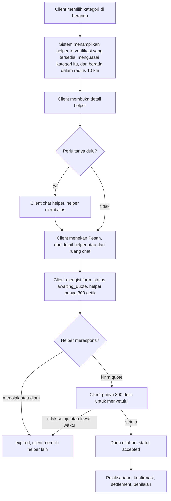

# Perubahan Model Pemesanan Menjadi Marketplace

Status dokumen: `CONFIRMED` untuk tiga keputusan di bagian 1 dan untuk turunan SA di bagian 3 (dikonfirmasi Backend 24 Oktober 2026, DEC-28). Tanggal 19 Oktober 2026, diperbarui 24 Oktober 2026.

Dokumen ini mencatat perubahan lingkup final yang diterima SA pada 19 Oktober 2026 tanpa perlu keputusan tim lagi, menjelaskan bentuk alur baru, dan memetakan dampaknya ke setiap artefak. Fungsinya sama dengan `09_dokumentasi-keputusan-minggu-1.md` dan `10_notulen-sinkronisasi-erd-final.md`: satu tempat untuk melacak kenapa banyak dokumen berubah sekaligus.

## 1. Tiga keputusan

| No | Keputusan | Nomor DEC | Menggantikan atau mengubah |
| --- | --- | --- | --- |
| 1 | Kategori Moving, Food run, dan Laundry dihapus. Kategori yang tersisa adalah Delivery, Personal, dan Household | DEC-25 | DEC-17 dan DEC-20 tidak berlaku. DEC-18 bagian Laundry tidak berlaku, bagian larangan Personal tetap |
| 2 | Pemesanan memakai model marketplace. Client memilih sendiri helper yang relevan dengan kebutuhannya dari daftar helper, lalu mengirim permintaan pesanan ke helper itu. Tidak ada lagi broadcast ke banyak helper. Harga jasa tetap berasal dari quote helper sesuai aturan DEC-21 (dipilih 19 Oktober 2026) | DEC-26 | DEC-05 digantikan. DEC-21 menjadi satu satunya jalur pemesanan |
| 3 | Client bisa chat helper sebelum memesan | DEC-27 | DEC-14 nomor 10 (chat hanya setelah pesanan) digantikan |

## 2. Alur pemesanan setelah perubahan

Dibanding model lama, ada tiga hal yang hilang. Client tidak lagi menunggu tawaran dari banyak helper dalam jendela 300 detik. Helper tidak lagi mengonfirmasi ketersediaan dalam 60 detik setelah dipilih, karena helper sendiri yang baru saja mengirim quote. Talangan, struk, dan penyesuaian harga tidak ada lagi, sehingga dana yang ditahan selalu sama dengan harga jasa setelah voucher.

Ada juga yang bertambah. Daftar helper kini menjadi pintu masuk pemesanan, jadi halaman detail helper naik prioritas menjadi Must. Chat menjadi milik pasangan client dan helper, bukan milik satu pesanan.

## 3. Turunan SA (dikonfirmasi Backend 24 Oktober 2026)

Detail berikut tidak disebut dalam perubahan, tetapi dibutuhkan supaya alur baru bisa dibangun. Penomoran melanjutkan sebelas turunan SA di `10_notulen-sinkronisasi-erd-final.md` bagian 6, dan semuanya tercatat juga di `05_erd-draft.md` bagian 7.

| No | Turunan | Alasan |
| --- | --- | --- |
| 12 | Ruang chat dibuat per pasangan client dan helper (`chat_rooms` unik pada `client_id` dan `helper_profile_id`), bukan per pesanan | Chat sebelum pesanan belum punya pesanan untuk ditautkan. Satu ruang per pasangan juga sama dengan pola marketplace yang dikenal pengguna |
| 13 | Hanya client yang bisa membuka ruang chat baru, lewat tombol Chat atau otomatis saat mengirim permintaan pesanan. Helper hanya membalas | Mencegah helper menghubungi client secara acak untuk mencari pekerjaan |
| 14 | `chat_messages.order_id` terisi otomatis kalau pasangan itu sedang punya pesanan berstatus `awaiting_quote` sampai `disputed` | Admin perlu membaca percakapan yang relevan saat memutuskan sengketa (FR-ADM-005) |
| 15 | Pemberitahuan tetap soal pembayaran di luar aplikasi dan batas 20 ruang chat baru per client per hari | Chat sebelum pesanan membuka peluang transaksi di luar TD-Wallet dan spam ke helper (RSK-05, RSK-06) |
| 16 | `orders.helper_id` terisi sejak pesanan dibuat dan tidak pernah berubah. Kolom `booking_type` dan enum `BookingType` dihapus | Helper sudah diketahui sejak client memilihnya, dan jenis pesanan tinggal satu |
| 17 | `order_offers` menyimpan quote, maksimal satu baris per pesanan. Kolom `helper_id` dan `confirmation_expires_at` dihapus, nilai `selected`, `not_selected`, dan `declined` dihapus dari `offer_status`. Penolakan helper dicatat di `order_status_history.reason` | Tidak ada lagi banyak tawaran untuk satu pesanan dan tidak ada konfirmasi 60 detik |
| 18 | `orders.offer_window_expires_at` diganti nama menjadi `quote_deadline_at` | Nama lama merujuk ke jendela broadcast. Kolom ini masih turunan nomor 11 yang belum dimigrasi, jadi penggantian nama belum memakan biaya |
| 19 | Begitu helper menerima satu pesanan (status `accepted`), permintaan lain yang ditujukan kepadanya dan masih `awaiting_quote` otomatis `expired` (FR-ORD-024) | Helper boleh mengirim quote ke beberapa client sekaligus, tetapi hanya boleh memegang satu pesanan aktif (INV-06) |
| 20 | Pesanan yang `expired` bisa dikirim ulang ke helper lain sebagai pesanan baru dengan data yang sama (API-ORD-13, tombol Pilih helper lain) | Pengganti tombol "Siarkan ke helper lain" pada DEC-21 |
| 21 | Larangan Personal "menangani uang tunai pihak lain di luar talangan tercatat" menjadi "membelikan barang atau menangani uang tunai atas nama client" | Tanpa talangan, belanja atas nama client tidak punya perlindungan. Tanpa larangan ini, client bisa memakai Personal untuk menggantikan Food run |

Tiga turunan lama gugur karena fiturnya hilang: nomor 2 (`recognized_amount` dan `additional_hold_amount`), nomor 3 (`advance_reimbursement`), dan nomor 9 (tombol Pesan Langsung nonaktif karena batas talangan).

## 4. Dampak per artefak

| Artefak | Versi | Perubahan utama |
| --- | --- | --- |
| `README.md` | | DEC-25 sampai DEC-27, status keputusan lama yang terdampak, RSK-05 dan RSK-06, struktur folder |
| `01_stakeholder-register-glossary.md` | v0.3 | Definisi kategori, istilah talangan dan broadcast dihapus, istilah permintaan pesanan dan ruang percakapan ditambah |
| `02_requirement-master-list.md` | v0.3, baseline v1.0 | 11 FR DEPRECATED, 7 FR baru, 25 FR direvisi, NFR-PERF-04 baru. v1.0 (24 Okt): seluruh FR aktif CONFIRMED, kolom test case QA di matriks |
| `03_use-case-inventory.md` | v0.3, baseline v1.0 | UC-ORD-01, 02, 02B, 02C, dan 06 DEPRECATED. UC-CHT-02 baru. Skenario UC-ORD-09, UC-ORD-09B, dan UC-CHT-02. v1.0 (24 Okt): inventaris layar dan gap dari prototipe Figma final |
| `04_dual-role-transaction-analysis.md` | v0.3 | Sequence diagram, state machine, tabel pembatalan, invarian, edge case. Bagian talangan dihapus |
| `05_erd-draft.md` | v0.4, baseline v1.0 | Tabel `price_adjustments` dihapus, `chat_rooms` dirombak, `order_offers` disederhanakan, kolom talangan dihapus, enum disesuaikan, catatan migrasi untuk Backend. v1.0 (24 Okt): turunan SA dikonfirmasi, bagian 9 selisih implementasi |
| `06_api-contract-draft.md` | v0.3 | API-ORD-04D, 06, 07, dan 10 DEPRECATED. API-ORD-13, API-HLP-02, dan API-CHT-01 sampai 04 baru |
| `07_acceptance-criteria-gherkin.md` | v0.3 | Skenario broadcast dan talangan dihapus, skenario cari helper, chat, dan quote ditambah |
| `11_skenario-pengguna.md` | v2.0 | Skenario utama diganti Household lewat chat dan quote |
| `12_class-diagram.md` | v0.2 | `PriceAdjustment`, `BookingType`, `AdjustmentStatus` dihapus, `ChatRoom` dirombak, `ChatService` baru |
| `13_use-case-dan-activity-diagram.md` | v0.2 | UC-D1, UC-D2, AD-01, AD-02, AD-04, AD-05, AD-07, AD-08 digambar ulang. AD-03 dipensiunkan |
| SRS Word | v0.3, lalu v1.0 | v0.3 disusun dari file v0.2 yang diedit tim. v1.0 adalah baseline yang disetujui PIC 24 Oktober 2026: seluruh FR aktif CONFIRMED, tabel antarmuka dari prototipe Figma final, tabel selisih prototipe, referensi dokumen QA |
| SDD Word | v0.1, lalu v1.0 | v0.1 draf pertama dari template ASE Lab 2026. v1.0 disetujui PIC 24 Oktober 2026: tampilan UI dari Figma per use case, endpoint registrasi dan pendaftaran helper, lingkungan pengujian Render, bab 4 berisi hasil QA dan selisih implementasi |
| StarUML | `TolonginDong StarUML v0.2.mdj` | Salinan baru dari file tim dengan perubahan class diagram. File lama tidak ditimpa |

## 5. Dampak ke divisi lain

| Divisi | Yang perlu dikerjakan |
| --- | --- |
| UI/UX (Rafi) | Beranda menampilkan tiga kategori. Tap kategori membuka daftar helper, bukan form pesanan. Halaman detail helper dengan tombol Chat dan Pesan. Ruang chat sebelum pesanan dengan tombol Pesan helper ini dan pemberitahuan pembayaran di luar aplikasi. Layar permintaan masuk dan form quote di sisi helper. Layar hasil quote dan tombol Pilih helper lain di sisi client. Layar daftar tawaran, konfirmasi 60 detik, unggah struk, dan field batas talangan tidak perlu dibuat |
| Backend (Kai) | Turunan SA nomor 12 sampai 21 sudah dikonfirmasi 24 Oktober 2026. Sisa pekerjaan: menjalankan tabel migrasi di `05` bagian 8 dan menutup selisih di `05` bagian 9 serta SDD v1.0 bagian 4.4 (talangan, `booking_type`, `quote_deadline_at`, alur accept dan reject helper, kategori lama, tipe id) |
| Mobile (Gede) | Navigasi baru: beranda, daftar helper, detail helper, chat, form, quote. Polling atau real time untuk chat sesuai NFR-PERF-04. Status `searching`, `pending_confirmation`, dan `price_adjustment` tidak perlu dipetakan lagi |
| QA (Sofia) | Memakai `07` v0.3. Skenario talangan dan broadcast tidak diuji. Data uji minimal butuh dua helper dengan kategori berbeda dan satu helper yang sedang sibuk |

## 6. Hal yang masih terbuka

| No | Hal | Status |
| --- | --- | --- |
| 1 | Konfirmasi Kai atas turunan SA nomor 1, 4 sampai 8, 10, 11, dan nomor 12 sampai 21 | Selesai 24 Oktober 2026 (DEC-28) |
| 2 | Angka batas 20 ruang chat baru per hari (FR-CHT-010) | Selesai, dikonfirmasi bersama turunan SA 24 Oktober 2026 |
| 3 | Prototipe Figma final sudah memakai tiga kategori dan chat, tetapi belum memuat layar sisi helper (permintaan masuk dan form quote), tombol Pesan helper ini, layar kedaluwarsa, sengketa, dan panel admin. Subkategori Pindahan di Household dan opsi Bayar di Tempat perlu diselaraskan | Menunggu UI/UX, rincian di `03` bagian 5 |
| 4 | Tiga hal lama dari notulen `10` bagian 7: mekanisme klaim voucher, nasib voucher pada sengketa, dan selisih Rp1 pada split | Belum dibahas |
| 5 | Tipe id pengguna dan helper (UUID di implementasi, BIGINT di `05`) serta format nomor pesanan (`ORD-` di implementasi, `TD-` di `05`) | Menunggu keputusan Backend dan SA, lihat `05` bagian 9 |
